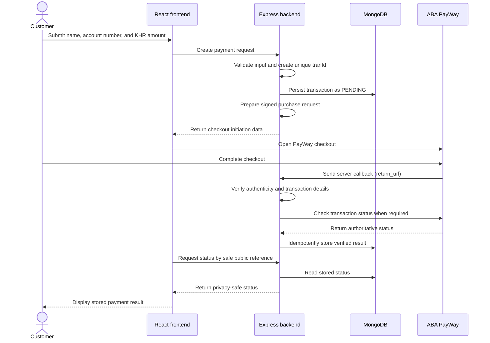

# ABA PayWay Payment Application

> **Status:** Step 2 MongoDB connection and transaction model implemented. Payment integration has not started.

This repository is planned as a practical-exam project: an HTTPS payment application that collects a sender's name, an account number, and an amount in Cambodian riel (KHR), opens ABA PayWay checkout, and displays a payment result verified by the backend.

## Current progress

- [x] Step 0: Project scope, architecture, security expectations, testing strategy, and implementation roadmap documented.
- [x] Step 1: React/Tailwind client and Express server foundation, including a health endpoint and frontend connection status.
- [x] Step 2: MongoDB startup connection, readiness reporting, and the Mongoose transaction model.
- [ ] Payment functionality, gateway integration, deployment, and live-payment evidence.

Steps 0 through 2 are complete in the working tree. Everything described below is planned functionality unless explicitly marked complete.

## Getting started

### Prerequisites

- Node.js 20.19 or newer (Vite also supports compatible Node.js 22.12+ releases)
- npm
- MongoDB Community Server for local development, or private access to a MongoDB Atlas deployment

PayWay credentials are not required because payment integration has not started.

### Installation

From the repository root:

```sh
npm install
```

This installs the root, `client`, and `server` workspace dependencies and uses the committed root `package-lock.json`.

Copy `server/.env.example` to `server/.env`. Do not commit the resulting file. The example URI expects a local MongoDB instance and uses the `angkor_payment` database:

```dotenv
PORT=3000
MONGODB_URI=mongodb://127.0.0.1:27017/angkor_payment
```

Start your local MongoDB service before starting the application. Alternatively, replace `MONGODB_URI` in the untracked `server/.env` with a private Atlas connection string. Never paste credentials into source files, logs, screenshots, or commits. Environment loading is anchored to `server/.env`, so it behaves consistently whether the server is launched from the repository root or its workspace.

### Development

Run the frontend and backend together:

```sh
npm run dev
```

The backend validates its configuration, connects to MongoDB with a five-second server-selection timeout, and creates the required transaction indexes before it begins listening. Startup exits with a redacted error if configuration, MongoDB connection, or index initialization fails.

Vite prints the frontend URL (normally `http://localhost:5173`). After database initialization, Express listens on `http://localhost:3000`. The Vite development server proxies `/api` requests to Express, and the page displays the observed backend connection state.

The applications can also be run separately:

```sh
npm run dev:client
npm run dev:server
```

### Build and lint

```sh
npm run build
npm run lint
npm test
```

The build command creates the frontend production bundle under `client/dist/`. The Express server does not currently serve that bundle; production hosting is a later step.

The standard test command runs model validation and HTTP health/readiness tests without requiring MongoDB. Persistence, timestamp, and duplicate-index checks run only when `TEST_MONGODB_URI` is provided and its database name ends in `_test`, `-test`, `_tests`, or `-tests`. The test deletes only the record identified by its generated test transaction ID; it never drops the database.

Example using a separate local test database in PowerShell:

```powershell
$env:TEST_MONGODB_URI='mongodb://127.0.0.1:27017/angkor_payment_test'
npm test
Remove-Item Env:TEST_MONGODB_URI
```

### Backend configuration

| Variable | Default | Current purpose |
| --- | --- | --- |
| `PORT` | `3000` | Express listening port |
| `MONGODB_URI` | None; required | Private MongoDB connection string used at server startup |
| `TEST_MONGODB_URI` | None; optional | Isolated test database used only for opt-in persistence checks |

Environment files containing real values are ignored by Git, while `.env.example` files are explicitly allowed. Never put PayWay credentials in the frontend or in `VITE_` variables because Vite exposes those values to browser code.

### Health and readiness

- `GET /api/health` returns HTTP 200 with `{"status":"ok"}` when the HTTP process is serving. It is intentionally not a database-readiness check.
- `GET /api/ready` returns HTTP 200 with `{"status":"ready"}` while Mongoose is connected, or HTTP 503 with `{"status":"unavailable"}` otherwise.

Neither response exposes a connection string, database name, credentials, or driver internals. On `SIGINT` or `SIGTERM`, the server stops accepting HTTP requests and closes the Mongoose connection.

### Current limitations

- The page is a responsive placeholder, not a payment form.
- Payment integration, signing, checkout, callbacks, authentication, and transaction status handling are not implemented.
- The health endpoint reports only that the HTTP server is running; it is not a database-readiness check.
- No payment creation API or transaction-ID generator exists yet.
- Payment state-transition rules are not implemented yet.
- Deployment and HTTPS configuration are not included.

Codex assisted with the Step 0 planning document, Step 1 project scaffolding, and Step 2 MongoDB/model foundation. This use of AI must be accurately disclosed in the final submission, along with any later AI-assisted work.

## 1. Project overview and scope

The planned customer journey is:

1. The customer enters their name, account number, and a whole-KHR amount in the payment form.
2. The frontend sends the data to the backend; it does not sign PayWay requests or decide payment success.
3. The backend validates the input, records a pending transaction, signs a purchase request using server-held credentials, and starts PayWay checkout.
4. The customer completes or cancels checkout on PayWay.
5. PayWay notifies the backend. The backend verifies the notification and checks the transaction status when required.
6. MongoDB stores the verified result.
7. The frontend requests a safe public status representation and displays pending/checking, success, failure, or cancellation.

Planned responsibilities:

- **React frontend:** collect payment details, initiate the backend flow, open or redirect to checkout, and display only backend-stored status.
- **Express backend:** validate input, create transaction IDs, persist transactions, sign PayWay requests, receive and verify callbacks, reconcile status, and expose a privacy-safe status endpoint.
- **MongoDB:** retain the transaction lifecycle and the verified gateway result.
- **ABA PayWay:** host checkout, process the payment, send the server callback, and provide the authoritative payment status through its documented APIs.

The initial submission does **not** include user login, a dashboard, refunds, or payout functionality.

### Planned technology

- Frontend: React, Vite, and Tailwind CSS
- Backend: Node.js and Express using JavaScript ES modules
- Database: MongoDB with Mongoose
- Repository layout: one repository with `client/` and `server/` directories
- Secret boundary: PayWay credentials and signing material exist only on the backend

## 2. Architecture



The exact message fields and authentication steps in this conceptual diagram must be reconciled with the current official PayWay specification before implementation.

## 3. Frontend pages

### Payment form

Planned fields:

- Sender name
- Account number
- Amount in KHR

The form will provide usability validation, but backend validation remains authoritative.

### Result page

The result page will show one of these backend-derived states:

- Pending/checking
- Success
- Failure

The browser must never infer, declare, or persist payment success from a redirect, query parameter, client-side state, or HTTP 200 response alone.

### Cancel page

The cancel page will explain that checkout was cancelled or interrupted and will allow the customer to check the stored status. A browser cancellation is not proof that a payment failed and must not overwrite a payment later verified as successful.

## 4. Backend responsibilities

The backend is planned to provide:

- Server-side validation for required values, string lengths, numeric format, allowed amounts, safe numeric limits, and the supported `KHR` currency.
- Unique transaction IDs that comply with PayWay's documented length, character-set, and uniqueness constraints.
- Purchase-request construction and signing in the exact order and encoding required by the official specification.
- Callback authenticity verification before trusting callback content.
- Transaction-status checks and reconciliation against PayWay's authoritative result.
- Idempotent state updates so duplicate or repeated callbacks are safe.
- Protection against invalid state regression, including preventing cancellation or timeout from replacing a verified payment.
- Explicit request timeouts, useful but non-sensitive error responses, and structured logs with secrets and sensitive customer data redacted.
- A safe public status lookup that exposes the minimum necessary state and never returns the sender's name or account number.

## 5. MongoDB transaction model

The Step 2 Mongoose schema contains:

| Field | Planned purpose |
| --- | --- |
| `tranId` | PayWay-compatible transaction identifier; required and protected by a unique index |
| `name` | Sender name supplied by the customer |
| `accountNumber` | Customer-entered account number stored as a string so formatting and leading zeroes are preserved |
| `amount` | Exact whole-KHR amount, validated as an integer within safe application and gateway limits |
| `currency` | Currency code; initially restricted to `KHR` |
| `status` | Internal lifecycle status such as `PENDING`, `PAID`, `FAILED`, or `CANCELLED` |
| `paywayResponseCode` | PayWay response/status code retained for reconciliation and support, subject to documentation review |
| `createdAt` | Record creation timestamp |
| `updatedAt` | Most recent record update timestamp |
| `paidAt` | Timestamp set only when payment has been authoritatively verified |

Whole-KHR amounts are stored as JavaScript numbers and validated as positive safe integers, preventing fractional, zero, negative, and unsafe integer values. `name` is trimmed and limited to 100 characters; `accountNumber` is a trimmed string limited to 64 characters so leading zeroes are preserved. These are reasonable application-level limits, **not** claimed PayWay constraints. PayWay-specific bounds still require official-specification review.

The `tranId` schema path is required and immutable, and its unique index is created explicitly with `Transaction.init()` before the HTTP server starts. A MongoDB unique index enforces uniqueness at the database level; `unique: true` is **not** a Mongoose validation rule. Transaction-ID generation is intentionally deferred until the official PayWay format constraints are verified.

State-transition behavior is not implemented in Step 2. Later verified callback handling must be conditional and idempotent: duplicate notifications must not be processed harmfully, and browser cancellation or an application timeout must never overwrite a verified `PAID` state.

## 6. Account-number decision

The entered account number will be stored in MongoDB and associated with `tranId` for the exam workflow.

Storing an account number as transaction metadata does **not** route or settle money to that account. PayWay settlement follows the merchant configuration agreed with ABA PayWay. Before implementation and live testing, the exam team must confirm that its merchant settlement configuration and destination account identifier match the intended recipient. Payout and money-routing functionality is outside the initial scope.

## 7. PayWay integration details requiring verification

The current official documentation is the source of truth:

- [ABA PayWay developer portal](https://developer.payway.com.kh/)
- [Purchase integration guide](https://developer.payway.com.kh/purchase-14530820e0)
- [Relevant API folder](https://developer.payway.com.kh/folder-3158159)
- [API endpoints](https://developer.payway.com.kh/api-endpoints-984508m0)
- [Check transaction](https://developer.payway.com.kh/check-transaction-14530826e0)

Before gateway code is written, verify and document:

- [ ] Exact fields included in the signature and their required signing order
- [ ] Canonicalization, character encoding, escaping, hashing, and parameter/body encoding
- [ ] Callback authenticity-verification algorithm, required headers/fields, replay considerations, and acknowledgement response
- [ ] Purchase, callback, and status-check response codes and their mapping to internal states
- [ ] Supported amount representation, minimum/maximum amount, decimal rules, and KHR-specific constraints
- [ ] Transaction-ID length, allowed characters, uniqueness, and reuse rules
- [ ] Sandbox and production checkout/API base URLs and endpoint paths
- [ ] Required merchant configuration, IP/domain allowlisting, and callback registration
- [ ] Required and optional purchase/status fields, redirect behavior, and timeout behavior

PayWay's checkout guide uses `return_url` for the **server callback**. It must not be treated as the customer's browser-return URL. Any separate customer browser return/cancel behavior must be confirmed from official documentation and tested without allowing the browser to establish success.

No undocumented API behavior will be assumed. Missing, ambiguous, or merchant-specific behavior will be raised with the exam team before implementation.

## 8. Security requirements

- Never commit API keys, credentials, signing secrets, or real `.env` files.
- Never place secrets in React source, browser storage, built frontend assets, or `VITE_` variables; such variables are exposed to the browser.
- Keep all PayWay secrets and signing operations on the backend.
- Deploy the application and its callbacks over HTTPS.
- Verify callback authenticity and match the transaction ID, amount, currency, and other relevant details before recording payment.
- Never mark a transaction successful based only on a browser redirect or an HTTP 200 response.
- Redact secrets, names, account numbers, and other sensitive data from logs, screenshots, callback evidence, and error output.
- Expose only minimal payment state through public status lookup and use an unguessable or otherwise adequately protected lookup mechanism.
- Keep the source repository private.

## 9. Testing strategy

Testing is planned to include:

- Local automated tests using mocked gateway responses; local development must not initiate real payments.
- Validation tests for missing, malformed, too-long, out-of-range, fractional, and unsupported-currency inputs.
- Signature fixtures/tests based on official examples or values confirmed by PayWay.
- Invalid, unauthenticated, duplicate, repeated, out-of-order, and delayed callback tests.
- Amount/currency/transaction mismatch tests and timeout/reconciliation handling.
- Forged browser-return tests proving that redirects cannot produce a successful stored state.
- State-transition tests proving that `PAID` cannot be downgraded by cancellation, timeout, or delayed failure messages.
- Deployed HTTPS, certificate, callback reachability, and callback-registration checks.
- Exactly two authorized live payments initiated through the deployed form: **1 KHR** and **2,000 KHR**.

No transaction will be initiated while preparing this README. Any live transaction beyond the two authorized payments requires prior clearance from the exam team.

## 10. Deployment and external prerequisites

Request these items or confirmations from the exam team:

- Merchant ID and API key through the team's designated Telegram channel—not through source control or public chat.
- Destination account identifier and confirmation of the intended settlement recipient.
- Domain/IP allowlisting and server-callback registration requirements.
- DNS changes if `khmerfp.com` will be used.
- Clarification of any unresolved integration behavior not covered by the official documentation.

Hosting must be arranged separately. The deployment will use `khmerfp.com` or another owned domain, use HTTPS, and remain available through **28 September 2026, end of day**.

### Setup and environment configuration

Local MongoDB/Atlas configuration, development commands, and verification guidance are documented in [Getting started](#getting-started). PayWay configuration remains pending until its implementation step. Secret values will never be documented or committed.

## 11. Submission requirements

**Deadline:** 27 September 2026 at 7:00 PM, Phnom Penh time (UTC+7).

The final submission will include:

- A private source repository or clean project archive, including meaningful commit history.
- The live HTTPS URL.
- Accurate setup instructions and environment-variable names without secret values.
- An explanation of the account-number metadata decision and settlement limitation.
- An explanation of callback authentication, detail matching, status checking, and idempotent state transitions.
- Evidence for both authorized live payments: transaction IDs, filled-form screenshots, PayWay checkout screenshots, result screenshots, redacted callbacks, and redacted stored records.
- A list of incomplete items and proposed improvements.
- The domain used for deployment.
- An accurate AI-assistance disclosure stating which tools were used and what each tool helped produce or verify.

Evidence must be sufficient to connect each submitted form to checkout, verified callback/status data, and its stored record, while redacting credentials and sensitive information.

## 12. Incremental implementation roadmap

Each step should be independently reviewable and delivered as one focused commit.

- [x] **Step 0:** README and project plan.
- [x] **Step 1:** Create the React/Tailwind and Express foundation with a health endpoint. *(Implemented in the working tree; review and commit pending.)*
- [x] **Step 2:** Add the MongoDB connection and transaction model. *(Implemented in the working tree; review and commit pending.)*
- [ ] **Step 3:** Build the payment form and authoritative server-side validation without live gateway calls.
- [ ] **Step 4:** Review the official specification and implement signed purchase integration.
- [ ] **Step 5:** Implement verified callbacks, status checks, reconciliation, and idempotent updates.
- [ ] **Step 6:** Add result/cancel pages and safe frontend status handling.
- [ ] **Step 7:** Add focused tests and complete a security review.
- [ ] **Step 8:** Deploy with HTTPS and complete domain, allowlisting, and callback registration.
- [ ] **Step 9:** Run the authorized live payments, collect redacted evidence, and finalize documentation.

Implementation must proceed incrementally; later steps should not silently fill unresolved official-specification gaps.

## Unresolved decisions and confirmations

- Obtain the merchant ID and API key through the designated secure channel.
- Confirm the destination account identifier and merchant settlement configuration.
- Choose and arrange hosting.
- Confirm whether to use `khmerfp.com` or another owned domain and arrange any required DNS changes.
- Confirm PayWay's current allowlisting and callback-registration process for the selected environment.
- Resolve every unchecked official-specification item in Section 7 before implementing gateway calls.
- Select a privacy-safe, adequately protected public transaction-status lookup design.
- Confirm the approved format and storage location for redacted payment evidence.
- Confirm the AI-assistance disclosure format expected by the exam team.
