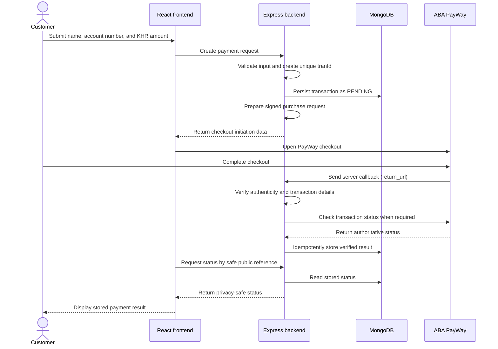

# ABA PayWay Payment Application

> **Status:** Sandbox Purchase preparation, authenticated callback reconciliation, and a protected customer result page are implemented. A matching callback plus an independently approved Check Transaction result can atomically mark an existing sandbox transaction `PAID`; production remains blocked.

> **Interview environment:** The project owner confirmed on 25 September 2026 that this practical interview must use only ABA PayWay sandbox credentials. Render uses production application runtime settings, but PayWay remains in sandbox and no live payment is authorized.

This repository is planned as a practical-exam project: an HTTPS payment application that collects a sender's name, an account number, and an amount in Cambodian riel (KHR), opens ABA PayWay checkout, and displays a payment result verified by the backend.

## Current progress

- [x] Step 0: Project scope, architecture, security expectations, testing strategy, and implementation roadmap documented.
- [x] Step 1: React/Tailwind client and Express server foundation, including a health endpoint and frontend connection status.
- [x] Step 2: MongoDB startup connection, readiness reporting, and the Mongoose transaction model.
- [x] Step 3: Responsive payment-details form and authoritative server-side validation, without transaction creation or gateway calls.
- [x] Step 4A: Official PayWay documentation reviewed and the verified integration contract recorded.
- [x] Step 4B: Backend-only sandbox environment configuration with checkout disabled by default.
- [x] Step 4C: Official credential/signing rules rechecked; unresolved mandatory rules documented and signing intentionally not implemented.
- [x] Internal preparation: validated details can be stored as a `PENDING` transaction, but this service is not connected to a route or the frontend.
- [x] Minimal sandbox Purchase: server-side HMAC signing, pending persistence, preparation endpoint, and hosted-form submission.
- [x] Internal Check Transaction client: sandbox-only signed status requests with conservative, unverified outcome normalization.
- [x] Callback-authentication foundation: bounded JSON, separate signature verification, and post-authentication field validation without acknowledgement or state changes.
- [x] Payment reconciliation: authenticated callbacks are matched to saved transactions, independently checked, and persisted with an idempotent conditional `PAID` transition.
- [x] Protected payment result: browser-scoped status access, a read-only minimal status endpoint, and bounded frontend polling.
- [x] Render deployment preparation: one-service static/API hosting, safe routing, Blueprint configuration, and deployment verification guidance.
- [x] Structured operational logging for checkout preparation and callback outcomes with allowlisted metadata and redacted transaction identifiers.
- [x] Restrictive HTTP security headers, sandbox-only checkout form policy, and production-runtime HSTS.
- [ ] Complete sandbox callback-to-`PAID` verification and collect the required interview evidence.

The PayWay sandbox has accepted the hosted Purchase request for 2,000 KHR and displayed checkout. End-to-end callback authentication, Check Transaction approval, and the resulting durable `PAID` transition still require verification after PayWay registers the public callback URL.

Bank-dependent questions are parked until ABA responds: callback registration and credential mapping, callback acknowledgement/retry behavior, negative callback field semantics, 1 KHR merchant support, and the signing positions of `view_type` and `payment_gate`. No implementation will guess these rules.

## Getting started

### Prerequisites

- Node.js 20.19 or newer (Vite also supports compatible Node.js 22.12+ releases)
- npm
- MongoDB Community Server for local development, or private access to a MongoDB Atlas deployment

PayWay credentials are not required for normal local startup while checkout and callback processing remain unconfigured.

### Installation

From the repository root:

```sh
npm install
```

This installs the root, `client`, and `server` workspace dependencies and uses the committed root `package-lock.json`.

Copy `server/.env.example` to `server/.env`. Do not commit the resulting file. The example URI expects a local MongoDB instance and uses the `angkor_payment` database:

```dotenv
PORT=3000
MONGODB_URI=mongodb://127.0.0.1:27017/angkor_payment
```

Start your local MongoDB service before starting the application. Alternatively, replace `MONGODB_URI` in the untracked `server/.env` with a private Atlas connection string. Never paste credentials into source files, logs, screenshots, or commits. Environment loading is anchored to `server/.env`, so it behaves consistently whether the server is launched from the repository root or its workspace.

### Development

Run the frontend and backend together:

```sh
npm run dev
```

The backend validates its configuration, connects to MongoDB with a five-second server-selection timeout, and creates the required transaction indexes before it begins listening. Startup exits with a redacted error if configuration, MongoDB connection, or index initialization fails.

Vite prints the frontend URL (normally `http://localhost:5173`). After database initialization, Express listens on `http://localhost:3000`. The Vite development server proxies `/api` requests to Express, and the page displays the observed backend connection state.

The applications can also be run separately:

```sh
npm run dev:client
npm run dev:server
```

### Build and lint

```sh
npm run build
npm run lint
npm test
```

The build command creates the frontend production bundle under `client/dist/`. The Express server does not currently serve that bundle; production hosting is a later step.

The standard test command runs the client Vitest suite followed by the server Node.js suite. Server tests load private settings from `server/.env.test` and never fall back to `MONGODB_URI`. Persistence, timestamp, unique-index, and duplicate-rejection checks run only when `TEST_MONGODB_URI` is configured, and the test helper refuses to connect or clean up unless the selected database name is exactly `angkor_payment_test`. Cleanup targets only generated test transaction IDs; tests never drop a database or collection. Use `npm run test:client` or `npm run test:server` to run one workspace independently.

Create the ignored private test file from the credential-free example:

```powershell
Copy-Item server/.env.test.example server/.env.test
```

For local MongoDB, the copied file already selects the separate `angkor_payment_test` database:

```dotenv
TEST_MONGODB_URI=mongodb://127.0.0.1:27017/angkor_payment_test
```

For Atlas, privately replace that value in `server/.env.test` with the Atlas connection string and ensure its database path is `/angkor_payment_test` before any query options. Percent-encode special characters in the username or password. Never place the URI in `server/.env.example`, source code, terminal screenshots, logs, commits, or chat. Then run `npm test` from the repository root. If configuration is absent, the two MongoDB persistence tests report as skipped rather than passed.

**Latest verification (22 September 2026):** the client Vitest suite reported 4 passed and the server suite reported 151 passed, 0 failed, and 0 skipped against the privately configured `angkor_payment_test` database. Guarded integration tests verified persistence, one effective atomic `PAID` transition under concurrent callbacks, durable evidence, unchanged `paidAt` on duplicates, read-only protected status access, rejection of operator-shaped transaction IDs before database access, and safe production static routing. Offline Purchase, callback, reconciliation, Check Transaction, status-token, polling, and result-presentation tests verified secret omission, minimal disclosure, forged-return resistance, and safe pending/error behavior. Client and server lint, the Vite production build, local Express static smoke test, and `git diff --check` passed. Automated tests made no real PayWay request. Cleanup remained limited to generated test records; no database or collection was dropped, and no connection string or credential was printed.

GitHub Actions runs dependency installation, client and server lint, both test suites with an isolated `angkor_payment_test` MongoDB service, and the frontend production build on pushes and pull requests. The workflow contains no PayWay credentials and makes no PayWay request.

### Backend configuration

| Variable | Default | Current purpose |
| --- | --- | --- |
| `PORT` | `3000` | Express listening port |
| `MONGODB_URI` | None; required | Private MongoDB connection string used at server startup |
| `TEST_MONGODB_URI` | None; optional | Loaded from ignored `server/.env.test`; must select exactly `angkor_payment_test` |
| `PAYWAY_ENV` | `sandbox` | Selects the fixed `sandbox` or `production` endpoint mapping; other values fail startup |
| `PAYWAY_CHECKOUT_ENABLED` | `false` | Strict `true`/`false` switch; production cannot be enabled in Step 4B |
| `PAYWAY_SANDBOX_MERCHANT_ID` | None | Backend-only sandbox merchant ID; required only when sandbox checkout is enabled |
| `PAYWAY_SANDBOX_API_KEY` | None | Backend-only candidate HMAC credential: the supplied non-RSA value labelled “Public Key”; never use either RSA key |
| `PAYWAY_SANDBOX_CALLBACK_SECRET` | None | Separate backend-only candidate callback HMAC secret; optional at startup and never assumed to equal the Purchase API key |
| `PAYWAY_SANDBOX_SUCCESS_URL` | None | Server-controlled browser destination after sandbox success; required when checkout is enabled |
| `PAYWAY_SANDBOX_CANCEL_URL` | None | Server-controlled browser destination after sandbox cancellation; required when checkout is enabled |
| `PAYWAY_PRODUCTION_MERCHANT_ID` | None | Reserved backend-only production merchant ID; not used by sandbox configuration |
| `PAYWAY_PRODUCTION_API_KEY` | None | Reserved backend-only production Purchase/Check Transaction HMAC credential; mapping awaits PayWay confirmation |
| `PAYWAY_PRODUCTION_CALLBACK_SECRET` | None | Reserved separate production callback credential; never assumed to equal the Purchase credential |
| `PAYWAY_PRODUCTION_SUCCESS_URL` | None | Reserved production browser-success URL; HTTPS is required when configured |
| `PAYWAY_PRODUCTION_CANCEL_URL` | None | Reserved production browser-cancel URL; HTTPS is required when configured |

Environment files containing real values, including `server/.env.test`, are ignored by Git, while credential-free `.env.example` and `.env.test.example` files are explicitly allowed. Never put PayWay credentials in the frontend or in `VITE_` variables because Vite exposes those values to browser code.

### PayWay sandbox configuration

The official [PayWay overview](https://developer.payway.com.kh/) directs developers to create a sandbox account and states that sandbox Merchant ID/API keys are sent after registration. Use the official [sandbox registration page](https://sandbox.payway.com.kh/register-sandbox/) and keep received credentials only in the ignored `server/.env`. PayWay also requires the applicable domain/IP to be whitelisted; coordinate that with the PayWay Integration team before testing from a deployed environment. Checked 21 September 2026.

The safe default configuration is:

```dotenv
PAYWAY_ENV=sandbox
PAYWAY_CHECKOUT_ENABLED=false
PAYWAY_SANDBOX_MERCHANT_ID=
PAYWAY_SANDBOX_API_KEY=
PAYWAY_SANDBOX_CALLBACK_SECRET=
PAYWAY_SANDBOX_SUCCESS_URL=http://localhost:5173/payment/result
PAYWAY_SANDBOX_CANCEL_URL=http://localhost:5173/payment/cancel
```

With checkout disabled, the server starts without PayWay credentials. If sandbox checkout is set to exactly `true`, the merchant ID, candidate HMAC credential, success URL, and cancel URL become required. Any other boolean spelling is rejected. `PAYWAY_ENV=production` may select the fixed production endpoint metadata while checkout remains disabled, but production checkout activation is deliberately rejected at startup.

### Production configuration scaffold

Production variable names are defined separately so a future live deployment cannot fall back to sandbox credentials. When `PAYWAY_ENV=production`, configuration reads only the `PAYWAY_PRODUCTION_*` values; sandbox values are ignored. Configured production navigation URLs must use HTTPS. The production endpoint mapping is fixed, but checkout remains deliberately blocked even if all production placeholders are populated.

Do not populate these placeholders until ABA PayWay privately confirms the live Merchant ID, Purchase/Check Transaction HMAC credential, callback credential, merchant capabilities, and registered URLs. Adding values does not activate production checkout. Checkout preparation and Check Transaction now consume the selected environment contract without mixing endpoints or credentials, but validated configuration still rejects production checkout activation until those external facts are confirmed.

The server may start without PayWay credentials while checkout is disabled. Enabling sandbox checkout requires all four sandbox settings above; production activation remains rejected. The official Purchase example calls its HMAC value both `$api_key` and a bank-provided “public key,” so this implementation permits the separately supplied, non-RSA credential labelled “Public Key” as the candidate HMAC value. This is an implementation assumption until the sandbox accepts a request. Never paste an RSA public/private key into `PAYWAY_SANDBOX_API_KEY`, and do not assume the Purchase key is the future callback-verification secret.

`PAYWAY_SANDBOX_CALLBACK_SECRET` is deliberately separate. Leave it empty until PayWay identifies the callback-verification credential through a private channel. Its absence does not stop the application, but the callback endpoint returns HTTP 503 and performs no verification. Never copy the Purchase key into this setting merely because both algorithms use HMAC-SHA-512.

### Manual sandbox setup and test

1. Keep the real values only in ignored `server/.env`. Set `PAYWAY_ENV=sandbox` and leave `PAYWAY_CHECKOUT_ENABLED=false` while reviewing configuration.
2. Privately set the sandbox Merchant ID. Put only the supplied non-RSA credential labelled “Public Key” in `PAYWAY_SANDBOX_API_KEY`; do not use either RSA PEM key.
3. Set the success and cancel URLs to routes on the domain registered/whitelisted with PayWay. The localhost examples work for local UI navigation but may not be accepted by PayWay's allowlist; use registered HTTPS URLs for a deployed sandbox test.
4. Start MongoDB, run `npm run dev`, confirm `/api/ready` reports ready, then deliberately change `PAYWAY_CHECKOUT_ENABLED=true` and restart the server.
5. Open the Vite page, confirm the prominent **Sandbox checkout** label, enter fictional test details and an allowed exam amount, and select **Continue to PayWay sandbox** once.
6. The backend revalidates the input, stores a `PENDING` record, and returns signed form fields. The browser directly posts a `multipart/form-data` form to PayWay and renders PayWay's HTML response. Do not expect a JSON payment URL.
7. Record whether PayWay accepts the candidate credential, signature, integer KHR amount, navigation URLs, and transaction-ID format. A local test pass proves only deterministic construction; it does not prove gateway acceptance.
8. On browser return, confirm the result page initially shows pending and changes to success only after the protected backend endpoint reports stored `PAID`. A cancel return still checks stored state and never writes `CANCELLED`.
9. After testing, restore `PAYWAY_CHECKOUT_ENABLED=false`. Never interpret browser navigation or query parameters as payment status.

Do not double-click or automatically retry after an uncertain preparation/navigation outcome. A pending record may already exist. This step contains no callback, status check, or automatic transition to `PAID`.

### Render HTTPS sandbox deployment

The prepared deployment uses one Render **Node.js Web Service** for both Express and the built React application. Express serves only `client/dist`; `/api` remains the API namespace, and MongoDB remains on Atlas. The Blueprint selects `NODE_ENV=production` for deployed application behavior and `PAYWAY_ENV=sandbox` for test gateway traffic. Checkout remains disabled by default and production PayWay activation remains blocked.

Use these exact Render settings:

| Render setting | Value |
| --- | --- |
| Service type | Web Service |
| Runtime | Node |
| Repository root directory | `.` |
| Build command | `npm run render-build` |
| Start command | `npm start` |
| Health-check path | `/api/health` |
| Node version | Node.js 22 LTS, declared by `engines` and `.node-version` |

The same settings are recorded in `render.yaml`. The build command installs workspace development tooling explicitly and builds `client/dist`; the start command runs plain Node.js without watch mode. Render supplies `PORT`, and the server listens on `0.0.0.0:$PORT`, as required for a Render web service. Render terminates public HTTPS at its load balancer and forwards traffic to the service. [Render Web Services](https://render.com/docs/web-services), [Blueprint YAML Reference](https://render.com/docs/blueprint-spec), and [Health Checks](https://render.com/docs/health-checks), checked 22 September 2026.

Configure these values privately in the Render dashboard. Values marked secret must never be committed:

| Variable | Value or placeholder | Classification |
| --- | --- | --- |
| `NODE_ENV` | `production` | Hosting runtime setting |
| `MONGODB_URI` | `mongodb+srv://<private-atlas-credentials>/<application-database>` | Secret hosting/database setting |
| `PAYWAY_ENV` | `sandbox` | Interview payment environment; independent of `NODE_ENV` |
| `PAYWAY_CHECKOUT_ENABLED` | Start with `false` | Safety switch; change to exactly `true` only after all configuration is reviewed |
| `PAYWAY_SANDBOX_MERCHANT_ID` | `<private sandbox merchant ID>` | Backend-only sandbox configuration |
| `PAYWAY_SANDBOX_API_KEY` | `<private confirmed sandbox API key>` | Backend-only sandbox secret |
| `PAYWAY_SANDBOX_CALLBACK_SECRET` | `<private confirmed callback credential>` | Backend-only secret; do not assume it equals the Purchase key |
| `PAYWAY_SANDBOX_SUCCESS_URL` | `https://payway.khmerfp.com/payment/result` | Public browser-return URL |
| `PAYWAY_SANDBOX_CANCEL_URL` | `https://payway.khmerfp.com/payment/cancel` | Public browser-cancel URL |

Do not invent or guess `<public-origin>`. After Render assigns the service hostname, use that exact HTTPS origin consistently. The server callback to register with PayWay is `https://<public-origin>/api/payments/callback`; there is no duplicate callback URL environment variable because the current Purchase request intentionally omits `return_url` and relies on PayWay API Settings. Keep the callback separate from browser navigation.

The success and cancel URLs must be stored as ordinary absolute URLs. Do not pre-percent-encode or Base64-encode them: the existing hosted form submission performs normal form encoding once and signs/submits the same values. The currently omitted Purchase `return_url` must not be added manually. If it is implemented later, its official Base64 rule must be applied exactly once by the backend request builder, not in Render configuration.

Checkout begins and returns on the same public origin and in the same browser tab so the browser retains its `sessionStorage` status token. Starting checkout on `localhost` and returning to Render will not work for protected status access. Likewise, switching between an `onrender.com` hostname and a custom domain changes the origin and prevents the new origin from reading the original token. The token remains excluded from URLs, logs, and PayWay fields.

In production runtime, Express trusts forwarded client information only when the immediate proxy address is in the standard loopback, link-local, or private-network ranges. It does not use unrestricted `trust proxy=true`. This supports client-IP rate limiting behind Render while refusing forwarded headers received directly from an untrusted public peer. Confirm the observed proxy path after deployment; Express warns that proxy trust must match the actual topology. [Express behind proxies](https://expressjs.com/en/guide/behind-proxies.html), checked 22 September 2026.

For Atlas network access, first create the Render service and open its **Connect → Outbound** tab. Copy the displayed outbound CIDR ranges into Atlas Network Access according to your organization’s policy. A service may use any address in those ranges. If Atlas cannot allowlist shared ranges, Render offers paid dedicated outbound IPs for eligible workspaces. Do not automatically add `0.0.0.0/0`, broaden Atlas access, or place database credentials in the Blueprint. [Render Outbound IP Addresses](https://render.com/docs/outbound-ip-addresses) and [Dedicated IPs](https://render.com/docs/dedicated-ips), checked 22 September 2026.

Keep `PAYWAY_CHECKOUT_ENABLED=false` until the sandbox credentials, navigation URLs, domain allowlisting, and callback registration are reviewed. Set it privately to exactly `true` only for authorized sandbox testing. Production activation remains rejected by application configuration and is outside the confirmed interview scope.

#### Render verification checklist

After a later deployment, verify without initiating an unauthorized payment:

1. Open `https://<public-origin>/` and confirm the payment form loads over HTTPS.
2. Confirm `GET /api/health` returns HTTP 200 `{"status":"ok"}` and `GET /api/ready` returns HTTP 200 only while Atlas is connected.
3. Navigate directly to `/payment/result` and `/payment/cancel`; each must load the React application. Without the initiating tab’s token, the page should safely report unavailable status.
4. Request `/api/not-a-route`; it must return JSON HTTP 404, never `index.html`.
5. Request `/assets/not-present.js`, `/.env`, and `/server/src/app.js`; each must return HTTP 404 and no repository content.
6. With the callback secret configured, send a bounded fictional unsigned JSON callback to `/api/payments/callback`; it must return HTTP 401 and must not query PayWay or modify a transaction. If the callback secret is intentionally absent, HTTP 503 is expected instead.
7. Confirm the public success, cancel, and callback URLs and any required domain/IP entries are registered or allowlisted by PayWay before sandbox checkout testing.
8. Confirm Atlas permits only the intended Render outbound ranges and that `/api/ready` remains stable.
9. Treat callback-secret mapping and real gateway signature interoperability as unresolved until an authenticated sandbox callback succeeds end to end.

If a custom domain such as `khmerfp.com` is added later, update both browser-return variables to that one HTTPS origin, register `https://<custom-domain>/api/payments/callback`, update PayWay domain/callback allowlisting, and retest from a checkout initiated on the custom domain. Existing `sessionStorage` tokens under the Render hostname do not transfer to the custom domain.

Render’s Free web services spin down after 15 minutes without inbound traffic and can take about one minute to wake. A PayWay callback arriving during a cold start might time out before the application is ready, and PayWay’s callback retry contract remains unresolved. Free service availability must therefore not be described as reliable callback handling; use an always-on suitable plan for the final exam flow or implement and validate an operational recovery process. Render may also restart free services, and its filesystem is ephemeral, which is why transaction state remains in Atlas. [Render Free Services](https://render.com/docs/free), checked 22 September 2026.

### Health and readiness

- `GET /api/health` returns HTTP 200 with `{"status":"ok"}` when the HTTP process is serving. It is intentionally not a database-readiness check.
- `GET /api/ready` returns HTTP 200 with `{"status":"ready"}` while Mongoose is connected, or HTTP 503 with `{"status":"unavailable"}` otherwise.

Neither response exposes a connection string, database name, credentials, or driver internals. On `SIGINT` or `SIGTERM`, the server stops accepting HTTP requests and closes the Mongoose connection.

### Validation-only payment details API

`POST /api/payments/validate` validates details without generating a transaction ID, writing to MongoDB, contacting PayWay, or initiating a payment. The JSON contract accepts exactly three fields:

- `name`: string, trimmed by the server, 1–100 characters
- `accountNumber`: string, trimmed by the server, 1–64 characters; leading zeros are preserved
- `amount`: JSON number that is a positive safe integer and, for this exam, either `1` or `2000`

The name supports Khmer and other Unicode characters. No English-only or bank-specific account-number format is imposed. The length limits are application decisions, not official PayWay constraints. Currency is not accepted from the client; the server assigns `KHR`.

Example request using fictional data:

```json
{
  "name": "សុខា ឧទាហរណ៍",
  "accountNumber": "0012345678",
  "amount": 2000
}
```

Successful response:

```json
{
  "message": "Validation passed. No payment was initiated.",
  "details": {
    "amount": 2000,
    "currency": "KHR"
  }
}
```

Invalid input returns HTTP 400 with field-specific errors:

```json
{
  "message": "Validation failed.",
  "errors": {
    "amount": "amount must be either 1 or 2000 KHR."
  }
}
```

Malformed JSON returns HTTP 400, oversized JSON returns HTTP 413, and unexpected server failures return a generic HTTP 500 response. Error responses do not include stack traces, request bodies, names, account numbers, credentials, or database details.

### Sandbox checkout preparation API

`POST /api/payments/checkout/prepare` accepts the same three-field JSON contract. When checkout is disabled it returns HTTP 503 without writing a transaction. When enabled, valid input is persisted as `PENDING` before HTTP 201 returns a sandbox form contract containing `action`, `method`, public form fields, and minimal transaction state. Invalid input returns the same HTTP 400 field-error shape. Database/signing failures return the generic HTTP 500 response and no form contract.

The public form fields are `req_time`, `merchant_id`, `tran_id`, canonical string `amount`, `cancel_url`, `continue_success_url`, `currency`, `view_type=hosted_view`, `payment_gate=0`, and generated `hash`. The HMAC credential, RSA keys, name, and account number are never returned. The endpoint does not call PayWay; the browser performs the documented hosted form POST after preparation succeeds.

### Protected payment status API and result page

Checkout preparation generates a cryptographically random 256-bit status-access token. MongoDB stores only its SHA-256 hash. The raw token is returned once to the initiating browser, saved in `sessionStorage` before the hosted form is submitted, and is never included in PayWay fields, success/cancel URLs, or logs. The navigation URLs contain only the generated `tran_id` query parameter.

`GET /api/payments/:tranId/status` requires the raw token in `X-Payment-Status-Token`. A matching request returns only `tranId`, `amount`, `currency`, `status`, and `paidAt`, with `Cache-Control: no-store`. Unknown transaction IDs and incorrect or missing tokens receive the same HTTP 404 response. An in-memory per-client limit permits 30 status reads per minute. The endpoint is read-only: it never calls PayWay and never changes a transaction.

The `/payment/result` and `/payment/cancel` pages read only `tran_id` from the browser URL; `status`, `success`, and similar query parameters are not trusted. With the matching session token, the page polls the protected endpoint about every three seconds, never overlaps requests, and stops on `PAID`, `FAILED`, `CANCELLED`, unmount, or after one minute. Only backend `PAID` displays success. Network errors and timeouts remain pending/unknown and provide a manual refresh action. A cancel return does not modify MongoDB; if reconciliation already stored `PAID`, the cancel page still displays the paid result.

Because `sessionStorage` is scoped to the browser tab/session, opening a copied return URL in another tab/device, clearing browser storage, or closing the session may remove access. The page then explains that protected status is unavailable; it does not weaken endpoint authentication. There is currently no recovery flow for a lost browser token.

### Current limitations

- The page can prepare and open sandbox hosted checkout only when explicitly enabled.
- Sandbox acceptance of the candidate HMAC credential and canonical request remains unverified.
- Authenticated callback reconciliation can apply only the verified `PENDING` to `PAID` transition. Automatic recovery and provider-driven transitions to `FAILED` or `CANCELLED` are not implemented; the result page only supports displaying those existing model states.
- The health endpoint reports only that the HTTP server is running; it is not a database-readiness check.
- The checkout preparation route creates `PENDING` records but never marks them `PAID`.
- An internal service can prepare a `PENDING` transaction, but no public route invokes it and no checkout or payment is initiated.
- Checkout remains disabled by default; when deliberately enabled, only the browser submits the prepared form to the sandbox Purchase endpoint.
- The temporary amount allow-list of 1 or 2,000 KHR is an exam restriction, not a PayWay limitation.
- No browser-return event can update payment state, and conflicting or uncertain provider evidence remains unverified.
- Render deployment configuration is prepared, but no service, domain, callback, allowlist, or cloud setting has been created or changed.

Codex assisted with the Step 0 planning document, Step 1 project scaffolding, Step 2 MongoDB/model foundation, Step 3 validation form/API, official PayWay documentation review, sandbox configuration, pending-transaction preparation, the minimal sandbox Purchase flow, callback authentication/reconciliation, the Check Transaction client, and protected customer status/result handling. This use of AI must be accurately disclosed in the final submission, along with any later AI-assisted work.

## 1. Project overview and scope

The planned customer journey is:

1. The customer enters their name, account number, and a whole-KHR amount in the payment form.
2. The frontend sends the data to the backend; it does not sign PayWay requests or decide payment success.
3. The backend validates the input, records a pending transaction, signs a purchase request using server-held credentials, and starts PayWay checkout.
4. The customer completes or cancels checkout on PayWay.
5. PayWay notifies the backend. The backend verifies the notification and checks the transaction status when required.
6. MongoDB stores the verified result.
7. The frontend requests a safe public status representation and displays pending/checking, success, failure, or cancellation.

Planned responsibilities:

- **React frontend:** collect payment details, initiate the backend flow, open or redirect to checkout, and display only backend-stored status.
- **Express backend:** validate input, create transaction IDs, persist transactions, sign PayWay requests, receive and verify callbacks, reconcile status, and expose a privacy-safe status endpoint.
- **MongoDB:** retain the transaction lifecycle and the verified gateway result.
- **ABA PayWay:** host checkout, process the payment, send the server callback, and provide the authoritative payment status through its documented APIs.

The initial submission does **not** include user login, a dashboard, refunds, or payout functionality.

### Planned technology

- Frontend: React, Vite, and Tailwind CSS
- Backend: Node.js and Express using JavaScript ES modules
- Database: MongoDB with Mongoose
- Repository layout: one repository with `client/` and `server/` directories
- Secret boundary: PayWay credentials and signing material exist only on the backend

## 2. Architecture



The exact message fields and authentication steps in this conceptual diagram must be reconciled with the current official PayWay specification before implementation.

## 3. Frontend pages

### Payment form

The Step 3 validation-only form collects:

- Sender name
- Account number
- Amount in KHR

The form provides accessible field messages, a loading state, and deliberate whole-number conversion. Backend validation remains authoritative. For the exam, it accepts only 1 or 2,000 KHR; this temporary allow-list is not presented as a PayWay limitation. Its action is labelled **Validate details**, and the page explicitly states that payment integration is not connected and no money will be charged.

### Result page

The result page will show one of these backend-derived states:

- Pending/checking
- Success
- Failure

The browser must never infer, declare, or persist payment success from a redirect, query parameter, client-side state, or HTTP 200 response alone.

### Cancel page

The cancel page will explain that checkout was cancelled or interrupted and will allow the customer to check the stored status. A browser cancellation is not proof that a payment failed and must not overwrite a payment later verified as successful.

## 4. Backend responsibilities

The backend is planned to provide:

- Server-side validation for required values, string lengths, numeric format, allowed amounts, safe numeric limits, and the supported `KHR` currency.
- Unique transaction IDs that comply with PayWay's documented length, character-set, and uniqueness constraints.
- Purchase-request construction and signing in the exact order and encoding required by the official specification.
- Callback authenticity verification before trusting callback content.
- Transaction-status checks and reconciliation against PayWay's authoritative result.
- Idempotent state updates so duplicate or repeated callbacks are safe.
- Protection against invalid state regression, including preventing cancellation or timeout from replacing a verified payment.
- Explicit request timeouts, useful but non-sensitive error responses, and structured logs with secrets and sensitive customer data redacted.
- A safe public status lookup that exposes the minimum necessary state and never returns the sender's name or account number.

## 5. MongoDB transaction model

The Step 2 Mongoose schema contains:

| Field | Planned purpose |
| --- | --- |
| `tranId` | PayWay-compatible transaction identifier; required and protected by a unique index |
| `name` | Sender name supplied by the customer |
| `accountNumber` | Customer-entered account number stored as a string so formatting and leading zeroes are preserved |
| `amount` | Exact whole-KHR amount, validated as an integer within safe application and gateway limits |
| `currency` | Currency code; initially restricted to `KHR` |
| `status` | Internal lifecycle status such as `PENDING`, `PAID`, `FAILED`, or `CANCELLED` |
| `paywayResponseCode` | PayWay response/status code retained for reconciliation and support, subject to documentation review |
| `verificationEvidence` | Minimal authenticated-callback and Check Transaction codes, amounts, currencies, and verification timestamp retained only after verified reconciliation |
| `createdAt` | Record creation timestamp |
| `updatedAt` | Most recent record update timestamp |
| `paidAt` | Timestamp set only when payment has been authoritatively verified |

Whole-KHR amounts are stored as JavaScript numbers and validated as positive safe integers, preventing fractional, zero, negative, and unsafe integer values. `name` is trimmed and limited to 100 characters; `accountNumber` is a trimmed string limited to 64 characters so leading zeroes are preserved. These are reasonable application-level limits, **not** claimed PayWay constraints. PayWay-specific bounds still require official-specification review.

The `tranId` schema path is required and immutable, and its unique index is created explicitly with `Transaction.init()` before the HTTP server starts. A MongoDB unique index enforces uniqueness at the database level; `unique: true` is **not** a Mongoose validation rule.

The internal preparation service generates exactly 20 decimal digits using Node.js cryptographic randomness, with the first digit restricted to `1`–`9`. This is an **application assumption** based only on PayWay's verified maximum length of 20; official allowed-character, prefix, and reuse rules remain unresolved, so the format is not claimed to be PayWay-compatible yet. The service retries at most three insert attempts only when MongoDB identifies a duplicate `tranId`; unrelated database errors and duplicates on other indexes are returned immediately.

Before writing, the service reuses the Step 3 validator and explicitly selects only normalized `name`, `accountNumber`, allowed `amount`, server-controlled `KHR`, generated `tranId`, and `PENDING`. Caller-supplied `status`, `tranId`, `paidAt`, `paywayResponseCode`, currency, or any other unexpected field fails validation. Its internal result contains only `tranId`, amount, currency, and status. The sandbox checkout preparation service now invokes it before signing; the persistence service itself performs no signing or external request.

The implemented reconciliation service applies `PENDING` to `PAID` only through a conditional atomic update after callback authentication, exact saved-data matching, and an independently approved Check Transaction result. Duplicate callbacks re-read the durable evidence and never replace the original `paidAt`. Browser cancellation, delayed conflicting notifications, timeouts, and unknown results never overwrite verified `PAID`.

## 6. Account-number decision

The entered account number will be stored in MongoDB and associated with `tranId` for the exam workflow.

Storing an account number as transaction metadata does **not** route or settle money to that account. PayWay settlement follows the merchant configuration agreed with ABA PayWay. Before implementation and live testing, the exam team must confirm that its merchant settlement configuration and destination account identifier match the intended recipient. Payout and money-routing functionality is outside the initial scope.

## 7. PayWay integration details requiring verification

The current official documentation is the source of truth:

- [ABA PayWay developer portal](https://developer.payway.com.kh/)
- [Purchase integration guide](https://developer.payway.com.kh/purchase-14530820e0)
- [Relevant API folder](https://developer.payway.com.kh/folder-3158159)
- [API endpoints](https://developer.payway.com.kh/api-endpoints-984508m0)
- [Check transaction](https://developer.payway.com.kh/check-transaction-14530826e0)

Before gateway code is written, verify and document:

- [ ] Exact fields included in the signature and their required signing order
- [ ] Canonicalization, character encoding, escaping, hashing, and parameter/body encoding
- [ ] Callback authenticity-verification algorithm, required headers/fields, replay considerations, and acknowledgement response
- [ ] Purchase, callback, and status-check response codes and their mapping to internal states
- [ ] Supported amount representation, minimum/maximum amount, decimal rules, and KHR-specific constraints
- [ ] Transaction-ID length, allowed characters, uniqueness, and reuse rules
- [ ] Sandbox and production checkout/API base URLs and endpoint paths
- [ ] Required merchant configuration, IP/domain allowlisting, and callback registration
- [ ] Required and optional purchase/status fields, redirect behavior, and timeout behavior

PayWay's checkout guide uses `return_url` for the **server callback**. It must not be treated as the customer's browser-return URL. Any separate customer browser return/cancel behavior must be confirmed from official documentation and tested without allowing the browser to establish success.

No undocumented API behavior will be assumed. Missing, ambiguous, or merchant-specific behavior will be raised with the exam team before implementation.

## Verified PayWay integration contract

**Review date:** 21 September 2026. **Implementation status:** documentation only. No PayWay request, checkout, callback handler, transaction-status call, or payment state transition has been implemented.

The labels below have strict meanings:

- **Verified fact:** stated by the official PayWay documentation linked beside the rule.
- **Application decision:** a proposed design for this project, not a PayWay requirement.
- **Unresolved:** absent, unclear, or internally inconsistent in the reviewed official documentation; confirmation is required before dependent code is written.

Only these official sources were used: [PayWay overview](https://developer.payway.com.kh/), [API endpoints](https://developer.payway.com.kh/api-endpoints-984508m0), [Ecommerce Checkout](https://developer.payway.com.kh/folder-3158159), [Purchase](https://developer.payway.com.kh/purchase-14530820e0), and [Check Transaction](https://developer.payway.com.kh/check-transaction-14530826e0). All rules in this section were checked on 21 September 2026.

### 1. Purchase request

#### Endpoint and transport

| Rule | Classification and source |
| --- | --- |
| Sandbox base URL is `https://checkout-sandbox.payway.com.kh/`; production base URL is `https://checkout.payway.com.kh/`. | **Verified fact.** [API endpoints](https://developer.payway.com.kh/api-endpoints-984508m0), checked 21 September 2026. |
| Purchase path is `api/payment-gateway/v1/payments/purchase`. Therefore the full endpoints are `https://checkout-sandbox.payway.com.kh/api/payment-gateway/v1/payments/purchase` and `https://checkout.payway.com.kh/api/payment-gateway/v1/payments/purchase`. | **Verified fact.** [Purchase](https://developer.payway.com.kh/purchase-14530820e0) and [API endpoints](https://developer.payway.com.kh/api-endpoints-984508m0), checked 21 September 2026. |
| Method is `POST`; the Purchase request body is documented as `multipart/form-data`. A successful hosted-checkout response is HTTP 200 `text/html` containing the checkout interface—not a JSON payment URL. | **Verified fact.** [Purchase](https://developer.payway.com.kh/purchase-14530820e0), checked 21 September 2026. |
| API access is limited to PayWay-whitelisted domains/IPs. A non-whitelisted origin is documented as error `6: wrong domain`; GET/browser-address-bar access is documented as HTTP 405. | **Verified fact.** [API endpoints](https://developer.payway.com.kh/api-endpoints-984508m0), checked 21 September 2026. |

#### Parameters

The Purchase parameter table marks these fields required: `req_time`, `merchant_id`, `tran_id`, `amount`, and `hash`. All remaining listed Purchase fields are optional. [Purchase](https://developer.payway.com.kh/purchase-14530820e0), checked 21 September 2026.

| Parameter | Verified rule |
| --- | --- |
| `req_time` | UTC timestamp string formatted `YYYYMMDDHHmmss`. |
| `merchant_id` | Merchant key supplied by ABA Bank; string, maximum 30 characters. |
| `tran_id` | Unique payment transaction identifier; string, maximum 20 characters. No allowed-character rule is stated. |
| `amount` | Required number described as the purchase amount. |
| `hash` | Required Base64-encoded HMAC-SHA-512 signature described in the next subsection. |
| `firstname`, `lastname` | Optional buyer-name strings, maximum 100 characters each. |
| `email` | Optional buyer email, maximum 50 characters. |
| `phone` | Optional buyer phone, maximum 20 characters. |
| `type` | Optional string, maximum 20 characters; defaults to `purchase`; documented values are `purchase` and `pre-auth`. This project will use `purchase`. |
| `payment_option` | Optional string, maximum 20 characters. Documented values are `cards`, `abapay_khqr`, `abapay_khqr_deeplink`, `alipay`, `wechat`, and `google_pay`. When empty/omitted, PayWay displays the methods supported by the merchant profile. |
| `items` | Optional Base64-encoded JSON array, up to 50 line items; descriptive only and not used by PayWay to calculate or validate the amount. |
| `shipping` | Optional number. |
| `currency` | Optional `KHR` or `USD`; if omitted, PayWay uses the merchant profile's default account currency. This project will always send `KHR`. |
| `return_url` | Optional Base64-encoded server callback URL. If absent, PayWay uses the callback configured in API Settings; a custom domain must be whitelisted. |
| `cancel_url` | Optional browser destination after the user closes the payment dialog or cancels. The parameter table does not state Base64 encoding for it. |
| `skip_success_page` | Optional integer `0` (show PayWay success pages) or `1` (skip them); omission follows profile configuration. When success is skipped, the request's `continue_success_url`, or the profile-level value if absent, is used. |
| `continue_success_url` | Optional browser destination after successful payment. The parameter table does not state Base64 encoding for it. |
| `return_deeplink` | Optional for web and mandatory for mobile integration; Base64 of JSON containing both iOS and Android schemes. Not planned for this web submission. |
| `custom_fields` | Optional Base64-encoded JSON metadata. Not planned because the application retains its metadata in MongoDB. |
| `return_params` | Optional information returned in the callback. Its encoding and length are not specified. Not planned unless PayWay clarifies a need. |
| `view_type` | Optional `hosted_view` (redirect/new tab) or `popup` (bottom sheet on mobile, modal on desktop). |
| `payment_gate` | Optional integer; documentation says use `0` for Checkout if the merchant also has QR Payment API service. This project now sends `0` explicitly because the sandbox returned a QR-shaped JSON response when the field was omitted. |
| `payout` | Optional Base64-encoded payout JSON. Out of scope and will not be sent. |
| `additional_params` | Optional Base64-encoded WeChat Mini Program JSON. Out of scope and will not be sent. |
| `lifetime` | Optional integer minutes; minimum 3 minutes, maximum/default 30 days. The project value remains undecided. |
| `google_pay_token` | Required only when `payment_option=google_pay` and the merchant manages payment selection. Not planned. |

All parameter descriptions and limits in this table are **verified facts** from [Purchase](https://developer.payway.com.kh/purchase-14530820e0), checked 21 September 2026. The stated project usage is an **application decision**.

**Remaining sandbox assumptions:** the Purchase page does not document an allowed character set for `tran_id` or a Purchase-specific KHR representation/minimum. This implementation uses the proposed 20-digit ID and an integer amount string such as `1` or `2000`. The no-decimal choice follows PayWay's official KHR guidance in the [KHQR Guideline](https://developer.payway.com.kh/khqr-guideline-3192101f0), checked 21 September 2026, but sandbox acceptance for Ecommerce Checkout must still be observed.

#### Checkout mode

**Implemented application decision:** use hosted checkout by directly submitting a `multipart/form-data` form in the current browser context, as the official guide describes when not using its popup plugin. The request now sends `view_type=hosted_view` and `payment_gate=0` explicitly. PayWay documents `payment_gate=0` for Checkout when the merchant also has QR Payment API service. The browser renders PayWay's returned `text/html`; neither backend nor frontend expects a JSON payment URL. [Ecommerce Checkout](https://developer.payway.com.kh/folder-3158159) and [Purchase](https://developer.payway.com.kh/purchase-14530820e0), checked 22 September 2026.

The observed sandbox JSON containing `qrString`, `qrImage`, and `abapay_deeplink` has the response shape documented for PayWay's separate QR API, while the repository's configured action remained the Purchase endpoint. The repository does not prove whether merchant-profile routing or an external sandbox configuration change contributed to that response. It does show that `view_type` and `payment_gate` were omitted. Hosted checkout is the intended mode, so both controls are now explicit rather than changing the application into a QR integration. A Purchase/QR creation `status.code` of `00` only confirms request creation; it is not payment approval and never changes the saved `PENDING` state. [Purchase](https://developer.payway.com.kh/purchase-14530820e0) and [QR API](https://developer.payway.com.kh/qr-api-14530840e0), checked 22 September 2026.

### 2. Purchase signature

**Verified algorithm:** concatenate field values without separators, compute HMAC-SHA-512 using the ABA-provided HMAC credential and raw binary digest output, then Base64-encode that digest. The page's reference code names the variable `$api_key`, while its comment calls the value a “public key.” [Purchase](https://developer.payway.com.kh/purchase-14530820e0), checked 21 September 2026.

The exact order printed by the official Purchase signing example is:

```text
req_time
merchant_id
tran_id
amount
items
shipping
firstname
lastname
email
phone
type
payment_option
return_url
cancel_url
continue_success_url
return_deeplink
currency
custom_fields
return_params
payout
lifetime
additional_params
google_pay_token
skip_success_page
```

The implemented pure utility concatenates those UTF-8 string values with no separators, uses empty strings for absent optional positions, computes raw HMAC-SHA-512, and Base64-encodes it. The generated transaction-specific `hash` is returned for the hidden browser form, but the HMAC key never leaves the backend. [Purchase](https://developer.payway.com.kh/purchase-14530820e0), checked 21 September 2026.

#### Step 4C credential-mapping result

**Confirmed from official documentation:** the PayWay overview and Ecommerce Checkout guide say sandbox access supplies a Merchant ID and an “API Key.” The Purchase reference code uses that API-key variable as the HMAC-SHA-512 key, although the adjacent comment calls it a “public key.” [PayWay overview](https://developer.payway.com.kh/), [Ecommerce Checkout](https://developer.payway.com.kh/folder-3158159), and [Purchase](https://developer.payway.com.kh/purchase-14530820e0), checked 21 September 2026.

**Candidate mapping used for sandbox:** the official reference code uses `$api_key` and calls its value a bank-provided “public key.” The implementation therefore accepts the separately supplied non-RSA credential labelled “Public Key” as the candidate HMAC value. The documentation does not mention the separate RSA keys, so neither RSA key is used. Sandbox acceptance remains unverified and must be recorded honestly.

Ask PayWay this exact question through the official integration channel: **“For my sandbox credential package containing Merchant ID, a credential labelled Public Key, RSA Public Key, RSA Private Key, and API URL, which exact value is the symmetric HMAC-SHA-512 key for Ecommerce Checkout Purchase and Check Transaction? Please confirm that neither RSA PEM key is used for those HMAC operations, and state whether callback HMAC uses the same credential or a distinct secret.”** Do not include any credential values in the question.

**Implemented assumptions and remaining questions:**

- [API endpoints](https://developer.payway.com.kh/api-endpoints-984508m0) says irrelevant optional parameters may be skipped. After the sandbox returned a QR-shaped response, this hosted integration now posts the relevant `view_type=hosted_view` and `payment_gate=0` controls. The official Purchase signing sequence does not include either field, so they are submitted but not added to the HMAC input.
- The official signing example concatenates named optional variables in fixed positions. The implementation consistently supplies an empty string for each omitted optional position. This remains an assumption until sandbox acceptance.
- The table says `items`, `custom_fields`, `return_deeplink`, `payout`, and `additional_params` are individually Base64-encoded before their resulting strings enter the signature. `return_url` is likewise Base64-encoded before signing. No additional per-value encoding is documented for other fields.
- The Purchase signing rules above are specific to Purchase and must not be reused for callback verification.

The official pages provide no complete Purchase signature vector. Tests use fictional data and expected Base64 values independently generated with .NET HMAC-SHA-512; they prove deterministic local behavior, field order, UTF-8 encoding, and key/value sensitivity, not PayWay acceptance.

### 3. Callback and browser navigation

#### Navigation versus callback

- **Verified fact:** `return_url` is the server-to-server callback destination after payment completion, not the customer's browser return. It is Base64-encoded in the Purchase request. If omitted, PayWay uses API Settings; a custom domain must be whitelisted. [Ecommerce Checkout](https://developer.payway.com.kh/folder-3158159) and [Purchase](https://developer.payway.com.kh/purchase-14530820e0), checked 21 September 2026.
- **Verified fact:** `continue_success_url` is the browser destination after a successful payment; `cancel_url` is the browser destination after closing/cancelling checkout. The docs do not say to Base64-encode either one. [Purchase](https://developer.payway.com.kh/purchase-14530820e0), checked 21 September 2026.
- **Application decision:** use separate HTTPS routes for callback, success navigation, and cancellation. Browser navigation will never mark a transaction paid. Both browser pages will display the status stored by the backend.
- **Unresolved:** URL length limits, allowed schemes, query-string handling, whether `cancel_url`/`continue_success_url` require percent encoding beyond normal multipart handling, and the exact merchant-profile interaction must be confirmed.

#### Callback request and signature

**Verified facts:** PayWay sends `POST` with `Content-Type: application/json` to `return_url`. The documented sample payload contains `tran_id`, `apv`, `status`, `return_params`, `original_amount`, `original_currency`, `payment_amount`, `payment_currency`, `total_amount`, `discount_amount`, `transaction_date`, `first_name`, `last_name`, `email`, `phone`, `bank_ref`, `payment_type`, `payer_account`, `bank_name`, and `card_source`. In the sample, `status` is string `"0"`; `transaction_date` uses `YYYY-MM-DD HH:MM:SS`; `tran_id` has maximum length 20; and `apv` has length 6. [Ecommerce Checkout](https://developer.payway.com.kh/folder-3158159), checked 21 September 2026.

The official callback-verification example specifies this distinct algorithm:

1. Decode the JSON request body to an associative structure.
2. Sort top-level fields by key ascending.
3. Concatenate the sorted values without separators.
4. If a top-level value is an array/nested structure, encode that value with PHP `json_encode` before concatenation.
5. Compute raw HMAC-SHA-512 with the documented secret key, then Base64-encode the digest.
6. Compare it in constant time with request header `X-PayWay-HMAC-SHA512` (shown as `HTTP_X_PAYWAY_HMAC_SHA512` in PHP).

This is a **verified fact** from [Ecommerce Checkout](https://developer.payway.com.kh/folder-3158159), checked 22 September 2026.

#### Implemented callback-authentication foundation

`POST /api/payments/callback` accepts `application/json` through the application's 10 KB body limit. It verifies the original parsed object before any validation or transformation, using the separate `PAYWAY_SANDBOX_CALLBACK_SECRET` and case-insensitive `X-PayWay-HMAC-SHA512` header. Canonical Base64 SHA-512 signatures are decoded and compared as equal-length 64-byte values with Node.js constant-time comparison. Missing, malformed, wrong-key, modified-payload, and unequal-length signatures receive HTTP 401 without exposing expected signatures or payload details.

After authentication, the endpoint validates the application-required reconciliation fields: string `tran_id` (1–20 characters, retained exactly), six-character string `apv`, non-empty string `status`, non-negative numeric original/payment/total/discount amounts, `KHR` or `USD` original/payment currencies, and the documented transaction-date shape. It does not interpret `status`, look up or update MongoDB, call Check Transaction, or mark a transaction `PAID`.

**Implemented conservative serialization subset:** top-level keys must be ASCII identifier names so JavaScript sorting is demonstrably compatible with the documented PHP keys. Keys are sorted ascending; strings are concatenated unchanged; PHP-style top-level `true`, `false`, and `null` conversions are `"1"`, empty, and empty. Supported numbers must be finite, at most JavaScript's safe-integer magnitude, non-negative-zero, non-exponential, and have no more than two decimal places. Nested arrays/objects use a dedicated PHP-default-compatible JSON encoder that escapes slashes and Unicode, retains nested insertion order, and rejects numeric object keys and invalid surrogate sequences. JavaScript `JSON.stringify` is not used for signatures.

Values outside that subset receive HTTP 422 rather than risking a false authentication result. This is necessary because the official PHP example does not define language-neutral number formatting, nested key canonicalization, invalid-Unicode handling, or every `json_encode` option/configuration interaction. Fictional tests cover the supported numeric, Unicode, slash, nested, boolean, and null cases; a fixed HMAC fixture was independently generated from the documented signing bytes. Local tests are not evidence that PayWay produced or accepted the same signature.

Missing callback-secret configuration returns HTTP 503. After authentication and validation, reconciliation looks up the existing transaction by exact string `tranId`; callbacks never create transactions. Callback `original_amount` and `original_currency` must exactly match the saved amount and currency before Check Transaction is called.

#### Implemented reconciliation and acknowledgement rules

A transaction becomes `PAID` only when all of the following evidence agrees:

- The saved record is still `PENDING` with no `paidAt`.
- The authenticated callback has status `"0"`, zero discount, and original, total, and payment amounts equal to the saved amount. Its original and payment currencies must equal the saved currency.
- Check Transaction returns API code `"00"`, payment status code `"0"`, status `APPROVED`, and the exact requested transaction ID.
- Check Transaction's original, total, and payment amounts equal the saved amount, and its payment currency equals the saved currency.

The authenticated callback is the evidence for `original_currency`. The documented Check Transaction response does not include original currency, so its `payment_currency` is stored and compared separately and is never substituted for `original_currency`. Discounts, currency conversion, missing fields, mismatches, pending/unknown outcomes, malformed provider responses, and unsupported status combinations remain unverified and never become `PAID` or automatically `FAILED`.

The database update condition is exact `tranId`, `status=PENDING`, and `paidAt=null`. It atomically sets `PAID`, the original `paidAt`, the provider payment-status code, and minimal callback/check evidence with a verification timestamp. A concurrent loser re-reads that evidence and returns the verified-duplicate result; it never changes `paidAt`. A delayed pending, failed, cancelled, or conflicting callback cannot downgrade a paid transaction and receives a non-success conflict response for manual review.

HTTP 200 JSON is returned only after the `PAID` update is durable or the same callback is recognized as an already durable verified duplicate. **Acknowledgement assumption:** the official Ecommerce Checkout page requires a JSON POST callback but does not document the exact acknowledgement body, timeout, or retry contract. HTTP 200 is therefore the conventional application decision, not a verified PayWay-specific body. Unknown transactions and evidence conflicts return non-success responses; timeouts, network/provider failures, and database failures return HTTP 503 and are not silently acknowledged.

The application does not assume PayWay will retry. A bounded reconciliation job or protected manual recovery command using the saved `tranId` and Check Transaction is still required for callbacks lost during outages or transient failures. Do not register this callback with PayWay until the separate callback-secret mapping, real signature interoperability, acknowledgement expectations, and operational recovery procedure are confirmed.

**Unresolved:** the reviewed official pages do not state the success acknowledgement status/body PayWay expects, the callback timeout, retry count/schedule, duplicate-delivery policy, source IP ranges, or replay window. The application will tolerate duplicates, but these operational details require PayWay confirmation.

### 4. Transaction verification

#### Check Transaction request

| Rule | Classification and source |
| --- | --- |
| Endpoint path is `api/payment-gateway/v1/payments/check-transaction-2`; full sandbox and production URLs use the verified environment base URLs above. | **Verified fact.** [Check Transaction](https://developer.payway.com.kh/check-transaction-14530826e0) and [API endpoints](https://developer.payway.com.kh/api-endpoints-984508m0), checked 21 September 2026. |
| Method is `POST`; request and response use `application/json`. Request fields are `req_time`, `merchant_id`, `tran_id`, and `hash`. | **Verified fact.** [Check Transaction](https://developer.payway.com.kh/check-transaction-14530826e0), checked 21 September 2026. |
| Check signature input is exactly `req_time + merchant_id + tran_id`, followed by raw HMAC-SHA-512 using the ABA-provided key and Base64 encoding. This is not the Purchase or callback signing sequence. | **Verified fact.** [Check Transaction](https://developer.payway.com.kh/check-transaction-14530826e0), checked 21 September 2026. |
| The API covers transactions created within seven days, is documented at 600 requests/second, and checking should stop once a result is returned. Older transactions use Transaction Details, which is outside the next signed-Purchase step. | **Verified fact.** [Check Transaction](https://developer.payway.com.kh/check-transaction-14530826e0) and [Ecommerce Checkout](https://developer.payway.com.kh/folder-3158159), checked 21 September 2026. |

The documented success-shaped response has `data.payment_status_code`, `total_amount`, `original_amount`, `refund_amount`, `discount_amount`, `payment_amount`, `payment_currency`, `apv`, `payment_status`, and `transaction_date`, plus `status.code`, `status.message`, and `status.tran_id`. `status.code="00"`/`status.message="Success!"` means the API request succeeded; payment approval must be determined separately from `data.payment_status_code` and `data.payment_status`. An HTTP 200 or API `status.code="00"` alone must never mark payment as paid. [Check Transaction](https://developer.payway.com.kh/check-transaction-14530826e0), checked 21 September 2026.

#### Implemented internal client

The internal `checkTransaction(transactionId)` client is not exposed through a public status route, frontend action, or scheduler. The authenticated callback reconciliation service invokes it before any `PAID` transition. It accepts only a non-empty string of at most 20 characters, preserves every digit, builds `req_time + merchant_id + tran_id`, signs it separately from Purchase signing, and sends the four-field JSON request to the fixed endpoint and credentials selected by centralized configuration. Mocked tests cover both mappings without contacting PayWay. Production checkout activation remains blocked.

The whole request, including response-body parsing, has a five-second default timeout. Network failures, timeouts, non-2xx responses, and invalid JSON become safe typed errors without request payloads or credentials. Valid JSON with malformed/missing fields, a mismatched response transaction ID, API errors, or undocumented status combinations returns `UNKNOWN`/`UNVERIFIED`; uncertainty is never converted to `PAID` or `FAILED`.

Documented combinations normalize to `APPROVED`, `PENDING`, `DECLINED`, or `CANCELLED`, but every result remains `UNVERIFIED` and requires later reconciliation against the saved transaction. The client retains `original_amount`, `total_amount`, `payment_amount`, and `payment_currency` separately. Because the documented Check Transaction response does not include `original_currency`, the client returns `originalCurrency: null` and never treats `payment_currency` as a substitute.

Documented payment outcomes are:

| Code | Documented status | Proposed internal treatment |
| --- | --- | --- |
| `0` | `APPROVED` or `PRE-AUTH` | Only `APPROVED`, with matching saved details, may become `PAID`; `PRE-AUTH` is outside scope and must not become `PAID`. |
| `2` | `PENDING` | Keep `PENDING`; retry/reconcile within a bounded policy. |
| `3` | `DECLINDED` in the numeric-code description and `DECLINED` in the status list | Treat as a failed outcome only after exact spelling/code handling is tested; preserve the raw response code. |
| `4` | `REFUNDED` | Outside initial scope; do not map silently to an existing state. |
| `7` | `CANCELLED` | May map to `CANCELLED` only if the record is not already verified `PAID`. |
| Any other/missing combination | Not documented | Treat as unknown, retain `PENDING`, record a redacted diagnostic, and reconcile/escalate; never guess success or automatically create another purchase. |

The PayWay code/status values are **verified facts** from [Check Transaction](https://developer.payway.com.kh/check-transaction-14530826e0), checked 21 September 2026. The client normalizes them conservatively. Reconciliation permits only the documented `0:APPROVED` combination, with all required matching evidence, to drive the atomic `PENDING` to `PAID` update; other combinations make no state change.

For every callback or Check Transaction result, the backend will locate the saved record by exact `tranId` and compare the authoritative response's original/total amount and currency with the saved whole-KHR `amount` and `KHR` currency before any success transition. A missing or mismatched ID, amount, or currency is an exception requiring reconciliation, not a successful payment. **Unresolved:** Check Transaction's displayed response includes `payment_currency` but not `original_currency`; confirm which amount/currency fields are guaranteed for KHR and should form the authoritative match.

### 5. Application decisions

These are proposed project rules, not statements from PayWay:

- Generate `tranId` on the backend as exactly 20 decimal digits using Node.js cryptographic randomness and unbiased/rejection-based digit selection; make the first digit non-zero. This satisfies the verified string/max-20 constraint while avoiding time-only IDs. Because PayWay does not document allowed characters or leading-zero behavior, confirm this digits-only format with the exam team before signed Purchase implementation.
- Validate the request, generate `tranId`, and persist the complete transaction as `PENDING` before returning any signed checkout fields to the browser. If persistence fails, do not expose a checkout request.
- Store `accountNumber` only in MongoDB under `tranId`; never send it to PayWay unless a future official requirement explicitly demands it. This metadata does not route funds or select the settlement account.
- Keep signing, callback verification, status checking, detail matching, and all state changes on the backend. Browser success/cancel navigation is informational only.
- Make callback/status updates conditional and idempotent. Duplicate notifications must have no repeated business effect, and cancellation, timeout, delayed failure, or unknown status must never overwrite verified `PAID`.
- Treat network timeout or an indeterminate Purchase response as uncertain. Keep the saved `PENDING` transaction and reconcile the same `tranId`; do not automatically initiate a second purchase.
- Log only redacted identifiers and operational metadata. Never log API keys, raw signatures, callback bodies, names, account numbers, or credential-bearing URLs.

### 6. External prerequisites and questions for the exam team

Before signed Purchase implementation or any live checkout, obtain written answers to these exact questions:

1. Does the assigned sandbox and production merchant profile accept KHR purchases of both **1 KHR** and **2,000 KHR**, especially the 1 KHR transaction?
2. Which merchant settlement account receives these payments, and does it match the destination account identifier provided for the exam? Confirm that the form's stored `accountNumber` is metadata only and does not route funds.
3. Which deployment domain and outbound IP must PayWay whitelist for sandbox and production? Must the browser origin, backend IP, callback domain, or all three be registered?
4. What exact HTTPS `return_url` must be registered in API Settings, and may the request override it? Are `continue_success_url` and `cancel_url` also subject to registration/whitelisting?
5. For Purchase signing, when an optional field is omitted, is it removed from the signing input or represented by an empty string in its documented position?
6. The general hashing rule requires all posted parameters, but the Purchase signing example omits `view_type` and `payment_gate`. Must either field be signed, and at what exact position?
7. For KHR, what exact string representation enters the Purchase form and signature (`1`, `1.00`, or another format), and what are the merchant-specific minimum/maximum amounts?
8. Is the proposed 20-digit cryptographically random `tranId` accepted, including its first-digit/non-zero rule? Are there undocumented character, prefix, or reuse constraints?
9. What callback HTTP status/body acknowledges successful receipt, and what are the timeout, retry schedule/count, duplicate-delivery behavior, and replay expectations?
10. Provide official callback signature fixtures covering integers, fractional numbers, numeric-looking strings, null/booleans, nested arrays/objects, Unicode, slashes, and key ordering so Node.js can reproduce the documented PHP signature byte-for-byte.
11. For the received package containing a credential labelled Public Key plus separate RSA Public and Private Keys, which exact value is the symmetric HMAC-SHA-512 key for Purchase and Check Transaction? Confirm that neither RSA PEM key is used for those HMAC operations, and whether callback HMAC uses the same credential or a distinct secret.
12. Which Check Transaction amount/currency fields are guaranteed for KHR matching, and what complete API-level error/status code list should the application handle?
13. Confirm that this merchant's Purchase endpoint honors `payment_gate=0` with `view_type=hosted_view`, and explain why omission returned the QR API response shape.

### 7. Minimal sandbox Purchase implementation

`POST /api/payments/checkout/prepare` uses the centrally selected environment contract. It checks the default-disabled configuration, reuses authoritative validation, persists a `PENDING` transaction, constructs the canonical request time and integer KHR amount strings, signs the official ordered field sequence, and returns a minimal hosted-form contract. It does not contact PayWay. Database or signing failures return no checkout payload. Validated configuration still prevents this endpoint from preparing production checkout.

The React form prevents repeat clicks while preparation is running. On success it creates a hidden `multipart/form-data` form and submits it directly to the fixed sandbox Purchase endpoint in the current browser context. The PayWay HTML response becomes the rendered page. There is no automatic retry after a network-uncertain preparation request.

Only `req_time`, `merchant_id`, `tran_id`, `amount`, `cancel_url`, `continue_success_url`, `currency`, `view_type=hosted_view`, `payment_gate=0`, and `hash` are submitted. `payment_option` remains omitted so PayWay can present methods supported by the merchant profile. Name and `accountNumber` remain MongoDB metadata under `tranId`; neither is sent to PayWay. The response never contains the HMAC key or RSA keys.

The `/payment/result` and `/payment/cancel` pages poll the protected read-only backend status using a browser-session token. They never call a state-changing endpoint. Callback authentication plus Check Transaction reconciliation can mark a saved transaction `PAID`; provider-driven transitions to `FAILED` or `CANCELLED` remain future work.

Local tests do not prove that PayWay accepted the candidate credential, signature, amount representation, URLs, or transaction-ID format.

## 8. Security requirements

- Never commit API keys, credentials, signing secrets, or real `.env` files.
- Never place PayWay or database secrets in React source, browser storage, built frontend assets, or `VITE_` variables; such variables are exposed to the browser. The per-transaction status token is deliberately a browser-held capability, while only its hash is stored server-side.
- Keep all PayWay secrets and signing operations on the backend.
- Deploy the application and its callbacks over HTTPS.
- Verify callback authenticity and match the transaction ID, amount, currency, and other relevant details before recording payment.
- Never mark a transaction successful based only on a browser redirect or an HTTP 200 response.
- Redact secrets, names, account numbers, and other sensitive data from logs, screenshots, callback evidence, and error output.
- Expose only minimal payment state through public status lookup and use an unguessable or otherwise adequately protected lookup mechanism.
- Keep the source repository private.

## 9. Testing strategy

Testing is planned to include:

- Local automated tests using mocked gateway responses; local development must not initiate real payments.
- Validation tests for missing, malformed, too-long, out-of-range, fractional, and unsupported-currency inputs.
- Signature fixtures/tests based on official examples or values confirmed by PayWay.
- Invalid, unauthenticated, duplicate, repeated, out-of-order, and delayed callback tests.
- Amount/currency/transaction mismatch tests and timeout/reconciliation handling.
- Forged browser-return tests proving that redirects cannot produce a successful stored state.
- State-transition tests proving that `PAID` cannot be downgraded by cancellation, timeout, or delayed failure messages.
- Deployed HTTPS, certificate, callback reachability, and callback-registration checks.
- Exactly two authorized live payments initiated through the deployed form: **1 KHR** and **2,000 KHR**.

No transaction will be initiated while preparing this README. Any live transaction beyond the two authorized payments requires prior clearance from the exam team.

## 10. Deployment and external prerequisites

Request these items or confirmations from the exam team:

- Merchant ID and API key through the team's designated Telegram channel—not through source control or public chat.
- Destination account identifier and confirmation of the intended settlement recipient.
- Domain/IP allowlisting and server-callback registration requirements.
- DNS changes if `khmerfp.com` will be used.
- Clarification of any unresolved integration behavior not covered by the official documentation.

Hosting must be arranged separately. The deployment will use `khmerfp.com` or another owned domain, use HTTPS, and remain available through **28 September 2026, end of day**.

### Setup and environment configuration

Local MongoDB/Atlas configuration, development commands, and verification guidance are documented in [Getting started](#getting-started). PayWay configuration remains pending until its implementation step. Secret values will never be documented or committed.

## 11. Submission requirements

**Deadline:** 27 September 2026 at 7:00 PM, Phnom Penh time (UTC+7).

The final submission will include:

- A private source repository or clean project archive, including meaningful commit history.
- The live HTTPS URL.
- Accurate setup instructions and environment-variable names without secret values.
- An explanation of the account-number metadata decision and settlement limitation.
- An explanation of callback authentication, detail matching, status checking, and idempotent state transitions.
- Evidence for both authorized live payments: transaction IDs, filled-form screenshots, PayWay checkout screenshots, result screenshots, redacted callbacks, and redacted stored records.
- A list of incomplete items and proposed improvements.
- The domain used for deployment.
- An accurate AI-assistance disclosure stating which tools were used and what each tool helped produce or verify.

Evidence must be sufficient to connect each submitted form to checkout, verified callback/status data, and its stored record, while redacting credentials and sensitive information.

## 12. Incremental implementation roadmap

Each step should be independently reviewable and delivered as one focused commit.

- [x] **Step 0:** README and project plan.
- [x] **Step 1:** Create the React/Tailwind and Express foundation with a health endpoint. *(Implemented in the working tree; review and commit pending.)*
- [x] **Step 2:** Add the MongoDB connection and transaction model. *(Implemented in the working tree; review and commit pending.)*
- [x] **Step 3:** Build the payment form and authoritative server-side validation without live gateway calls. *(Implemented in the working tree; review and commit pending.)*
- [x] **Step 4A:** Review the official PayWay specification and document the integration contract.
- [x] **Step 4B:** Add centralized, backend-only PayWay sandbox configuration with checkout disabled by default.
- [x] **Step 4C:** Recheck official credential/signing rules and document the blockers; signing was intentionally not implemented.
- [x] **Internal preparation:** Add the pending-transaction preparation service without exposing a route or initiating checkout.
- [x] **Step 4D:** Implement the default-disabled minimal sandbox Purchase signer, preparation endpoint, and hosted-form submission.
- [x] **Internal status preparation:** Add a sandbox-only Check Transaction client with mocked transport tests and no state changes.
- [x] **Callback foundation:** Authenticate and validate bounded sandbox callback payloads without acknowledgement, persistence, external requests, or state changes.
- [x] **Payment reconciliation foundation:** Match authenticated callbacks, independently check status, and atomically persist verified `PAID` evidence.
- [ ] **Step 5:** Complete operational callback recovery, real gateway interoperability, and any future failed/cancelled transitions.
- [x] **Step 6:** Add token-protected read-only status access and result/cancel pages that never update payment state.
- [ ] **Step 7:** Add focused tests and complete a security review.
- [ ] **Step 8:** Deploy with HTTPS and complete domain, allowlisting, and callback registration.
- [ ] **Step 9:** Run the authorized live payments, collect redacted evidence, and finalize documentation.

Implementation must proceed incrementally; later steps should not silently fill unresolved official-specification gaps.

## Unresolved decisions and confirmations

- Obtain the merchant ID and API key through the designated secure channel.
- Confirm the destination account identifier and merchant settlement configuration.
- Choose and arrange hosting.
- Confirm whether to use `khmerfp.com` or another owned domain and arrange any required DNS changes.
- Confirm PayWay's current allowlisting and callback-registration process for the selected environment.
- Record the sandbox result for every documented signing/credential assumption before considering production support.
- Confirm the approved format and storage location for redacted payment evidence.
- Confirm the AI-assistance disclosure format expected by the exam team.
