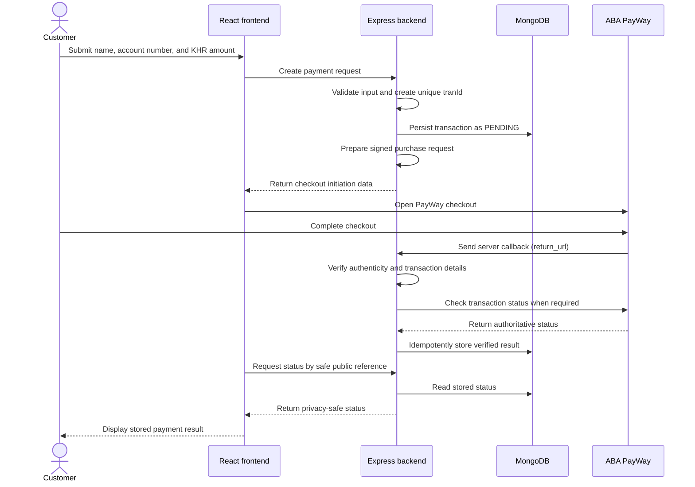

# ABA PayWay Payment Application

> **Status:** Internal pending-transaction preparation is implemented. Purchase signing remains blocked on written PayWay clarification; checkout and payment integration have not started.

This repository is planned as a practical-exam project: an HTTPS payment application that collects a sender's name, an account number, and an amount in Cambodian riel (KHR), opens ABA PayWay checkout, and displays a payment result verified by the backend.

## Current progress

- [x] Step 0: Project scope, architecture, security expectations, testing strategy, and implementation roadmap documented.
- [x] Step 1: React/Tailwind client and Express server foundation, including a health endpoint and frontend connection status.
- [x] Step 2: MongoDB startup connection, readiness reporting, and the Mongoose transaction model.
- [x] Step 3: Responsive payment-details form and authoritative server-side validation, without transaction creation or gateway calls.
- [x] Step 4A: Official PayWay documentation reviewed and the verified integration contract recorded.
- [x] Step 4B: Backend-only sandbox environment configuration with checkout disabled by default.
- [x] Step 4C: Official credential/signing rules rechecked; unresolved mandatory rules documented and signing intentionally not implemented.
- [x] Internal preparation: validated details can be stored as a `PENDING` transaction, but this service is not connected to a route or the frontend.
- [ ] Payment functionality, gateway integration, deployment, and live-payment evidence.

Steps 0 through 3, Step 4A, the configuration-only Step 4B, the documentation-only Step 4C review, and the internal pending-transaction preparation service are complete in the working tree. Everything described below is planned functionality unless explicitly marked complete.

## Getting started

### Prerequisites

- Node.js 20.19 or newer (Vite also supports compatible Node.js 22.12+ releases)
- npm
- MongoDB Community Server for local development, or private access to a MongoDB Atlas deployment

PayWay credentials are not required because payment integration has not started.

### Installation

From the repository root:

```sh
npm install
```

This installs the root, `client`, and `server` workspace dependencies and uses the committed root `package-lock.json`.

Copy `server/.env.example` to `server/.env`. Do not commit the resulting file. The example URI expects a local MongoDB instance and uses the `angkor_payment` database:

```dotenv
PORT=3000
MONGODB_URI=mongodb://127.0.0.1:27017/angkor_payment
```

Start your local MongoDB service before starting the application. Alternatively, replace `MONGODB_URI` in the untracked `server/.env` with a private Atlas connection string. Never paste credentials into source files, logs, screenshots, or commits. Environment loading is anchored to `server/.env`, so it behaves consistently whether the server is launched from the repository root or its workspace.

### Development

Run the frontend and backend together:

```sh
npm run dev
```

The backend validates its configuration, connects to MongoDB with a five-second server-selection timeout, and creates the required transaction indexes before it begins listening. Startup exits with a redacted error if configuration, MongoDB connection, or index initialization fails.

Vite prints the frontend URL (normally `http://localhost:5173`). After database initialization, Express listens on `http://localhost:3000`. The Vite development server proxies `/api` requests to Express, and the page displays the observed backend connection state.

The applications can also be run separately:

```sh
npm run dev:client
npm run dev:server
```

### Build and lint

```sh
npm run build
npm run lint
npm test
```

The build command creates the frontend production bundle under `client/dist/`. The Express server does not currently serve that bundle; production hosting is a later step.

The standard test command loads private test settings from `server/.env.test`. It never falls back to `MONGODB_URI`. Persistence, timestamp, unique-index, and duplicate-rejection checks run only when `TEST_MONGODB_URI` is configured, and the test helper refuses to connect or clean up unless the selected database name is exactly `angkor_payment_test`. Cleanup targets only the generated test transaction IDs; tests never drop a database or collection.

Create the ignored private test file from the credential-free example:

```powershell
Copy-Item server/.env.test.example server/.env.test
```

For local MongoDB, the copied file already selects the separate `angkor_payment_test` database:

```dotenv
TEST_MONGODB_URI=mongodb://127.0.0.1:27017/angkor_payment_test
```

For Atlas, privately replace that value in `server/.env.test` with the Atlas connection string and ensure its database path is `/angkor_payment_test` before any query options. Percent-encode special characters in the username or password. Never place the URI in `server/.env.example`, source code, terminal screenshots, logs, commits, or chat. Then run `npm test` from the repository root. If configuration is absent, the two MongoDB persistence tests report as skipped rather than passed.

**Latest verification (21 September 2026):** the complete server suite reported 56 passed, 0 failed, and 0 skipped against the privately configured `angkor_payment_test` database. The guarded integration checks verified actual pending-transaction persistence, timestamps, leading-zero account-number preservation, server-controlled `PENDING`/`KHR` values, creation of the unique `tranId` index, and duplicate `tranId` rejection. Cleanup remained limited to the generated test records; no database or collection was dropped. No connection string or credential was printed.

### Backend configuration

| Variable | Default | Current purpose |
| --- | --- | --- |
| `PORT` | `3000` | Express listening port |
| `MONGODB_URI` | None; required | Private MongoDB connection string used at server startup |
| `TEST_MONGODB_URI` | None; optional | Loaded from ignored `server/.env.test`; must select exactly `angkor_payment_test` |
| `PAYWAY_ENV` | `sandbox` | Selects the fixed `sandbox` or `production` endpoint mapping; other values fail startup |
| `PAYWAY_CHECKOUT_ENABLED` | `false` | Strict `true`/`false` switch; production cannot be enabled in Step 4B |
| `PAYWAY_SANDBOX_MERCHANT_ID` | None | Backend-only sandbox merchant ID; required only when sandbox checkout is enabled |
| `PAYWAY_SANDBOX_API_KEY` | None | Reserved backend-only sandbox HMAC credential setting; do not populate it from the received package until PayWay confirms which labelled credential maps to it |

Environment files containing real values, including `server/.env.test`, are ignored by Git, while credential-free `.env.example` and `.env.test.example` files are explicitly allowed. Never put PayWay credentials in the frontend or in `VITE_` variables because Vite exposes those values to browser code.

### PayWay sandbox configuration

The official [PayWay overview](https://developer.payway.com.kh/) directs developers to create a sandbox account and states that sandbox Merchant ID/API keys are sent after registration. Use the official [sandbox registration page](https://sandbox.payway.com.kh/register-sandbox/) and keep received credentials only in the ignored `server/.env`. PayWay also requires the applicable domain/IP to be whitelisted; coordinate that with the PayWay Integration team before testing from a deployed environment. Checked 21 September 2026.

The safe default configuration is:

```dotenv
PAYWAY_ENV=sandbox
PAYWAY_CHECKOUT_ENABLED=false
PAYWAY_SANDBOX_MERCHANT_ID=
PAYWAY_SANDBOX_API_KEY=
```

With checkout disabled, the server starts without PayWay credentials. If sandbox checkout is set to exactly `true`, both sandbox credential variables become required. Any other boolean spelling is rejected. `PAYWAY_ENV=production` may select the fixed production endpoint metadata while checkout remains disabled, but production checkout activation is deliberately rejected at startup.

This configuration does **not** implement or authorize checkout. There is still no signing code, purchase route, transaction creation, PayWay network client, callback handler, or status request. Keep `PAYWAY_CHECKOUT_ENABLED=false`. The received credential labelled “Public Key” must not be assigned to `PAYWAY_SANDBOX_API_KEY`, and neither RSA key may be substituted, until PayWay confirms the mapping in writing. The callback verification credential relationship also remains unresolved.

### Health and readiness

- `GET /api/health` returns HTTP 200 with `{"status":"ok"}` when the HTTP process is serving. It is intentionally not a database-readiness check.
- `GET /api/ready` returns HTTP 200 with `{"status":"ready"}` while Mongoose is connected, or HTTP 503 with `{"status":"unavailable"}` otherwise.

Neither response exposes a connection string, database name, credentials, or driver internals. On `SIGINT` or `SIGTERM`, the server stops accepting HTTP requests and closes the Mongoose connection.

### Validation-only payment details API

`POST /api/payments/validate` validates details without generating a transaction ID, writing to MongoDB, contacting PayWay, or initiating a payment. The JSON contract accepts exactly three fields:

- `name`: string, trimmed by the server, 1–100 characters
- `accountNumber`: string, trimmed by the server, 1–64 characters; leading zeros are preserved
- `amount`: JSON number that is a positive safe integer and, for this exam, either `1` or `2000`

The name supports Khmer and other Unicode characters. No English-only or bank-specific account-number format is imposed. The length limits are application decisions, not official PayWay constraints. Currency is not accepted from the client; the server assigns `KHR`.

Example request using fictional data:

```json
{
  "name": "សុខា ឧទាហរណ៍",
  "accountNumber": "0012345678",
  "amount": 2000
}
```

Successful response:

```json
{
  "message": "Validation passed. No payment was initiated.",
  "details": {
    "amount": 2000,
    "currency": "KHR"
  }
}
```

Invalid input returns HTTP 400 with field-specific errors:

```json
{
  "message": "Validation failed.",
  "errors": {
    "amount": "amount must be either 1 or 2000 KHR."
  }
}
```

Malformed JSON returns HTTP 400, oversized JSON returns HTTP 413, and unexpected server failures return a generic HTTP 500 response. Error responses do not include stack traces, request bodies, names, account numbers, credentials, or database details.

### Current limitations

- The page collects and validates payment details, but it is intentionally validation-only.
- Payment integration, signing, checkout, callbacks, authentication, and transaction status handling are not implemented.
- The health endpoint reports only that the HTTP server is running; it is not a database-readiness check.
- No public payment creation API or checkout route exists yet.
- An internal service can prepare a `PENDING` transaction, but no public route invokes it and no checkout or payment is initiated.
- PayWay endpoint selection exists, but checkout remains disabled and no PayWay request can be made.
- The temporary amount allow-list of 1 or 2,000 KHR is an exam restriction, not a PayWay limitation.
- Payment state-transition rules are not implemented yet.
- Deployment and HTTPS configuration are not included.

Codex assisted with the Step 0 planning document, Step 1 project scaffolding, Step 2 MongoDB/model foundation, Step 3 validation form/API, Step 4A review of the official PayWay documentation, Step 4B sandbox configuration, the Step 4C credential/signing review, and the internal pending-transaction preparation service. This use of AI must be accurately disclosed in the final submission, along with any later AI-assisted work.

## 1. Project overview and scope

The planned customer journey is:

1. The customer enters their name, account number, and a whole-KHR amount in the payment form.
2. The frontend sends the data to the backend; it does not sign PayWay requests or decide payment success.
3. The backend validates the input, records a pending transaction, signs a purchase request using server-held credentials, and starts PayWay checkout.
4. The customer completes or cancels checkout on PayWay.
5. PayWay notifies the backend. The backend verifies the notification and checks the transaction status when required.
6. MongoDB stores the verified result.
7. The frontend requests a safe public status representation and displays pending/checking, success, failure, or cancellation.

Planned responsibilities:

- **React frontend:** collect payment details, initiate the backend flow, open or redirect to checkout, and display only backend-stored status.
- **Express backend:** validate input, create transaction IDs, persist transactions, sign PayWay requests, receive and verify callbacks, reconcile status, and expose a privacy-safe status endpoint.
- **MongoDB:** retain the transaction lifecycle and the verified gateway result.
- **ABA PayWay:** host checkout, process the payment, send the server callback, and provide the authoritative payment status through its documented APIs.

The initial submission does **not** include user login, a dashboard, refunds, or payout functionality.

### Planned technology

- Frontend: React, Vite, and Tailwind CSS
- Backend: Node.js and Express using JavaScript ES modules
- Database: MongoDB with Mongoose
- Repository layout: one repository with `client/` and `server/` directories
- Secret boundary: PayWay credentials and signing material exist only on the backend

## 2. Architecture



The exact message fields and authentication steps in this conceptual diagram must be reconciled with the current official PayWay specification before implementation.

## 3. Frontend pages

### Payment form

The Step 3 validation-only form collects:

- Sender name
- Account number
- Amount in KHR

The form provides accessible field messages, a loading state, and deliberate whole-number conversion. Backend validation remains authoritative. For the exam, it accepts only 1 or 2,000 KHR; this temporary allow-list is not presented as a PayWay limitation. Its action is labelled **Validate details**, and the page explicitly states that payment integration is not connected and no money will be charged.

### Result page

The result page will show one of these backend-derived states:

- Pending/checking
- Success
- Failure

The browser must never infer, declare, or persist payment success from a redirect, query parameter, client-side state, or HTTP 200 response alone.

### Cancel page

The cancel page will explain that checkout was cancelled or interrupted and will allow the customer to check the stored status. A browser cancellation is not proof that a payment failed and must not overwrite a payment later verified as successful.

## 4. Backend responsibilities

The backend is planned to provide:

- Server-side validation for required values, string lengths, numeric format, allowed amounts, safe numeric limits, and the supported `KHR` currency.
- Unique transaction IDs that comply with PayWay's documented length, character-set, and uniqueness constraints.
- Purchase-request construction and signing in the exact order and encoding required by the official specification.
- Callback authenticity verification before trusting callback content.
- Transaction-status checks and reconciliation against PayWay's authoritative result.
- Idempotent state updates so duplicate or repeated callbacks are safe.
- Protection against invalid state regression, including preventing cancellation or timeout from replacing a verified payment.
- Explicit request timeouts, useful but non-sensitive error responses, and structured logs with secrets and sensitive customer data redacted.
- A safe public status lookup that exposes the minimum necessary state and never returns the sender's name or account number.

## 5. MongoDB transaction model

The Step 2 Mongoose schema contains:

| Field | Planned purpose |
| --- | --- |
| `tranId` | PayWay-compatible transaction identifier; required and protected by a unique index |
| `name` | Sender name supplied by the customer |
| `accountNumber` | Customer-entered account number stored as a string so formatting and leading zeroes are preserved |
| `amount` | Exact whole-KHR amount, validated as an integer within safe application and gateway limits |
| `currency` | Currency code; initially restricted to `KHR` |
| `status` | Internal lifecycle status such as `PENDING`, `PAID`, `FAILED`, or `CANCELLED` |
| `paywayResponseCode` | PayWay response/status code retained for reconciliation and support, subject to documentation review |
| `createdAt` | Record creation timestamp |
| `updatedAt` | Most recent record update timestamp |
| `paidAt` | Timestamp set only when payment has been authoritatively verified |

Whole-KHR amounts are stored as JavaScript numbers and validated as positive safe integers, preventing fractional, zero, negative, and unsafe integer values. `name` is trimmed and limited to 100 characters; `accountNumber` is a trimmed string limited to 64 characters so leading zeroes are preserved. These are reasonable application-level limits, **not** claimed PayWay constraints. PayWay-specific bounds still require official-specification review.

The `tranId` schema path is required and immutable, and its unique index is created explicitly with `Transaction.init()` before the HTTP server starts. A MongoDB unique index enforces uniqueness at the database level; `unique: true` is **not** a Mongoose validation rule.

The internal preparation service generates exactly 20 decimal digits using Node.js cryptographic randomness, with the first digit restricted to `1`–`9`. This is an **application assumption** based only on PayWay's verified maximum length of 20; official allowed-character, prefix, and reuse rules remain unresolved, so the format is not claimed to be PayWay-compatible yet. The service retries at most three insert attempts only when MongoDB identifies a duplicate `tranId`; unrelated database errors and duplicates on other indexes are returned immediately.

Before writing, the service reuses the Step 3 validator and explicitly selects only normalized `name`, `accountNumber`, allowed `amount`, server-controlled `KHR`, generated `tranId`, and `PENDING`. Caller-supplied `status`, `tranId`, `paidAt`, `paywayResponseCode`, currency, or any other unexpected field fails validation. Its internal result contains only `tranId`, amount, currency, and status. The service is not imported by any controller or route, and it performs no signing or external request.

State-transition behavior is not implemented in Step 2. Later verified callback handling must be conditional and idempotent: duplicate notifications must not be processed harmfully, and browser cancellation or an application timeout must never overwrite a verified `PAID` state.

## 6. Account-number decision

The entered account number will be stored in MongoDB and associated with `tranId` for the exam workflow.

Storing an account number as transaction metadata does **not** route or settle money to that account. PayWay settlement follows the merchant configuration agreed with ABA PayWay. Before implementation and live testing, the exam team must confirm that its merchant settlement configuration and destination account identifier match the intended recipient. Payout and money-routing functionality is outside the initial scope.

## 7. PayWay integration details requiring verification

The current official documentation is the source of truth:

- [ABA PayWay developer portal](https://developer.payway.com.kh/)
- [Purchase integration guide](https://developer.payway.com.kh/purchase-14530820e0)
- [Relevant API folder](https://developer.payway.com.kh/folder-3158159)
- [API endpoints](https://developer.payway.com.kh/api-endpoints-984508m0)
- [Check transaction](https://developer.payway.com.kh/check-transaction-14530826e0)

Before gateway code is written, verify and document:

- [ ] Exact fields included in the signature and their required signing order
- [ ] Canonicalization, character encoding, escaping, hashing, and parameter/body encoding
- [ ] Callback authenticity-verification algorithm, required headers/fields, replay considerations, and acknowledgement response
- [ ] Purchase, callback, and status-check response codes and their mapping to internal states
- [ ] Supported amount representation, minimum/maximum amount, decimal rules, and KHR-specific constraints
- [ ] Transaction-ID length, allowed characters, uniqueness, and reuse rules
- [ ] Sandbox and production checkout/API base URLs and endpoint paths
- [ ] Required merchant configuration, IP/domain allowlisting, and callback registration
- [ ] Required and optional purchase/status fields, redirect behavior, and timeout behavior

PayWay's checkout guide uses `return_url` for the **server callback**. It must not be treated as the customer's browser-return URL. Any separate customer browser return/cancel behavior must be confirmed from official documentation and tested without allowing the browser to establish success.

No undocumented API behavior will be assumed. Missing, ambiguous, or merchant-specific behavior will be raised with the exam team before implementation.

## Verified PayWay integration contract

**Review date:** 21 September 2026. **Implementation status:** documentation only. No PayWay request, checkout, callback handler, transaction-status call, or payment state transition has been implemented.

The labels below have strict meanings:

- **Verified fact:** stated by the official PayWay documentation linked beside the rule.
- **Application decision:** a proposed design for this project, not a PayWay requirement.
- **Unresolved:** absent, unclear, or internally inconsistent in the reviewed official documentation; confirmation is required before dependent code is written.

Only these official sources were used: [PayWay overview](https://developer.payway.com.kh/), [API endpoints](https://developer.payway.com.kh/api-endpoints-984508m0), [Ecommerce Checkout](https://developer.payway.com.kh/folder-3158159), [Purchase](https://developer.payway.com.kh/purchase-14530820e0), and [Check Transaction](https://developer.payway.com.kh/check-transaction-14530826e0). All rules in this section were checked on 21 September 2026.

### 1. Purchase request

#### Endpoint and transport

| Rule | Classification and source |
| --- | --- |
| Sandbox base URL is `https://checkout-sandbox.payway.com.kh/`; production base URL is `https://checkout.payway.com.kh/`. | **Verified fact.** [API endpoints](https://developer.payway.com.kh/api-endpoints-984508m0), checked 21 September 2026. |
| Purchase path is `api/payment-gateway/v1/payments/purchase`. Therefore the full endpoints are `https://checkout-sandbox.payway.com.kh/api/payment-gateway/v1/payments/purchase` and `https://checkout.payway.com.kh/api/payment-gateway/v1/payments/purchase`. | **Verified fact.** [Purchase](https://developer.payway.com.kh/purchase-14530820e0) and [API endpoints](https://developer.payway.com.kh/api-endpoints-984508m0), checked 21 September 2026. |
| Method is `POST`; the Purchase request body is documented as `multipart/form-data`. A successful hosted-checkout response is HTTP 200 `text/html` containing the checkout interface—not a JSON payment URL. | **Verified fact.** [Purchase](https://developer.payway.com.kh/purchase-14530820e0), checked 21 September 2026. |
| API access is limited to PayWay-whitelisted domains/IPs. A non-whitelisted origin is documented as error `6: wrong domain`; GET/browser-address-bar access is documented as HTTP 405. | **Verified fact.** [API endpoints](https://developer.payway.com.kh/api-endpoints-984508m0), checked 21 September 2026. |

#### Parameters

The Purchase parameter table marks these fields required: `req_time`, `merchant_id`, `tran_id`, `amount`, and `hash`. All remaining listed Purchase fields are optional. [Purchase](https://developer.payway.com.kh/purchase-14530820e0), checked 21 September 2026.

| Parameter | Verified rule |
| --- | --- |
| `req_time` | UTC timestamp string formatted `YYYYMMDDHHmmss`. |
| `merchant_id` | Merchant key supplied by ABA Bank; string, maximum 30 characters. |
| `tran_id` | Unique payment transaction identifier; string, maximum 20 characters. No allowed-character rule is stated. |
| `amount` | Required number described as the purchase amount. |
| `hash` | Required Base64-encoded HMAC-SHA-512 signature described in the next subsection. |
| `firstname`, `lastname` | Optional buyer-name strings, maximum 100 characters each. |
| `email` | Optional buyer email, maximum 50 characters. |
| `phone` | Optional buyer phone, maximum 20 characters. |
| `type` | Optional string, maximum 20 characters; defaults to `purchase`; documented values are `purchase` and `pre-auth`. This project will use `purchase`. |
| `payment_option` | Optional string, maximum 20 characters. Documented values are `cards`, `abapay_khqr`, `abapay_khqr_deeplink`, `alipay`, `wechat`, and `google_pay`. When empty/omitted, PayWay displays the methods supported by the merchant profile. |
| `items` | Optional Base64-encoded JSON array, up to 50 line items; descriptive only and not used by PayWay to calculate or validate the amount. |
| `shipping` | Optional number. |
| `currency` | Optional `KHR` or `USD`; if omitted, PayWay uses the merchant profile's default account currency. This project will always send `KHR`. |
| `return_url` | Optional Base64-encoded server callback URL. If absent, PayWay uses the callback configured in API Settings; a custom domain must be whitelisted. |
| `cancel_url` | Optional browser destination after the user closes the payment dialog or cancels. The parameter table does not state Base64 encoding for it. |
| `skip_success_page` | Optional integer `0` (show PayWay success pages) or `1` (skip them); omission follows profile configuration. When success is skipped, the request's `continue_success_url`, or the profile-level value if absent, is used. |
| `continue_success_url` | Optional browser destination after successful payment. The parameter table does not state Base64 encoding for it. |
| `return_deeplink` | Optional for web and mandatory for mobile integration; Base64 of JSON containing both iOS and Android schemes. Not planned for this web submission. |
| `custom_fields` | Optional Base64-encoded JSON metadata. Not planned because the application retains its metadata in MongoDB. |
| `return_params` | Optional information returned in the callback. Its encoding and length are not specified. Not planned unless PayWay clarifies a need. |
| `view_type` | Optional `hosted_view` (redirect/new tab) or `popup` (bottom sheet on mobile, modal on desktop). |
| `payment_gate` | Optional integer; documentation says use `0` for Checkout if the merchant also has QR Payment API service. Whether this merchant requires it is unresolved. |
| `payout` | Optional Base64-encoded payout JSON. Out of scope and will not be sent. |
| `additional_params` | Optional Base64-encoded WeChat Mini Program JSON. Out of scope and will not be sent. |
| `lifetime` | Optional integer minutes; minimum 3 minutes, maximum/default 30 days. The project value remains undecided. |
| `google_pay_token` | Required only when `payment_option=google_pay` and the merchant manages payment selection. Not planned. |

All parameter descriptions and limits in this table are **verified facts** from [Purchase](https://developer.payway.com.kh/purchase-14530820e0), checked 21 September 2026. The stated project usage is an **application decision**.

**Unresolved before signed Purchase implementation:** the reviewed pages do not document an allowed character set for `tran_id` or most strings; do not state a Purchase amount minimum/maximum; and do not state whether KHR must be sent as `1`, `1.00`, or another decimal representation. They also do not establish that this merchant profile accepts a 1 KHR purchase. These cannot be inferred from USD examples.

#### Checkout mode

**Application decision:** use `view_type=hosted_view`. After the backend validates input, creates and persists a `PENDING` transaction, and signs the exact PayWay fields, the browser will submit a `multipart/form-data` HTML form directly to the selected PayWay Purchase endpoint in a new browsing context. The browser must render PayWay's returned `text/html` checkout response. The integration must not expect the backend to receive a JSON payment URL. PayWay's official sample also demonstrates an alternative `popup` mode using `https://checkout.payway.com.kh/plugins/checkout2-0.js`, but this project does not currently select it. [Ecommerce Checkout](https://developer.payway.com.kh/folder-3158159) and [Purchase](https://developer.payway.com.kh/purchase-14530820e0), checked 21 September 2026.

### 2. Purchase signature

**Verified algorithm:** concatenate field values without separators, compute HMAC-SHA-512 using the ABA-provided HMAC credential and raw binary digest output, then Base64-encode that digest. The page's reference code names the variable `$api_key`, while its comment calls the value a “public key.” [Purchase](https://developer.payway.com.kh/purchase-14530820e0), checked 21 September 2026.

The exact order printed by the official Purchase signing example is:

```text
req_time
merchant_id
tran_id
amount
items
shipping
firstname
lastname
email
phone
type
payment_option
return_url
cancel_url
continue_success_url
return_deeplink
currency
custom_fields
return_params
payout
lifetime
additional_params
google_pay_token
skip_success_page
```

The signing input shown in the reference code is those values concatenated in that order with no separators. Whatever credential PayWay confirms for HMAC use must be treated as a secret server credential: it must never enter React, a `VITE_` variable, browser storage, logs, screenshots, or source control. A generated transaction-specific `hash` may later be placed in a browser-submitted hidden checkout form; disclosure of that signature would not disclose the HMAC key. [Purchase](https://developer.payway.com.kh/purchase-14530820e0), checked 21 September 2026.

#### Step 4C credential-mapping result

**Confirmed from official documentation:** the PayWay overview and Ecommerce Checkout guide say sandbox access supplies a Merchant ID and an “API Key.” The Purchase reference code uses that API-key variable as the HMAC-SHA-512 key, although the adjacent comment calls it a “public key.” [PayWay overview](https://developer.payway.com.kh/), [Ecommerce Checkout](https://developer.payway.com.kh/folder-3158159), and [Purchase](https://developer.payway.com.kh/purchase-14530820e0), checked 21 September 2026.

**Not established by the official documentation:** the reviewed pages do not describe a credential package containing a separately labelled “Public Key,” “RSA Public Key,” and “RSA Private Key”; do not map any of those exact package labels to Purchase/Check HMAC; and do not say RSA is used for Purchase signing. Therefore this project will not guess that the labelled Public Key is the HMAC secret and will not substitute either RSA key.

Ask PayWay this exact question through the official integration channel: **“For my sandbox credential package containing Merchant ID, a credential labelled Public Key, RSA Public Key, RSA Private Key, and API URL, which exact value is the symmetric HMAC-SHA-512 key for Ecommerce Checkout Purchase and Check Transaction? Please confirm that neither RSA PEM key is used for those HMAC operations, and state whether callback HMAC uses the same credential or a distinct secret.”** Do not include any credential values in the question.

**Unresolved and blocking:**

- [API endpoints](https://developer.payway.com.kh/api-endpoints-984508m0) says the hash must include every parameter posted and irrelevant optional parameters may be skipped. The Purchase signing example nevertheless omits the posted `view_type` and `payment_gate` parameters. PayWay/exam-team confirmation is required before sending either field.
- The documentation does not state whether an omitted optional contributes an empty string at its position, or is removed from the signing sequence entirely. It also does not define how multipart numeric values are canonicalized before signing.
- The table says `items`, `custom_fields`, `return_deeplink`, `payout`, and `additional_params` are individually Base64-encoded before their resulting strings enter the signature. `return_url` is likewise Base64-encoded before signing. No additional per-value encoding is documented for other fields.
- The Purchase signing rules above are specific to Purchase and must not be reused for callback verification.

The official pages provide no complete Purchase signature test vector with both input and expected Base64 output. No signing implementation or signing tests were added in Step 4C because credential mapping, the first two canonicalization contradictions, and KHR amount representation are mandatory inputs to a correct implementation. Resolve them using a merchant-specific official example or written PayWay guidance rather than encoding assumptions in code.

### 3. Callback and browser navigation

#### Navigation versus callback

- **Verified fact:** `return_url` is the server-to-server callback destination after payment completion, not the customer's browser return. It is Base64-encoded in the Purchase request. If omitted, PayWay uses API Settings; a custom domain must be whitelisted. [Ecommerce Checkout](https://developer.payway.com.kh/folder-3158159) and [Purchase](https://developer.payway.com.kh/purchase-14530820e0), checked 21 September 2026.
- **Verified fact:** `continue_success_url` is the browser destination after a successful payment; `cancel_url` is the browser destination after closing/cancelling checkout. The docs do not say to Base64-encode either one. [Purchase](https://developer.payway.com.kh/purchase-14530820e0), checked 21 September 2026.
- **Application decision:** use separate HTTPS routes for callback, success navigation, and cancellation. Browser navigation will never mark a transaction paid. Both browser pages will display the status stored by the backend.
- **Unresolved:** URL length limits, allowed schemes, query-string handling, whether `cancel_url`/`continue_success_url` require percent encoding beyond normal multipart handling, and the exact merchant-profile interaction must be confirmed.

#### Callback request and signature

**Verified facts:** PayWay sends `POST` with `Content-Type: application/json` to `return_url`. The documented sample payload contains `tran_id`, `apv`, `status`, `return_params`, `original_amount`, `original_currency`, `payment_amount`, `payment_currency`, `total_amount`, `discount_amount`, `transaction_date`, `first_name`, `last_name`, `email`, `phone`, `bank_ref`, `payment_type`, `payer_account`, `bank_name`, and `card_source`. In the sample, `status` is string `"0"`; `transaction_date` uses `YYYY-MM-DD HH:MM:SS`; `tran_id` has maximum length 20; and `apv` has length 6. [Ecommerce Checkout](https://developer.payway.com.kh/folder-3158159), checked 21 September 2026.

The official callback-verification example specifies this distinct algorithm:

1. Decode the JSON request body to an associative structure.
2. Sort top-level fields by key ascending.
3. Concatenate the sorted values without separators.
4. If a top-level value is an array/nested structure, encode that value with PHP `json_encode` before concatenation.
5. Compute raw HMAC-SHA-512 with the documented secret key, then Base64-encode the digest.
6. Compare it in constant time with request header `X-PayWay-HMAC-SHA512` (shown as `HTTP_X_PAYWAY_HMAC_SHA512` in PHP).

This is a **verified fact** from [Ecommerce Checkout](https://developer.payway.com.kh/folder-3158159), checked 21 September 2026.

**Serialization boundary and unresolved Node.js details:** the official algorithm demonstrates PHP concatenation and default `json_encode`, but does not define a language-neutral byte-level canonical form. It does not specify number formatting (for example `1` versus `1.0`), booleans/null, nested object key ordering, escaped versus unescaped Unicode/slashes, or invalid Unicode. JavaScript `JSON.stringify` is not assumed byte-equivalent to PHP `json_encode`. Before callback code is implemented, obtain official fixtures containing numbers, strings, nested values, and Unicode, or written canonicalization rules. The current scalar callback example and string-valued `return_params` are insufficient to prove every case.

**Unresolved:** the reviewed official pages do not state the success acknowledgement status/body PayWay expects, the callback timeout, retry count/schedule, duplicate-delivery policy, source IP ranges, or replay window. The application will tolerate duplicates, but these operational details require PayWay confirmation.

### 4. Transaction verification

#### Check Transaction request

| Rule | Classification and source |
| --- | --- |
| Endpoint path is `api/payment-gateway/v1/payments/check-transaction-2`; full sandbox and production URLs use the verified environment base URLs above. | **Verified fact.** [Check Transaction](https://developer.payway.com.kh/check-transaction-14530826e0) and [API endpoints](https://developer.payway.com.kh/api-endpoints-984508m0), checked 21 September 2026. |
| Method is `POST`; request and response use `application/json`. Request fields are `req_time`, `merchant_id`, `tran_id`, and `hash`. | **Verified fact.** [Check Transaction](https://developer.payway.com.kh/check-transaction-14530826e0), checked 21 September 2026. |
| Check signature input is exactly `req_time + merchant_id + tran_id`, followed by raw HMAC-SHA-512 using the ABA-provided key and Base64 encoding. This is not the Purchase or callback signing sequence. | **Verified fact.** [Check Transaction](https://developer.payway.com.kh/check-transaction-14530826e0), checked 21 September 2026. |
| The API covers transactions created within seven days, is documented at 600 requests/second, and checking should stop once a result is returned. Older transactions use Transaction Details, which is outside the next signed-Purchase step. | **Verified fact.** [Check Transaction](https://developer.payway.com.kh/check-transaction-14530826e0) and [Ecommerce Checkout](https://developer.payway.com.kh/folder-3158159), checked 21 September 2026. |

The documented success-shaped response has `data.payment_status_code`, `total_amount`, `original_amount`, `refund_amount`, `discount_amount`, `payment_amount`, `payment_currency`, `apv`, `payment_status`, and `transaction_date`, plus `status.code`, `status.message`, and `status.tran_id`. `status.code="00"`/`status.message="Success!"` means the API request succeeded; payment approval must be determined separately from `data.payment_status_code` and `data.payment_status`. An HTTP 200 or API `status.code="00"` alone must never mark payment as paid. [Check Transaction](https://developer.payway.com.kh/check-transaction-14530826e0), checked 21 September 2026.

Documented payment outcomes are:

| Code | Documented status | Proposed internal treatment |
| --- | --- | --- |
| `0` | `APPROVED` or `PRE-AUTH` | Only `APPROVED`, with matching saved details, may become `PAID`; `PRE-AUTH` is outside scope and must not become `PAID`. |
| `2` | `PENDING` | Keep `PENDING`; retry/reconcile within a bounded policy. |
| `3` | `DECLINDED` in the numeric-code description and `DECLINED` in the status list | Treat as a failed outcome only after exact spelling/code handling is tested; preserve the raw response code. |
| `4` | `REFUNDED` | Outside initial scope; do not map silently to an existing state. |
| `7` | `CANCELLED` | May map to `CANCELLED` only if the record is not already verified `PAID`. |
| Any other/missing combination | Not documented | Treat as unknown, retain `PENDING`, record a redacted diagnostic, and reconcile/escalate; never guess success or automatically create another purchase. |

The PayWay code/status values are **verified facts** from [Check Transaction](https://developer.payway.com.kh/check-transaction-14530826e0), checked 21 September 2026. The internal handling column is an **application decision** and is not implemented.

For every callback or Check Transaction result, the backend will locate the saved record by exact `tranId` and compare the authoritative response's original/total amount and currency with the saved whole-KHR `amount` and `KHR` currency before any success transition. A missing or mismatched ID, amount, or currency is an exception requiring reconciliation, not a successful payment. **Unresolved:** Check Transaction's displayed response includes `payment_currency` but not `original_currency`; confirm which amount/currency fields are guaranteed for KHR and should form the authoritative match.

### 5. Application decisions

These are proposed project rules, not statements from PayWay:

- Generate `tranId` on the backend as exactly 20 decimal digits using Node.js cryptographic randomness and unbiased/rejection-based digit selection; make the first digit non-zero. This satisfies the verified string/max-20 constraint while avoiding time-only IDs. Because PayWay does not document allowed characters or leading-zero behavior, confirm this digits-only format with the exam team before signed Purchase implementation.
- Validate the request, generate `tranId`, and persist the complete transaction as `PENDING` before returning any signed checkout fields to the browser. If persistence fails, do not expose a checkout request.
- Store `accountNumber` only in MongoDB under `tranId`; never send it to PayWay unless a future official requirement explicitly demands it. This metadata does not route funds or select the settlement account.
- Keep signing, callback verification, status checking, detail matching, and all state changes on the backend. Browser success/cancel navigation is informational only.
- Make callback/status updates conditional and idempotent. Duplicate notifications must have no repeated business effect, and cancellation, timeout, delayed failure, or unknown status must never overwrite verified `PAID`.
- Treat network timeout or an indeterminate Purchase response as uncertain. Keep the saved `PENDING` transaction and reconcile the same `tranId`; do not automatically initiate a second purchase.
- Log only redacted identifiers and operational metadata. Never log API keys, raw signatures, callback bodies, names, account numbers, or credential-bearing URLs.

### 6. External prerequisites and questions for the exam team

Before signed Purchase implementation or any live checkout, obtain written answers to these exact questions:

1. Does the assigned sandbox and production merchant profile accept KHR purchases of both **1 KHR** and **2,000 KHR**, especially the 1 KHR transaction?
2. Which merchant settlement account receives these payments, and does it match the destination account identifier provided for the exam? Confirm that the form's stored `accountNumber` is metadata only and does not route funds.
3. Which deployment domain and outbound IP must PayWay whitelist for sandbox and production? Must the browser origin, backend IP, callback domain, or all three be registered?
4. What exact HTTPS `return_url` must be registered in API Settings, and may the request override it? Are `continue_success_url` and `cancel_url` also subject to registration/whitelisting?
5. For Purchase signing, when an optional field is omitted, is it removed from the signing input or represented by an empty string in its documented position?
6. The general hashing rule requires all posted parameters, but the Purchase signing example omits `view_type` and `payment_gate`. Must either field be signed, and at what exact position?
7. For KHR, what exact string representation enters the Purchase form and signature (`1`, `1.00`, or another format), and what are the merchant-specific minimum/maximum amounts?
8. Is the proposed 20-digit cryptographically random `tranId` accepted, including its first-digit/non-zero rule? Are there undocumented character, prefix, or reuse constraints?
9. What callback HTTP status/body acknowledges successful receipt, and what are the timeout, retry schedule/count, duplicate-delivery behavior, and replay expectations?
10. Provide official callback signature fixtures covering integers, fractional numbers, numeric-looking strings, null/booleans, nested arrays/objects, Unicode, slashes, and key ordering so Node.js can reproduce the documented PHP signature byte-for-byte.
11. For the received package containing a credential labelled Public Key plus separate RSA Public and Private Keys, which exact value is the symmetric HMAC-SHA-512 key for Purchase and Check Transaction? Confirm that neither RSA PEM key is used for those HMAC operations, and whether callback HMAC uses the same credential or a distinct secret.
12. Which Check Transaction amount/currency fields are guaranteed for KHR matching, and what complete API-level error/status code list should the application handle?
13. Does this merchant require `payment_gate=0`, and is `hosted_view` approved for the exam evidence workflow?

### 7. Step 4C outcome and smallest next implementation step

Step 4C completed the official credential/signing review without accessing real credentials. Because required rules remain unresolved, it deliberately added no signing utility, checkout route, frontend checkout change, or PayWay request. `PAYWAY_CHECKOUT_ENABLED=false` remains the required setting.

While signing remains blocked, an internal preparation service now validates details, generates the proposed transaction ID, and persists a `PENDING` record. This is storage preparation only: it is deliberately disconnected from public routes and the frontend, and it cannot initiate checkout or move money. `PAYWAY_CHECKOUT_ENABLED=false` remains unchanged.

After written PayWay clarification, the smallest subsequent change will be a server-only pure signing utility—not purchase initiation yet:

1. Map only the PayWay-confirmed HMAC credential to the backend configuration, without printing or exposing it.
2. Add a pure Node.js `crypto` helper that accepts the secret as an argument, constructs the confirmed byte sequence without mutating input, and returns the documented HMAC-SHA-512/Base64 signature. Keep it separate from callback verification.
3. Add a fixed fictional fixture whose expected signature is produced by an official reference implementation or supplied official test vector—not by the helper under test. Cover determinism, transaction ID/amount/key sensitivity, exact ordering, optional-field behavior, and value encoding.
4. Keep checkout disabled and add no routes or network calls. Signed purchase initiation, transaction creation, and frontend checkout remain a later separately reviewed step.

Step 4C does **not** mark signing, checkout, callbacks, Check Transaction reconciliation, result polling, or full payment verification as implemented.

## 8. Security requirements

- Never commit API keys, credentials, signing secrets, or real `.env` files.
- Never place secrets in React source, browser storage, built frontend assets, or `VITE_` variables; such variables are exposed to the browser.
- Keep all PayWay secrets and signing operations on the backend.
- Deploy the application and its callbacks over HTTPS.
- Verify callback authenticity and match the transaction ID, amount, currency, and other relevant details before recording payment.
- Never mark a transaction successful based only on a browser redirect or an HTTP 200 response.
- Redact secrets, names, account numbers, and other sensitive data from logs, screenshots, callback evidence, and error output.
- Expose only minimal payment state through public status lookup and use an unguessable or otherwise adequately protected lookup mechanism.
- Keep the source repository private.

## 9. Testing strategy

Testing is planned to include:

- Local automated tests using mocked gateway responses; local development must not initiate real payments.
- Validation tests for missing, malformed, too-long, out-of-range, fractional, and unsupported-currency inputs.
- Signature fixtures/tests based on official examples or values confirmed by PayWay.
- Invalid, unauthenticated, duplicate, repeated, out-of-order, and delayed callback tests.
- Amount/currency/transaction mismatch tests and timeout/reconciliation handling.
- Forged browser-return tests proving that redirects cannot produce a successful stored state.
- State-transition tests proving that `PAID` cannot be downgraded by cancellation, timeout, or delayed failure messages.
- Deployed HTTPS, certificate, callback reachability, and callback-registration checks.
- Exactly two authorized live payments initiated through the deployed form: **1 KHR** and **2,000 KHR**.

No transaction will be initiated while preparing this README. Any live transaction beyond the two authorized payments requires prior clearance from the exam team.

## 10. Deployment and external prerequisites

Request these items or confirmations from the exam team:

- Merchant ID and API key through the team's designated Telegram channel—not through source control or public chat.
- Destination account identifier and confirmation of the intended settlement recipient.
- Domain/IP allowlisting and server-callback registration requirements.
- DNS changes if `khmerfp.com` will be used.
- Clarification of any unresolved integration behavior not covered by the official documentation.

Hosting must be arranged separately. The deployment will use `khmerfp.com` or another owned domain, use HTTPS, and remain available through **28 September 2026, end of day**.

### Setup and environment configuration

Local MongoDB/Atlas configuration, development commands, and verification guidance are documented in [Getting started](#getting-started). PayWay configuration remains pending until its implementation step. Secret values will never be documented or committed.

## 11. Submission requirements

**Deadline:** 27 September 2026 at 7:00 PM, Phnom Penh time (UTC+7).

The final submission will include:

- A private source repository or clean project archive, including meaningful commit history.
- The live HTTPS URL.
- Accurate setup instructions and environment-variable names without secret values.
- An explanation of the account-number metadata decision and settlement limitation.
- An explanation of callback authentication, detail matching, status checking, and idempotent state transitions.
- Evidence for both authorized live payments: transaction IDs, filled-form screenshots, PayWay checkout screenshots, result screenshots, redacted callbacks, and redacted stored records.
- A list of incomplete items and proposed improvements.
- The domain used for deployment.
- An accurate AI-assistance disclosure stating which tools were used and what each tool helped produce or verify.

Evidence must be sufficient to connect each submitted form to checkout, verified callback/status data, and its stored record, while redacting credentials and sensitive information.

## 12. Incremental implementation roadmap

Each step should be independently reviewable and delivered as one focused commit.

- [x] **Step 0:** README and project plan.
- [x] **Step 1:** Create the React/Tailwind and Express foundation with a health endpoint. *(Implemented in the working tree; review and commit pending.)*
- [x] **Step 2:** Add the MongoDB connection and transaction model. *(Implemented in the working tree; review and commit pending.)*
- [x] **Step 3:** Build the payment form and authoritative server-side validation without live gateway calls. *(Implemented in the working tree; review and commit pending.)*
- [x] **Step 4A:** Review the official PayWay specification and document the integration contract.
- [x] **Step 4B:** Add centralized, backend-only PayWay sandbox configuration with checkout disabled by default.
- [x] **Step 4C:** Recheck official credential/signing rules and document the blockers; signing was intentionally not implemented.
- [x] **Internal preparation:** Add the pending-transaction preparation service without exposing a route or initiating checkout.
- [ ] **Step 4D:** Implement and fixture-test the pure Purchase signer after PayWay resolves the documented blockers; keep checkout disabled.
- [ ] **Step 5:** Implement verified callbacks, status checks, reconciliation, and idempotent updates.
- [ ] **Step 6:** Add result/cancel pages and safe frontend status handling.
- [ ] **Step 7:** Add focused tests and complete a security review.
- [ ] **Step 8:** Deploy with HTTPS and complete domain, allowlisting, and callback registration.
- [ ] **Step 9:** Run the authorized live payments, collect redacted evidence, and finalize documentation.

Implementation must proceed incrementally; later steps should not silently fill unresolved official-specification gaps.

## Unresolved decisions and confirmations

- Obtain the merchant ID and API key through the designated secure channel.
- Confirm the destination account identifier and merchant settlement configuration.
- Choose and arrange hosting.
- Confirm whether to use `khmerfp.com` or another owned domain and arrange any required DNS changes.
- Confirm PayWay's current allowlisting and callback-registration process for the selected environment.
- Resolve every unchecked official-specification item in Section 7 before implementing gateway calls.
- Select a privacy-safe, adequately protected public transaction-status lookup design.
- Confirm the approved format and storage location for redacted payment evidence.
- Confirm the AI-assistance disclosure format expected by the exam team.
