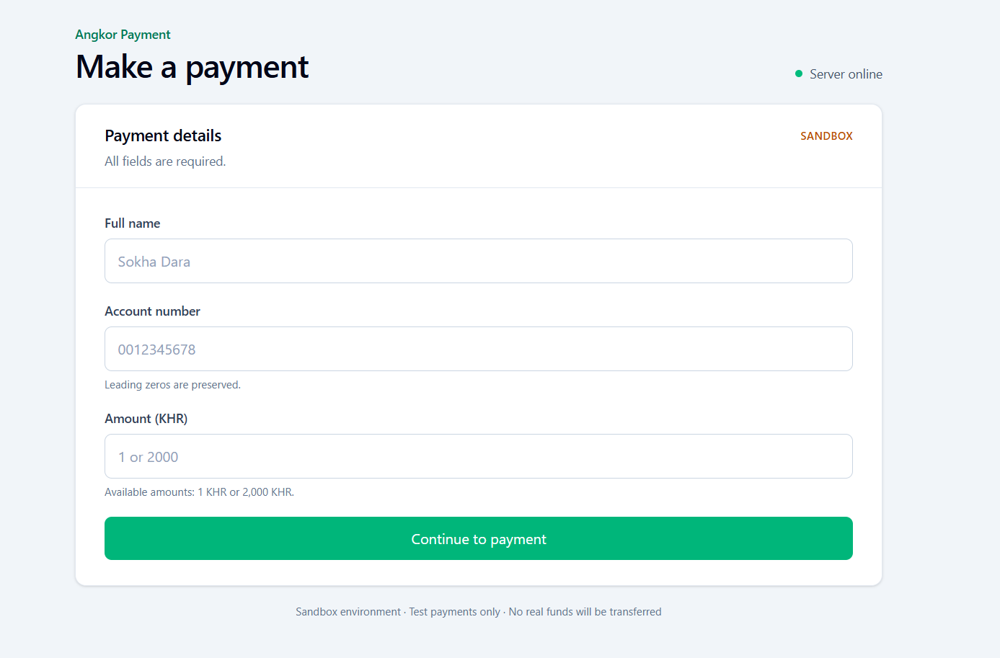
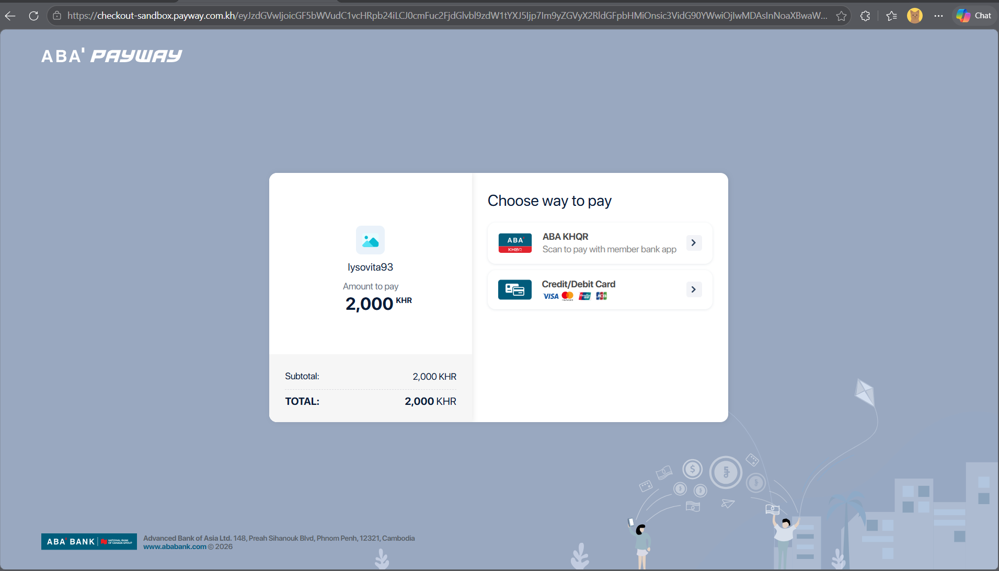
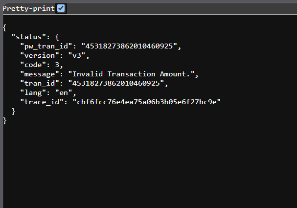
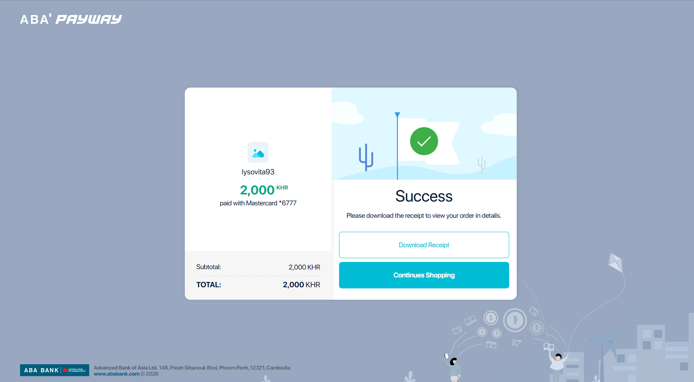
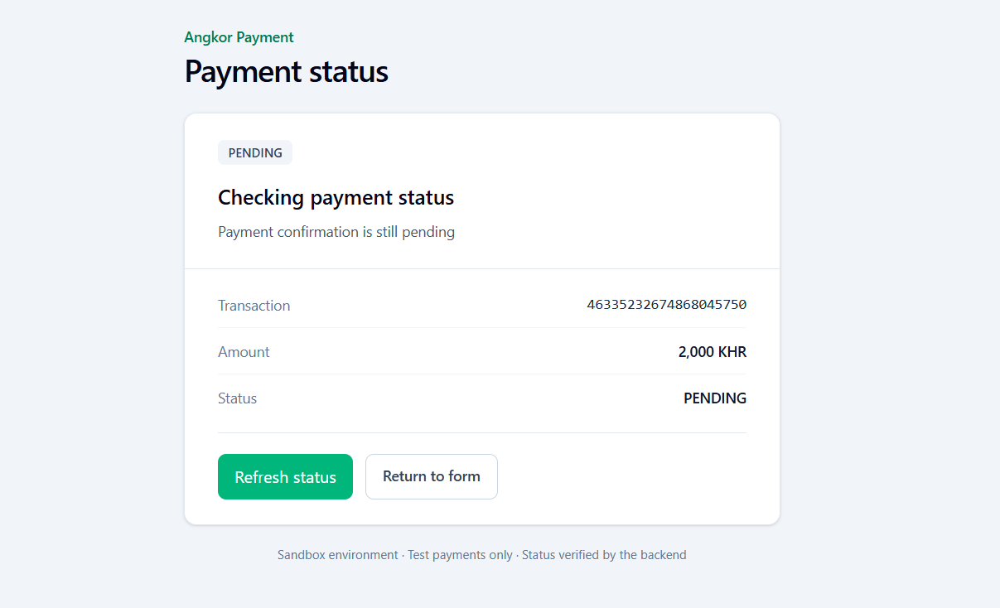
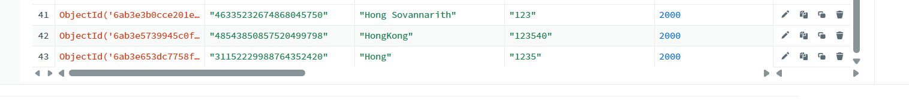
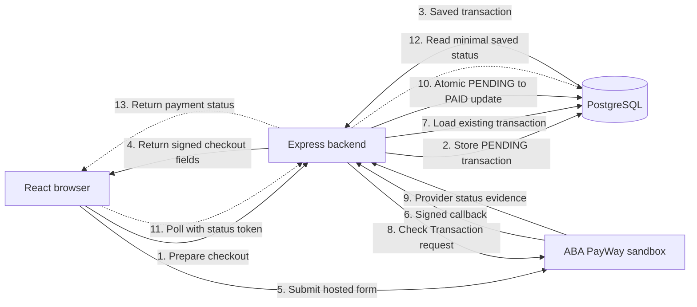

<<<<<<< HEAD
# Angkor Payment - ABA PayWay Integration

A full-stack payment application built for the ABA PayWay practical interview. It
collects payment details, creates a pending transaction, opens ABA PayWay hosted
checkout, authenticates PayWay callbacks, independently verifies approved payments,
and displays the result from protected backend state.

> **Current environment:** The deployed application uses production Node.js runtime
> settings but connects only to **ABA PayWay sandbox**. Real-money production checkout
> is deliberately blocked in configuration.

> **Submission status:** The application work required for the sandbox practical is
> complete: checkout preparation, persistence, signing, hosted checkout, callback
> authentication, independent Check Transaction verification, idempotent reconciliation,
> and protected result polling are implemented. PayWay may show a sandbox transaction
> as approved, but the application has not yet independently verified and persisted that
> approval because end-to-end callback verification is awaiting ABA confirmation. The
> application therefore correctly keeps that transaction `PENDING` instead of trusting
> the browser return or provider checkout page.

## Live application

- **Application:** [https://payway.khmerfp.com](https://payway.khmerfp.com)
- **Repository:** Private GitHub repository; reviewer access will be provided directly.
- **Payment environment:** ABA PayWay sandbox.
- **Source history:** Incremental commits document implementation and verification.

> **Hosting note:** This practical currently runs on a free Render web-service instance.
> After 15 minutes without inbound traffic, Render may spin the service down. The first
> request afterward wakes it and can take about one minute, so please allow the initial
> page or health check time to load. This cold start is a hosting-plan limitation, not a
> payment-processing failure. See [Render free web-service limitations](https://render.com/docs/free#spinning-down-on-idle).

## Project status

Implemented:

- Responsive React payment, result, and cancellation pages.
- Multi-provider authentication: Google, Facebook, Telegram and SMS one-time code
  sign-in, plus email/password, all issuing the same server-side session cookie.
- Authoritative server-side request validation.
- PostgreSQL persistence with a unique transaction ID.
- Server-side PayWay Purchase signing and hosted-checkout form submission.
- Separate Check Transaction signing and bounded HTTP client.
- Authenticated callback verification using constant-time HMAC comparison.
- Idempotent reconciliation before changing a transaction to `PAID`.
- Token-protected, read-only status polling from the result page.
- Health and database-readiness endpoints.
- Rate limiting, security headers, redacted structured logs, and request IDs.
- Render deployment configuration and SPA refresh support.
- Automated client, server, and isolated PostgreSQL integration tests.

Verified manually in sandbox:

- A 2,000 KHR Purchase request opens ABA PayWay hosted checkout.
- ABA PayWay presents KHQR and card payment choices for the sandbox merchant.
- Created transactions appear in PostgreSQL and the PayWay sandbox transaction portal.

Still dependent on ABA PayWay confirmation or external testing:

- Confirm the callback-verification credential/configuration and complete one real
  sandbox callback-to-`PAID` interoperability test. The application-side callback and
  reconciliation implementation is already complete and covered by mocked tests.
- Confirm callback acknowledgement and retry details for operational recovery.
- The assigned sandbox merchant rejected 1 KHR with provider code `3`, `Invalid
  Transaction Amount`; the application does not alter the requested amount or currency.
- Real-money production merchant credentials, allowlisting, and activation are outside
  this sandbox practical.

Local mocked tests prove application behavior but do not prove gateway acceptance.

## Sandbox evidence

The payment page clearly identifies the sandbox environment and accepts only the two
amounts required by the practical.



### ABA PayWay hosted checkout

The signed Purchase request opens ABA PayWay sandbox hosted checkout and presents the
payment methods enabled for the assigned sandbox merchant.



### 1 KHR sandbox result

The application submitted the amount exactly as `1` with currency `KHR`. ABA PayWay
sandbox returned provider code `3`, `Invalid Transaction Amount`. The application did
not replace the amount, switch to USD, or guess a different payment option to bypass
the response. This remains an assigned-merchant sandbox behavior awaiting ABA
confirmation, rather than an application validation or conversion failure.



### Provider-side sandbox approval

ABA PayWay displayed a successful 2,000 KHR sandbox payment. This proves that the
hosted checkout accepted and processed the sandbox payment, but it does not by itself
authorize the application to store `PAID`.



### Application verification state

After returning from PayWay, the application reads the transaction through its
token-protected backend status endpoint. It correctly shows `PENDING` because the
provider approval has not yet been authenticated and independently reconciled through
the callback workflow.



### PostgreSQL sandbox records

The corresponding sandbox transaction IDs were persisted by the application before
checkout, as required by the payment workflow.



All values shown in these images are sandbox test evidence. The application result
remains `PENDING` until the authenticated callback and independent Check Transaction
result are successfully reconciled. Provider-page success alone is intentionally not
presented as backend-verified payment success.

### Transaction evidence summary

| Amount | Sandbox transaction ID | Provider result | Available evidence |
|---:|---|---|---|
| 1 KHR | `45318273862010460925` | Code `3`: `Invalid Transaction Amount` | Redacted PayWay error response |
| 2,000 KHR | `46335232674868045750` | Provider-side success; application remains `PENDING` | Checkout, success, application status, and stored-record screenshots |

No authenticated callback payload was received for these attempts, so callback
evidence cannot be included and has not been fabricated. The 1 KHR request reached
PayWay, but a matching redacted stored-record screenshot should be added to the email
evidence if required by the reviewer.

## Architecture



The browser never decides whether payment succeeded. Browser return URLs, query
parameters, Purchase response code `00`, and HTTP 200 responses cannot mark a
transaction `PAID`. Only authenticated callback reconciliation with consistent Check
Transaction evidence can perform that transition.

## Technology

- React 19, Vite 8, and Tailwind CSS 4
- Node.js 22 and Express 5 using ES modules
- PostgreSQL and `node-postgres`
- Node.js `crypto` for random IDs, access tokens, hashing, and HMAC-SHA-512
- Node.js test runner for the server and Vitest for the client
- npm workspaces for `client` and `server`
- Render Blueprint for HTTPS deployment

## Repository structure

```text
.
|-- client/                 React application
|   `-- src/
|       |-- components/     Form, checkout, and result UI
|       |-- config/         Browser-safe application configuration
|       |-- services/       API and status-polling clients
|       `-- validation/     Client-side usability validation
|-- server/
|   |-- src/
|   |   |-- config/         Database and PayWay configuration
|   |   |-- controllers/    HTTP request/response handling
|   |   |-- middleware/     Security, rate limits, and request IDs
|   |   |-- models/         PostgreSQL transaction model
|   |   |-- payway/         Separate signing and token utilities
|   |   |-- routes/         Payment API routes
|   |   |-- services/       Checkout, status, checking, reconciliation
|   |   `-- validation/     Payment and callback contracts
|   |-- test/               Server unit and integration tests
|   `-- test-support/       Protected test-database helpers
|-- .github/workflows/      Continuous integration
|-- render.yaml             Render deployment definition
`-- package.json            Root workspace commands
```

## Prerequisites

- Node.js 22 LTS
- npm
- PostgreSQL 14 or newer, running locally or as a private managed database
- ABA PayWay sandbox credentials only when testing checkout

## Installation

From the repository root:

```sh
npm install
```

Copy the credential-free example to an ignored local file:

```powershell
Copy-Item server/.env.example server/.env
```

For macOS or Linux:

```sh
cp server/.env.example server/.env
```

Configure `DATABASE_URL` in `server/.env`, then start PostgreSQL before starting the
application. A private managed connection string may be used instead of a local database.
Never commit or paste real credentials into source, logs, screenshots, issues, or chat.

## Development

Run both workspaces:

```sh
npm run dev
```

The frontend normally runs at `http://localhost:5173` and proxies `/api` requests to
the backend at `http://localhost:3000`.

Run one workspace when needed:

```sh
npm run dev:client
npm run dev:server
```

The backend connects to PostgreSQL and initializes the schema and unique transaction
index before opening the HTTP listener. Configuration and connection failures stop
startup with a redacted error.

## Commands

```sh
npm run dev          # run client and server in watch mode
npm run build        # build the React production bundle
npm run lint         # lint both workspaces
npm test             # run client and server tests
npm run test:client  # run only client tests
npm run test:server  # run only server tests
npm start            # start the production Express process
```

## Environment configuration

| Variable | Required | Purpose |
|---|---:|---|
| `PORT` | No | HTTP listening port |
| `DATABASE_URL` | Yes | Private application database connection |
| `GOOGLE_CLIENT_ID` | Yes | Google OAuth client used by the login flow |
| `FACEBOOK_APP_ID` | For Facebook login | Public Facebook app id |
| `FACEBOOK_APP_SECRET` | For Facebook login | Server-only secret used to verify tokens via the Graph API |
| `APP_ORIGINS` | Yes | Comma-separated browser origins allowed to start a session |
| `SESSION_IDLE_TIMEOUT_MINUTES` | No | Session idle timeout (default 30) |
| `SESSION_ABSOLUTE_TIMEOUT_DAYS` | No | Session absolute timeout (default 7) |
| `TELEGRAM_BOT_TOKEN` | For Telegram | Shared secret of the Telegram bot used by sign-in and 2FA |
| `TELEGRAM_BOT_USERNAME` | For Telegram | Public bot username without `@` |
| `SMS_API_URL` | No | Legacy placeholder (not used; Vonage is the only SMS provider) |
| `SMS_API_KEY` | No | Legacy placeholder (not used) |
| `SMS_SENDER` | No | Legacy placeholder (not used) |
| `TWILIO_ACCOUNT_SID` | No | Legacy placeholder (not used) |
| `TWILIO_AUTH_TOKEN` | No | Legacy placeholder (not used) |
| `TWILIO_FROM_NUMBER` | No | Legacy placeholder (not used) |
| `MOCEAN_API_TOKEN` | No | Legacy placeholder (not used) |
| `MOCEAN_API_KEY` | No | Legacy placeholder (not used) |
| `MOCEAN_API_SECRET` | No | Legacy placeholder (not used) |
| `MOCEAN_FROM` | No | Legacy placeholder (not used) |
| `SMS_DEV_CONSOLE` | No | Legacy placeholder (not used) |
| `PHONE_OTP_MAX_ATTEMPTS` | No | Wrong-code attempts before a code is discarded (default 5) |
| `AUTH_RATE_LIMIT_WINDOW_MINUTES` | No | Fixed-window size for `/api/auth/*` limits |
| `AUTH_RATE_LIMIT_MAX_REQUESTS` | No | Requests allowed per window per IP |
| `AUTH_RATE_LIMIT_BLOCK_MINUTES` | No | Block duration after the limit is exceeded |
| `PAYWAY_ENV` | No | Selects the fixed PayWay environment mapping |
| `PAYWAY_CHECKOUT_ENABLED` | No | Strict checkout feature switch |
| `PAYWAY_SANDBOX_MERCHANT_ID` | When checkout enabled | Backend-only sandbox merchant ID |
| `PAYWAY_SANDBOX_API_KEY` | When checkout enabled | Backend-only Purchase/Check HMAC credential |
| `PAYWAY_SANDBOX_CALLBACK_SECRET` | For callbacks | Separate backend-only callback credential |
| `PAYWAY_SANDBOX_SUCCESS_URL` | When checkout enabled | Absolute browser result URL |
| `PAYWAY_SANDBOX_CANCEL_URL` | When checkout enabled | Absolute browser cancellation URL |
| `TEST_DATABASE_URL` | Integration tests | Must select exactly `angkor_payment_test` |

Production-named PayWay placeholders exist to prevent sandbox credential reuse, but
the application rejects production checkout activation. PayWay and database secrets
must never be placed in React or variables prefixed with `VITE_`, because those values
are exposed to browser bundles.

Only environment-variable names and purposes are documented here. Configure values
privately using the credential-free example file; never include real values in the
README or submission email.

## Safe local mode

The server can run without PayWay credentials while the checkout feature switch is
disabled. Validation, health, readiness, frontend navigation, and non-gateway tests
remain available in this mode.

## Manual sandbox checkout

Use only credentials provided privately for this practical. Do not use either RSA
PEM key as the Purchase HMAC secret.

1. Set the sandbox values privately in `server/.env`.
2. Set result and cancellation URLs for the environment being tested.
3. Confirm the deployed domain/IP has been accepted by PayWay if required.
4. Enable `PAYWAY_CHECKOUT_ENABLED` privately and restart the backend.
5. Confirm `GET /api/ready` returns `{"status":"ready"}`.
6. Open the payment page and use fictional customer metadata.
7. Submit once. Do not automatically retry an uncertain checkout attempt.
8. Complete the sandbox flow on ABA PayWay hosted checkout.
9. Confirm the result page displays success only after the backend stores `PAID`.
10. Disable `PAYWAY_CHECKOUT_ENABLED` after manual testing when appropriate.

For the practical, 2,000 KHR has opened hosted checkout successfully. A 1 KHR request
was submitted unchanged as amount `1` and currency `KHR`, but the assigned sandbox
merchant returned provider code `3`. That provider result is recorded as an external
verification issue rather than bypassed by changing currency or amount.

## API summary

### Process health

```http
GET /api/health
```

```json
{ "status": "ok" }
```

This reports process health and does not claim the database is connected.

### Database readiness

```http
GET /api/ready
```

Returns `200 {"status":"ready"}` while the database is connected and
`503 {"status":"unavailable"}` otherwise.

### Validate payment details

```http
POST /api/payments/validate
Content-Type: application/json
```

```json
{
  "name": "Sokha Example",
  "accountNumber": "0012345678",
  "amount": 2000
}
```

The API accepts only `name`, `accountNumber`, and numeric `amount`. It supports Unicode
names, preserves leading zeroes, and sets currency to `KHR` on the server. Current
practical amounts are restricted to 1 or 2,000 KHR; this is an application requirement,
not a general PayWay limit.

### Prepare sandbox checkout

```http
POST /api/payments/checkout/prepare
Content-Type: application/json
```

The request uses the same payment-details contract. The backend revalidates it,
generates a cryptographically random transaction ID and status token, stores a
`PENDING` transaction, and returns only the signed hosted-form contract required by
the initiating browser. It does not call PayWay itself.

### PayWay callback

```http
POST /api/payments/callback
Content-Type: application/json
X-PayWay-HMAC-SHA512: <provider-signature>
```

The original parsed payload is authenticated before callback field transformation.
Valid callback data is matched to an existing transaction and independently checked
with PayWay before an atomic `PAID` update. Invalid or uncertain evidence makes no
payment-state change.

The public deployed callback path is:

```text
https://payway.khmerfp.com/api/payments/callback
```

Callback registration and credential mapping must be confirmed privately with ABA.

### Protected payment status

```http
GET /api/payments/:tranId/status
X-Payment-Status-Token: <browser-session-token>
```

The endpoint returns only `tranId`, `amount`, `currency`, `status`, and `paidAt`.
Unknown transactions and wrong tokens use the same response. Responses are not cached,
the endpoint is rate-limited, and it never calls PayWay or changes payment state.

## Payment and reconciliation rules

- A `PENDING` transaction is saved before checkout fields reach the browser.
- Transaction IDs remain strings and are protected by a unique PostgreSQL constraint.
- Account number is stored only as application metadata; it does not route funds.
- Purchase, Check Transaction, and callback signing use separate field rules.
- API success and payment approval are different concepts.
- Callback transaction ID, original amount, and original currency must match storage.
- Check Transaction approval and supported monetary fields must also match.
- Unknown, pending, malformed, timed-out, or inconsistent results remain unverified.
- An atomic filter permits only `PENDING` with `paidAt: null` to become `PAID`.
- Duplicate callbacks preserve the original `paidAt` and have one business effect.
- Delayed cancellation, failure, pending, or browser events cannot downgrade `PAID`.

## Account-number handling

The account number entered in the React form is **not carried in the PayWay Purchase
request**. The backend stores it only in PostgreSQL as internal metadata under the generated
transaction ID. It is explicitly excluded from the signed checkout field selection and
is never used by the browser to choose a settlement destination.

The PayWay merchant profile determines where funds are settled. Sending the entered
account number as an undocumented Purchase parameter would not route funds and could
change the signed payload incorrectly. This design must be revisited only if ABA
provides a documented field and confirms a different business requirement.

## Authentication providers

All providers issue the same HttpOnly, SameSite=Lax session cookie after a
server-side identity check, and every account is stored in PostgreSQL.

| Provider | Client | Server verification |
|---|---|---|
| Google | Google Identity Services button | `google-auth-library` ID-token check |
| Facebook | Facebook JS SDK `FB.login` | Graph API `debug_token` (app + user check) then `/me` |
| Telegram | Telegram Login Widget | Login Widget HMAC signature check |
| Phone | Two-step phone + SMS code form | OTP hash comparison in PostgreSQL |
| Email | Email/password form | scrypt hash comparison |

Account linking stays strict across every provider: a sign-in method is only
reused when the account already holds the matching provider identity. A matching
email that is owned by another account is never silently linked, so a user must
re-authenticate with the original method before linking. Phone and Telegram
accounts (which share no email) receive a reserved, non-routable placeholder
address derived from their verified identifier.

Phone one-time codes are stored only as a SHA-256 hash, expire after a bounded
window, are single-use, and are limited to a small number of wrong attempts.
All SMS messages are delivered through a single centralized **Vonage** service.
Phone OTPs are used for phone login and registration; `VONAGE_API_KEY` and
`VONAGE_API_SECRET` must be set for delivery. Without Vonage credentials the
service logs a skip event and does not send messages.

## Security decisions

- Backend-only credentials and signing.
- Real `.env` files ignored; credential-free examples remain tracked.
- Bounded 10 KB JSON bodies with safe malformed/oversized errors.
- Constant-time callback signature comparison.
- Random status-access token; only its SHA-256 hash is stored.
- Non-enumerating protected status lookup.
- Checkout and status rate limits with `Retry-After` and `no-store` responses.
- Content Security Policy and other browser security headers.
- Validated/generated `X-Request-ID` correlation IDs.
- Structured logs with allowlisted fields and redacted transaction IDs.
- No names, account numbers, secrets, signatures, or full payloads in logs.
- Bounded database and PayWay HTTP timeouts.
- Graceful HTTP and PostgreSQL shutdown.

The current fixed-window rate limiter is in memory and suitable for this single-service
practical. A multi-instance production deployment should use a shared store.

## Testing

Create the ignored test environment file:

```powershell
Copy-Item server/.env.test.example server/.env.test
```

Configure `TEST_DATABASE_URL` privately so it selects only the dedicated test database.
The database guard refuses destructive cleanup unless the database name is exactly
`angkor_payment_test`. Tests never fall back to `DATABASE_URL`, never drop the database,
and delete only generated test records.

Run the complete verification:

```sh
npm test
npm run lint
npm run build
git diff --check
```

Automated PayWay tests inject or mock HTTP transport and use fictional credentials.
They make no real PayWay request and initiate no payment.

GitHub Actions performs dependency installation, lint, client/server tests with an
isolated PostgreSQL service, and the production frontend build without PayWay credentials.

### Latest local verification

Checked on 18 October 2026:

- Client tests: **4 passed, 0 failed**.
- Server tests: **198 passed, 0 failed, 0 skipped** out of 198.
- Client and server lint: **passed**.
- Frontend production build: **passed**.
- Real PayWay requests made by automated tests: **none**.

All server tests, including the reconciliation, protected status lookup,
pending-transaction persistence, and transaction timestamp / duplicate-rejection cases,
run against a guarded local PostgreSQL test database named `angkor_payment_test`.

## Render deployment

The repository includes `render.yaml` for one Node.js web service that serves both the
API and `client/dist`:

| Setting | Value |
|---|---|
| Root directory | `.` |
| Build command | `npm run render-build` |
| Start command | `npm start` |
| Health check | `/api/health` |
| Runtime | Node.js 22 |

Set all environment values only in the Render dashboard. `NODE_ENV` controls deployed
Node behavior, while `PAYWAY_ENV` independently selects the payment-provider
environment. The practical uses PayWay sandbox. Express serves known SPA routes so
result/cancel pages survive refresh.

Deployment verification:

```text
GET https://payway.khmerfp.com/api/health
GET https://payway.khmerfp.com/api/ready
```

Also refresh `/`, `/payment/result`, and `/payment/cancel` directly and confirm each
loads over HTTPS.

## Official PayWay references

The integration was implemented against official documentation only:

- [PayWay Developer Portal](https://developer.payway.com.kh/)
- [Purchase API](https://developer.payway.com.kh/purchase-14530820e0)
- [Ecommerce Checkout](https://developer.payway.com.kh/folder-3158159)
- [API Endpoints](https://developer.payway.com.kh/api-endpoints-984508m0)
- [Check Transaction](https://developer.payway.com.kh/check-transaction-14530826e0)

Verified integration assumptions and open provider questions should be rechecked with
ABA before any future production activation.

## Known limitations and next work

- The implementation is complete, but sandbox callback credential/configuration
  interoperability still requires ABA confirmation and one end-to-end verification.
- No durable background recovery job exists for missed or transiently failed callbacks.
- Existing `FAILED` and `CANCELLED` statuses are displayable, but this version does not
  invent provider transitions for them.
- Browser status access is session-scoped; clearing storage or changing browsers loses
  the token and does not weaken endpoint security.
- Production PayWay checkout is intentionally blocked.
- Shared rate limiting, centralized monitoring, formal retention policy, backup/restore
  procedures, and production runbooks are future operational work.

### With another two days

1. Complete one end-to-end authenticated sandbox callback after ABA confirms the
   callback credential and registration, then capture a redacted callback and stored
   `PAID` record as evidence.
2. Confirm the 1 KHR merchant restriction with ABA and capture the matching redacted
   PostgreSQL record for the rejected attempt.
3. Add a durable recovery worker for callbacks or Check Transaction attempts that fail
   temporarily, plus monitoring and alerts for transactions that remain `PENDING`.
4. Repeat the full deployed test matrix and archive a final redacted evidence set.

## Final integration status

The sandbox checkout flow is implemented, and PayWay successfully processed a 2,000
KHR sandbox payment. The application currently retains the transaction as `PENDING`
because end-to-end callback verification is awaiting confirmation from ABA.

All application-side callback authentication, Check Transaction verification,
reconciliation, and idempotent persistence logic is implemented and tested with mocked
provider responses. No transaction is marked `PAID` based only on browser navigation,
an HTTP success response, or the PayWay success page.

## AI assistance disclosure

Codex assisted with project scaffolding, implementation suggestions, refactoring,
documentation, and automated-test preparation. All generated work was reviewed,
tested, and remains the submitter's responsibility. AI assistance must be disclosed in
the final practical submission.
# Login-Pathway
=======
# KhmerFP
>>>>>>> origin/main
