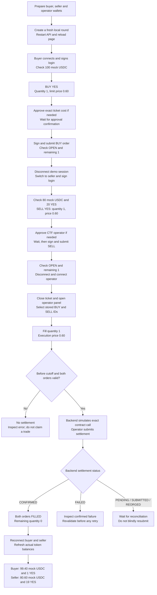
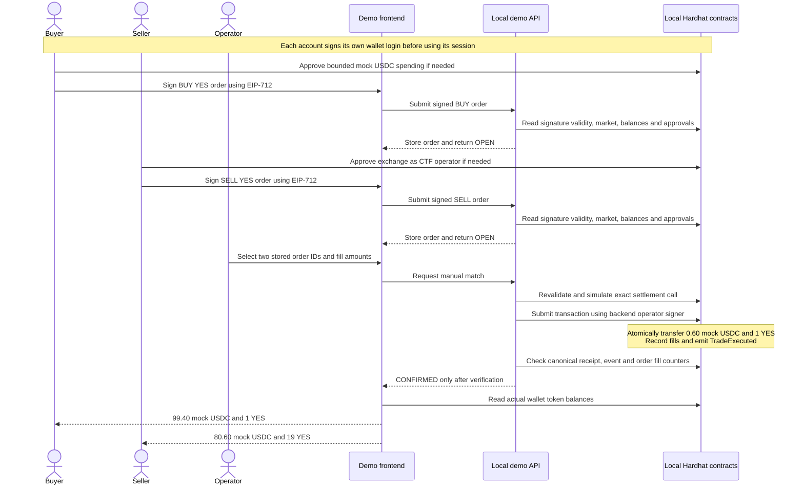

# Local demo: complete trade test

This test checks one trade from the browser to the local blockchain. It uses mock USDC and existing YES inventory. It does not test live Bitcoin prices, winner resolution or redemption.

## Prepare before starting the timer

- Use Node.js 22 and the matching-contract worktree.
- Import the buyer, seller and operator local test accounts before creating the round. Use only local test keys, never real funds.
- Select Hardhat Local, chain 31337, with RPC `http://127.0.0.1:8545`.
- Keep the local chain and frontend running. Open `http://127.0.0.1:5173/local-demo/bitcoin`.
- Follow [the startup and recovery guide](LOCAL_BITCOIN_UI.md) to stop the demo API, archive its journal, create a fresh round and restart the API. Never reset the chain in the middle of this test.

The configured public addresses are in `contracts/deployments/local-bitcoin-demo.json`. BUY/SELL describes the trade direction; YES/NO describes the outcome token. In this test both users trade YES.

## Browser test diagram

Use one BUY and one SELL order for this test. Signing twice creates separate orders when the nonces differ. Cancel unwanted orders rather than assuming they replace each other. All submission and settlement steps must finish before the five-minute cutoff.

When using one browser profile, disconnect the demo session before changing wallet accounts, then reconnect and sign the new login. Tabs in that profile share the same demo cookie. Separate browser profiles can keep separate sessions.

## What each part does

The API keeps signed orders in its local journal, not in the production database. The browser never receives the backend operator's signing credentials. A signed order alone moves no tokens. Approvals are separate on-chain transactions, and the final settlement transfers both assets atomically.

The seller's ERC-1155 operator approval covers all its positions in this CTF contract. It is broader than the buyer's bounded ERC-20 allowance. Use the local test accounts and revoke the operator approval when no longer needed.

## Pass checklist

| Check | Expected result |
| --- | --- |
| Buyer login | Correct buyer address and 100 mock USDC after fresh setup |
| Seller login | Correct seller address, 80 mock USDC, 20 YES and 20 NO |
| Submitted orders | One BUY and one SELL, same YES token ID, each remaining 1 |
| Operator access | Configured authenticated operator has the on-chain role |
| Settlement | Backend reports CONFIRMED with a transaction hash |
| Orders after settlement | Both FILLED, remaining 0 |
| Buyer after settlement | 99.40 mock USDC, 1 YES, 0 NO |
| Seller after settlement | 80.60 mock USDC, 19 YES, 20 NO |
| Payment conservation | Buyer pays exactly 0.60; seller receives exactly 0.60 mock USDC |
| Position conservation | Buyer gains exactly the 1 YES token the seller gives up |

These balance expectations assume a fresh setup and exactly one successful fill at 0.60. Local ETH pays transaction gas separately and is not included in this table. MetaMask's fiat portfolio total is not the mock USDC balance; check the demo's contract-read balances.

Keep the round ID, both order IDs, settlement transaction hash and before/after balances as test evidence. Never include private keys or recovery phrases.

## Failure checks

Run each check with valid setup and enough time left. For a failed match, confirm that there is no successful TradeExecuted event and no fill-counter or asset-balance change caused by that attempt. A reverted transaction can still consume local ETH gas.

| Test | Expected result |
| --- | --- |
| Cancel an order, then attempt to match it | Rejected; no settlement of the cancelled order |
| BUY limit 0.55 against SELL limit 0.60 | Rejected; no acceptable execution price |
| Attempt settlement at or after cutoff | Rejected |
| Use buyer session to request matching | Rejected; operator authorization required |
| Reuse a fully filled order | Rejected; cannot overfill |
| Remove the required allowance or approval | Rejected; no partial asset transfer |

## Current test status and scope

The buyer's browser login, mock balance, signing, order storage, cancellation and expiry have been observed. The complete buyer-to-seller browser settlement remains pending until every pass check above is recorded. Passing automated tests is separate evidence and does not mark this manual test complete.

BTC opening and closing fixtures are currently missing. The chart can remain empty throughout this trade test. After settlement is verified, separate work is still needed for price evidence, authorized resolution and redemption of winning positions.
