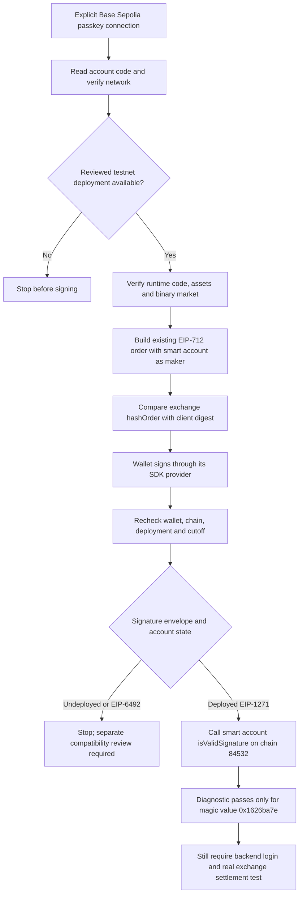

# Coinbase Smart Wallet integration

Stage 4.3G note: this is the historical connection-probe report. Current account
linking, CI status and dependency findings are documented in GITHUB_CI_READINESS.md
and DEPENDENCY_SECURITY_REVIEW.md. The root audit is now 17 entries after targeted
fixes. The later linking build can emit an unused SDK WASM asset even while the
feature is disabled; the older probe-only build statement below is not a claim
about the current whole application. Real Coinbase ownership proof remains pending.

Stage 4.3A, reviewed 16 November 2026. Branch: `feature/matching-contract-mvp`.

## Status and priorities

This is the beginning of the full wallet integration, not a replacement simulation. **Stage 4.3A has not met its real-wallet success criterion yet.** No actual Coinbase passkey connection, KhmerFP signature or Coinbase-backed settlement has been observed by this implementation run.

Work is ordered as follows:

| Priority | Work | Status |
| --- | --- | --- |
| 1 | Inspect existing wallet, order, contract and database boundaries | Reviewed |
| 2 | Select official SDK and inspect network/signature behavior | Reviewed; dependency findings remain open |
| 3 | Build an isolated connection and signature-verification probe | Implemented; real passkey interaction pending |
| 4 | Verify actual wallet signing against a reviewed exchange deployment | Blocked by missing approved testnet deployment and real wallet interaction |
| 5 | Connect the verified adapter to the existing Bitcoin ticket | Deliberately gated on priority 4 |
| 6 | Verify backend login, approvals, cancellation and complete settlement | Pending real integration; existing fallback preserved |

No contract, database migration, payment path or normal authentication behavior was changed. No public transaction was submitted. The local MetaMask/EIP-1193 fallback remains available at `/local-demo/bitcoin`.

## SDK choice

Use **`@base-org/account`, pinned to `2.6.0`**, through its EIP-1193 provider. The package reports Node.js >=20; run KhmerFP on its supported Node.js 22.

Coinbase's current [Wallet SDK overview](https://docs.cdp.coinbase.com/coinbase-wallet/overview) recommends this package while its next SDK generation is being prepared. The [official web quickstart](https://docs.cdp.coinbase.com/coinbase-wallet/quickstart/web) shows `createBaseAccountSDK().getProvider()`. `@coinbase/wallet-sdk` 4.4.0 was inspected as an alternative, but is not installed.

SDK package provenance: `https://github.com/base/account-sdk`. npm tarball integrity for 2.6.0:

```text
sha512-bLI815ZcE+YNEbbAMA5mb+yT6gQjl4AvfrH8h3numQjdcbPkRmrqCRKJHhVinBdMwxGHAwbEm5QuMDW8bP3LCg==
```

Keep ethers 6.15.0 for existing contracts, typed-data construction and reads. Adding Wagmi and another React provider is unnecessary for this isolated proof. The Coinbase SDK includes viem internally; application code does not import it as an undeclared direct dependency.

The probe uses the universal account, manual subaccount creation/funding settings, no spend permissions and disabled optional SDK telemetry. It does not override the wallet popup URL, supply a paymaster or use a server-wallet API key. Passkeys stay inside the wallet flow. No seed phrase or private key is requested.

The Coinbase passkey smart wallet is not the Coinbase browser extension or a CDP API-key-controlled server wallet. The SDK may use an injected Coinbase in-app provider; the probe rejects an injected-provider substitution instead of treating it as passkey compatibility evidence.

## Network findings

The installed source `node_modules/@base-org/account/dist/store/chain-clients/utils.js` lists Base Sepolia, Ethereum Sepolia and Optimism Sepolia as default test networks. It does not list 31337 and `getClient(31337)` has no default fallback. These facts are tested against the actual installed SDK, not a mocked provider.

The SDK also accepts chain information from its hosted wallet handshake. Therefore absence from its default list is **not proof that every possible custom deployment is impossible**. Actual Coinbase passkey operation on this project's Hardhat chain remains unverified. We have not claimed it works.

| Environment | Evidence | Decision |
| --- | --- | --- |
| Local Hardhat 31337 | Existing exchange/official CTF tests work with local accounts and a mock EIP-1271 wallet. No default Coinbase SDK client; no configured Coinbase account factory, EntryPoint, bundler or passkey-wallet local service | Preserve as fallback; do not label it Coinbase-compatible |
| Base Sepolia 84532 | Present in the pinned SDK testnet definitions; actual passkey connection pending | Explicit connection-only probe is prepared |
| Base mainnet 8453 | Not allowed by the probe | No real-money or mainnet testing |

Our local node's unlocked EOA accounts are not a Coinbase account-abstraction service. Supplying a custom chain ID alone does not establish factory deployment, bundling, passkey or gas support. The SDK's hosted wallet popup communicates with Coinbase infrastructure; local development does not make that infrastructure local.

## Run the connection probe

Use Node.js 22. From the worktree root, start Vite:

```powershell
npm run dev --workspace client -- --host 127.0.0.1 --port 5173 --strictPort
```

Open `http://127.0.0.1:5173/local-demo/coinbase`.

1. Click **Connect Coinbase passkey wallet on Base Sepolia**. This is an explicit testnet selection; the existing local Bitcoin page does not change networks automatically.
2. Complete the wallet's passkey interaction yourself. This cannot be replaced by a test EOA or an automated mock.
3. The page checks chain 84532 and reads the returned account's code from fixed RPC `https://sepolia.base.org`.
4. Read DEPLOYED or UNDEPLOYED. Neither state by itself proves wallet ownership, backend login or exchange compatibility.
5. Disconnect or change wallet/network to clear probe evidence. The page does not store the signature or create a production session.

The page is development-only on a loopback host and excluded from production builds. It has no transaction-submission, approval, payment, wallet-deployment or automatic-settlement button. No environment variables or credentials are required for this connection-only probe. The public Base Sepolia RPC may rate-limit reads; a failed read must not be shown as a passed check.

## Signing and verification design

`coinbaseCompatibility.js` uses the existing `orderTypes`, `amounts()` and `buildOrder()` definitions. The fields remain maker, tokenId, side, makerAmount, takerAmount, nonce and expiration. No alternate order-validation backend is introduced.

The intended signing path is:



The probe currently sets `COINBASE_POC.deployment` to null. This is intentional. Never fill it with a guessed contract address or sign a domain pointing at a fabricated exchange. Before enabling signing, review a manifest containing chainId 84532; addresses and runtime code hashes for mock collateral, CTF and exchange; a real conditionId; the YES/NO token IDs in order; and the real tradingCutoff. Account funding, balances and approvals must belong to those deployed contracts.

The helper verifies exchange asset bindings, six collateral decimals, two CTF outcome slots, registered token IDs, enabled status, runtime hashes, order digest and cutoff. Rechecking after the passkey dialog prevents an expired or changed context from being displayed as a successful signing proof. Typed amounts remain exact six-decimal integers.

### EIP-1271

`KhmerFPExchange.sol` already delegates signature verification to OpenZeppelin `SignatureChecker.isValidSignatureNow`. For deployed accounts it calls EIP-1271 with the **original KhmerFP order digest** and the wallet signature. The backend's existing `validSignature()` performs the same deployed-wallet distinction on its configured chain.

Coinbase's [official ERC1271 contract](https://github.com/coinbase/smart-wallet/blob/main/src/ERC1271.sol) adds replay-safe account/domain wrapping internally. Do not replace its result with EOA recovery or manually sign an owner hash and assume it is valid. Let the actual SDK produce the signature and let the wallet's own contract validate it. Contract-wallet signatures may become invalid after account-owner changes; revalidation is required at settlement.

Current mock-wallet tests demonstrate the EIP-1271 mechanism, not Coinbase passkeys, Coinbase signature encoding or Coinbase ERC-1155 receiver compatibility. Those are still real-wallet acceptance tests.

### EIP-6492 and undeployed wallets

The probe recognizes the ERC-6492 suffix and stops. It does not decode and execute factory calldata, deploy an account, or strip the wrapper. Undeployed smart accounts cannot use the exchange's current deployed-account path. The backend also lacks a counterfactual verification path.

Recommended first experiment: use a smart account deployed on Base Sepolia through an explicitly approved wallet transaction, then verify the actual returned signature format. Even a deployed account might return a wrapper; observe and report it instead of assuming it is raw EIP-1271 data.

If this requires a change, propose it separately before touching the exchange. Review trusted factories, wallet-address derivation, chain binding, calldata limits, gas limits and verifier behavior. Off-chain counterfactual verification would not by itself make the current on-chain exchange accept undeployed wallets. Do not grant trading access on an unverified counterfactual login.

## What remains before a real testnet trade

The current Express demo intentionally accepts only loopback Hardhat 31337 and a matching local deployment instance. Do not relax those guards or reuse its unlocked operator signer for Base Sepolia. A separate reviewed testnet configuration is required before network-capable backend integration.

1. Resolve SDK dependency findings or approve a constrained research-only experiment; do not call the current dependency set production-ready.
2. Obtain explicit approval for any Base Sepolia contract/account deployment and mock-token funding transaction. This brief's public-deployment restriction remains in force.
3. Verify official CTF, six-decimal mock collateral, latest exchange code, admin/guardian/operator roles and a sufficiently long test window. Do not use real USDC or publicly known Hardhat keys as the testnet operator.
4. Populate and review the public deployment manifest. Inspect all transactions before approval; changing the wallet connection does not authorize contract deployment.
5. Complete actual passkey connection and exact typed-data signing. Record the account, chain, code state, order digest and EIP-1271 result without logging signing secrets.
6. Prove backend personal-sign challenge ownership for the smart account on the same chain. Preserve one-use nonce, expiry, separate session cookie and invalidation on wallet/network/deployment changes. The current diagnostic is not an authenticated trading session.
7. Through the smart wallet, test bounded ERC-20 approval, explicit ERC-1155 operator approval and maker cancellation. Verify user-operation or wallet-call receipt semantics instead of assuming every response is an Ethereum transaction hash.
8. The authenticated configured operator selects stored orders. Preserve backend revalidation, simulation, submission locking and exchange-side signature checks. Confirm canonical receipts, TradeExecuted events, fill counters and actual balances before showing a completed trade.
9. Only after this evidence passes, make Coinbase primary in the existing Bitcoin UI. Keep the local injected-wallet fallback as a development option until then.

Wallet transactions need test ETH or a reviewed paymaster arrangement. Passkey connection and order signing do not imply gas sponsorship. A smart wallet may deploy on its first user operation and use a bundler; the browser must not confuse a user-operation/call-bundle ID with a confirmed transaction. No bundler, paymaster or sponsorship account has been configured here.

## Database and custody boundary

The existing `user_wallets` design has `SMART_ACCOUNT`, chain/address identity, provider metadata and ownership-verification state. `wallet_authorizations` records evidence and scopes; it does not grant on-chain permission. Neither table stores private keys. No database changes are needed merely to test an SDK provider.

Later integration must link the authenticated product user to the actual smart-account maker address and chain. The passkey signer, wallet owner and smart account must not be substituted for one another. A connected SDK address, deployed code or VERIFIED evidence flag alone does not grant unrestricted transfers or prove settlement finality.

## Dependency and security findings

The new SDK added 91 packages during installation. Existing lockfile package versions were compared with HEAD and none changed in place; npm reorganized some transitive package locations. Audit output is a point-in-time finding, not a clean bill of health.

The reviewed root audit reported 22 findings: 12 moderate, 8 high and 2 critical. SDK-related high findings include the `@coinbase/cdp-sdk` / abitype / zod path. Other findings include the existing Vitest/tinypool toolchain, Vite, ethers/ws and payment dependencies. No unrelated major upgrades or `npm audit fix --force` were run. Public deployment and production use remain blocked by dependency review. Browser-only usage does not prove that a vulnerable transitive dependency is unreachable.

The older 2.5.5 metadata was checked: it also depends on `@coinbase/cdp-sdk` through a range. An audit suggestion to downgrade is not accepted as proof of remediation without testing the resolved dependency graph.

Other review points: wrong-chain rejection; fixed public testnet RPC; no automatic mainnet fallback; no arbitrary signing domains; nonce/expiration/cancellation preserved; no new token-spending authority; EIP-6492 rejected; original operator permissions unchanged; no production account linking or fiat integration; no signature logged or persisted by the probe.

## Validation evidence

Separate these evidence levels:

| Level | What it proves | Current evidence |
| --- | --- | --- |
| Adapter unit tests | Network guards, exact digest, encoding/magic checks and rejected counterfactual signatures | Mocked-provider tests; not a real Coinbase connection |
| Screen unit tests | Explicit testnet selection, no injected-wallet substitution, disconnect invalidation and signing gate | Mocked SDK; not passkey evidence |
| Installed SDK checks | Pinned SDK default network list and client fallback behavior | Real SDK modules, no wallet interaction |
| Existing exchange suite | Local settlement and generic EIP-1271 regression behavior | 40 local contract tests passed in this stage |
| Actual Coinbase passkey | Account connection and signing through the hosted wallet | Pending user interaction |
| Actual exchange settlement | Signed smart-wallet orders settle mock collateral/CTF and update balances | Not executed; testnet deployment/configuration missing |

Run `npm test --workspace client` and `npm run lint --workspace client` under Node.js 22. Run contract tests in `contracts/` using `npm test`. Optional backend integration tests reset the disposable Hardhat chain and must be run only when no manual local test is in progress.

Results from this implementation run: 85 frontend tests passed, 40 contract tests passed, and 319 backend tests passed with 15 optional integration tests skipped. Syntax, frontend lint, build and `git diff --check` passed. The probe page and optimized SDK browser module returned HTTP 200. A read-only request to the fixed testnet RPC returned chain `0x14a34`. The final production build contains no Coinbase probe SDK JavaScript or WASM asset. Earlier intermediate builds emitted unused SDK WASM; the development-source import now avoids that output. Real passkey signing and public settlement remain unexecuted.

No real-wallet success claim, public transaction, production database connection, migration, commit or push is part of this stage's current implementation. The next milestone is the actual passkey connection plus a reviewed deployment/signature experiment, not a cosmetic replacement of the Connect button.

## Evidence references

- [Coinbase SDK recommendation](https://docs.cdp.coinbase.com/coinbase-wallet/overview)
- [Official browser setup](https://docs.cdp.coinbase.com/coinbase-wallet/quickstart/web)
- [Base docs migration notice](https://docs.base.org/sdks/migrated-products)
- [Official account SDK repository](https://github.com/base/account-sdk)
- [Coinbase Smart Wallet ERC1271 implementation](https://github.com/coinbase/smart-wallet/blob/main/src/ERC1271.sol)
- [ERC-6492 specification](https://eips.ethereum.org/EIPS/eip-6492)
- Local: `client/src/demo/coinbaseCompatibility.js`, `client/src/demo/CoinbaseWalletProbe.jsx`, `server/src/demo/orderService.js`, `contracts/src/KhmerFPExchange.sol`, and the installed SDK source paths noted above.
