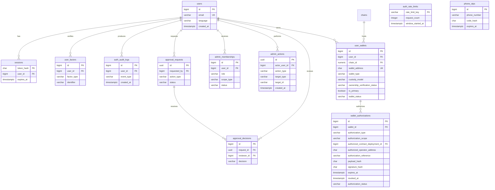
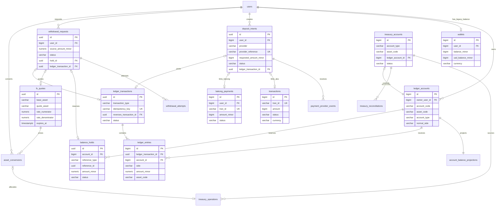
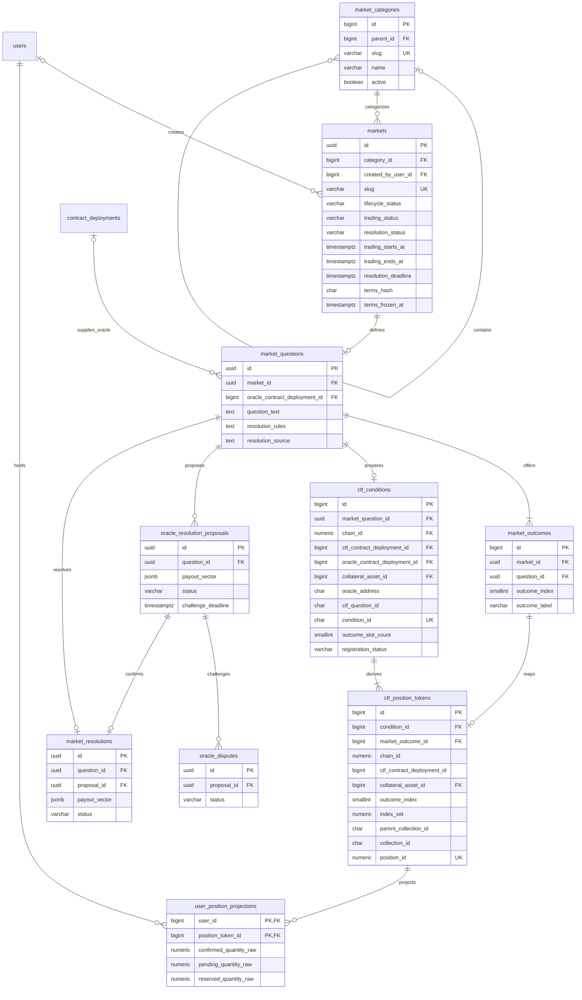
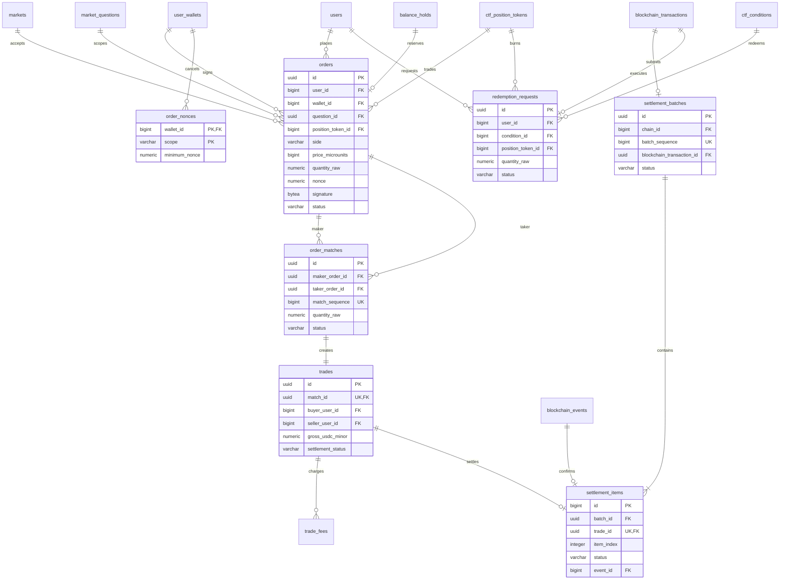
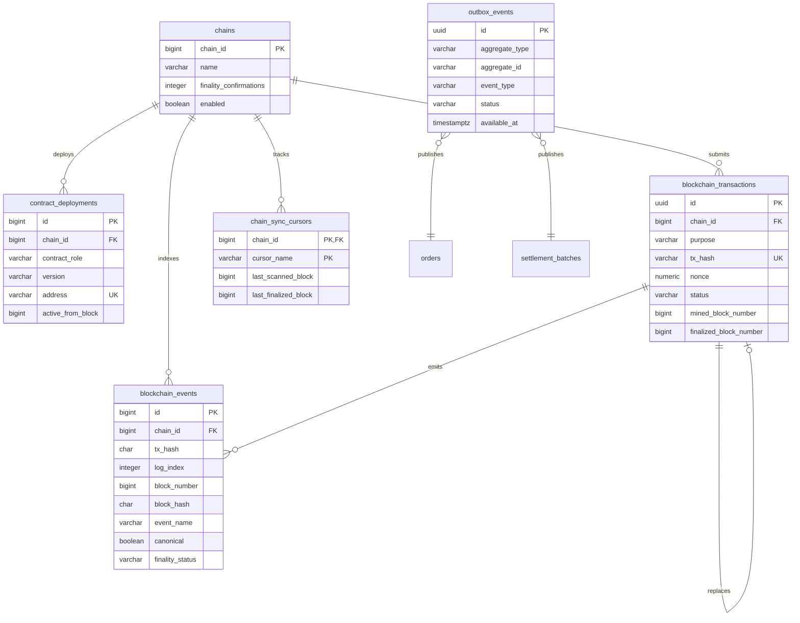

# KhmerFP Blockchain Database ERD

Status: Proposed target model. Wallet identity is implemented by migration `0005`, and the binary CTF registry is implemented by migration `0006`; administration, ownership projections, and trading tables remain planned.

The ERD is divided by domain so each diagram stays readable. Cross-domain links use the same table and key names throughout.

## 1. Identity, wallets, and administration

## 2. Ledger, fiat, FX, and treasury

## 3. Markets, CTF, and oracle

## 4. Orders, trades, and settlement

## 5. Blockchain indexing and workers

## 6. Cross-domain source-of-truth map

| Concern | Authority | PostgreSQL role |
|---|---|---|
| Authentication | PostgreSQL identity/session tables | Primary authority |
| Fiat provider payment | Provider plus verified evidence | Intent, evidence, idempotency, ledger posting |
| User financial liability | Double-entry ledger | Primary accounting authority |
| Open order availability | PostgreSQL orders and holds | Durable authority; Redis is a cache |
| CTF token ownership | Finalized Base state | Indexed projection and reconciliation |
| Market definition | PostgreSQL plus contract identifiers | Product authority |
| Resolution payout vector | Finalized oracle/CTF transaction | Proposal, approvals, evidence, indexed final state |
| Settlement finality | Base canonical chain | Pending/final state and ledger reconciliation |

## 7. Diagram limitations

Mermaid shows logical relationships, not every operational FK. Polymorphic references such as `reference_type/reference_id` cannot use a normal FK and require application validation plus unique idempotency keys. Exact constraint names and deletion behavior must be defined during each implementation milestone.
