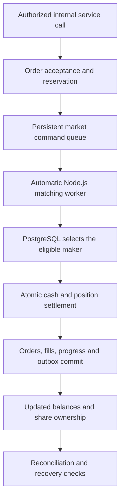
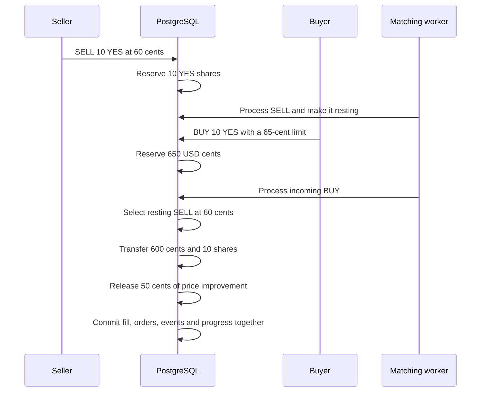
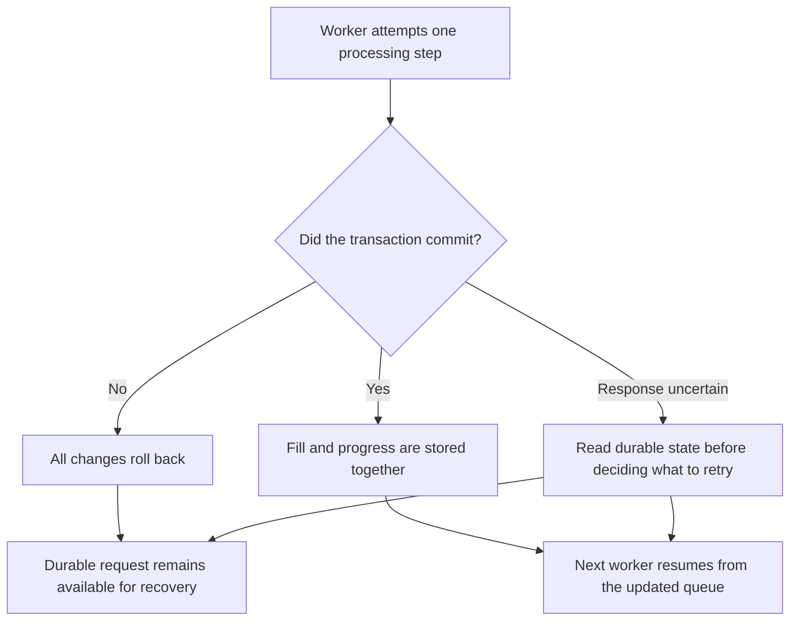

# KhmerFP — Custodial Trading Foundation

### Current implementation and workflow

**Presentation scope:** locally implemented accounting and automatic matching, using mock funds.

**Release status:** production custody is disabled. Real deposits, treasury signing, blockchain backing and withdrawals are not connected to this foundation.

---

## 1. What we are building

A prediction market where users trade with a USD balance while KhmerFP manages the accounting and, eventually, custody operations.

- Each user has a separate cash balance and separate prediction-share ownership.
- Orders reserve cash or shares before they can trade.
- An automatic matching worker selects compatible orders.
- Cash, shares and order records update together.
- Financial history remains available for reconciliation and recovery.

**The accounting and matching foundation exists locally. The complete real-money treasury service is still being built.**

---

## 2. What is implemented today

| Component | Current capability |
|---|---|
| Cash ledger | Exact USD-cent accounting and balanced journals |
| Position ledger | Separate ownership of each registered prediction token |
| Reservations | Hold cash for BUY orders and shares for SELL orders |
| Market registry | Binary, categorical, price-range and distinct recurring-round identities |
| Persistent trading | Orders, fills, events and durable command history |
| Automatic matching | Price-time priority, crossed prices and maker-price execution |
| Atomic settlement | Transfer cash and shares in one database transaction |
| Recovery | Resume durable processing without duplicating fills |
| Reconciliation | Check journals, balances, reservations, orders, fills and outbox records |

The current local database target contains **49 application tables across 17 migrations**. Phase 4.5 is checkpointed locally; Phase 4.6 remains uncommitted.

---

## 3. How the current components fit together



PostgreSQL is the authoritative record. The Node.js worker advances the queue; it does not keep the only copy of orders in memory.

**Public custodial order APIs and the frontend connection remain future integration work.** The existing local blockchain demo is a separate workflow.

---

## 4. What a customer balance means

A cash balance records how much KhmerFP owes the customer. A position records which exact prediction shares belong to that customer.

| Term | Simple meaning |
|---|---|
| Posted balance | Cash or shares already recorded in the ledger |
| Reserved amount | The portion held for an outstanding operation |
| Available amount | Posted balance minus reserved amount |
| Journal | Related accounting entries for one operation |
| Reconciliation | Checking that independent accounting records agree |

Example: a customer has $100 and reserves $6.50 for a BUY order.

| Posted cash | Reserved cash | Available cash |
|---:|---:|---:|
| $100.00 | $6.50 | $93.50 |

The hold prevents the same funds from being spent twice. It is not a completed payment.

---

## 5. Example trade: two customers

**Starting point:** controlled local fixtures give the buyer mock USD and the seller mock shares.

- Buyer: $100 available, wants 10 YES shares, maximum price **65 cents**.
- Seller: owns 10 shares of that exact YES token, offers them at **60 cents**.
- The seller's order is already resting in the book.
- No trading fees apply in the current implementation.



This is **internal ledger settlement**. It does not submit a bank payment or a blockchain transaction.

---

## 6. The result of that trade

| Customer | Cash before | Cash after | YES shares before | YES shares after |
|---|---:|---:|---:|---:|
| Buyer | $100.00 | $94.00 | 0 | 10 |
| Seller | $0.00 | $6.00 | 10 | 0 |
| **Total** | **$100.00** | **$100.00** | **10** | **10** |

- The buyer spends $6.00 rather than the reserved maximum of $6.50.
- The unused $0.50 becomes available again.
- Both orders are fully filled; their remaining reservations are zero.
- Cash and token quantities are conserved by the transfer.
- No additional money or shares are created by matching.

A full share currently uses **1,000,000 token base units**. USD uses **100 cents per dollar**. The implementation uses exact integer arithmetic.

---

## 7. How the engine decides who trades first

| Incoming order | Counterparty selection |
|---|---|
| BUY | Lowest eligible SELL price, then oldest sequence |
| SELL | Highest eligible BUY price, then oldest sequence |

Both execute at the **resting maker's limit price**.

A match is possible when `BUY limit >= SELL limit`. The prices do not need to be equal.

Additional rules:

- Match only the identical canonical token.
- Use persistent sequence numbers for time priority.
- Fill the smaller remaining quantity and continue across makers when possible.
- Keep a valid unmatched remainder open.
- Do not combine YES and NO liquidity or create synthetic shares.

If the next eligible maker belongs to the same user, cancel the incoming remainder and release its unused hold. Earlier valid fills remain committed; the maker is unchanged.

---

## 8. Partial fills remain fully accounted for

**BUY 100 shares at a 64-cent limit → reserve 6,400 cents.**

| Action | Shares filled | Cash spent | Price improvement released |
|---|---:|---:|---:|
| Fill at 60 cents | 30 | 1,800 cents | 120 cents |
| Fill at 63 cents | 50 | 3,150 cents | 50 cents |
| **Completed portion** | **80** | **4,950 cents** | **170 cents** |

The remaining 20 shares keep **1,280 cents** reserved.

`6,400 = 4,950 spent + 170 released + 1,280 still reserved`

This exact example is verified by the disposable PostgreSQL integration tests.

---

## 9. How we protect the accounting

**One fill is one database transaction.** Its cash transfer, share transfer, reservation changes, order updates, fill, events, outbox and command progress succeed together or roll back together.

| Protection | What it prevents |
|---|---|
| Balanced journals per asset/token | Creating value through incomplete accounting entries |
| Immutable posted history | Rewriting completed financial operations |
| Available-balance and reservation checks | Overspending and overselling |
| Actor-bound operation keys | Duplicate processing and cross-user result access |
| Exact order, reservation and token links | Substituting another user's hold or another token |
| Restricted runtime database role | Direct edits to protected balances and history |
| Market status and cutoff checks | Executing outside the permitted trading window |
| Mandatory commit-time validation | Committing inconsistent accounting or trading state |

The backend must still authorize the current user and action. An actor string alone is not authentication. Public order-route authorization is not yet wired into this foundation.

---

## 10. What happens after a failure?



- Restarting the worker does not rely on recovering an in-memory order book.
- A committed fill cannot be repeated merely because its response was lost.
- A failed fill cannot leave only one accounting leg committed.
- Eligible corrections use compensating entries; historical journals are not edited.
- A trade's cash or position leg cannot be reversed independently.

**Recovery evidence:** separate Node workers were killed immediately before and after COMMIT. Restarted processing produced exactly one fill in both cases.

---

## 11. What we have verified locally

| Validation | Result |
|---|---:|
| PostgreSQL trading, accounting and registry tests | 167 passed; zero skips |
| Migration-adoption tests | 8 passed; zero skips |
| Actual process-kill/restart suite | 3 passed; zero skips |
| Wallet PostgreSQL suite | 14 passed; zero skips |
| Unit, domain and SQL-reading tests | 34 passed |
| Frontend regressions | 186 passed |
| Backend regressions | 350 passed; 17 documented skips |
| Contract regressions under Node.js 22 | 46 passed |
| Negative migration-artifact cases | 88 passed |

Catalog, reconciliation, repeated-migration, CTF, Drizzle, lint, syntax, YAML and diff checks also passed locally.

The backend skips include unconfigured fixture-dependent cases and a missing real Coinbase proof. The wallet PostgreSQL suite was run separately. These results do not establish a GitHub CI pass for the unpushed changes.

**Performance boundary:** local matching smoke workloads reconciled with zero engine deadlocks. They are not production capacity evidence. Immediate SQL-step benchmarks exclude the default worker's 250 ms polling delay; history growth and shared-account latency remain production concerns.

---

## 12. Where the treasury work is still pending

The current ledger records obligations and ownership. Real treasury assets must eventually back those records.

| Future connection | What must be added |
|---|---|
| ABA/Bakong → cash ledger | Verified, idempotent payment credits and external reconciliation |
| Fiat → USDC | Approved conversion accounting, funding and liquidity controls |
| Treasury custody | Signing provider, access controls, limits and operating procedures |
| CTF inventory → position ledger | Confirmed custody and event verification before live recognition |
| Market resolution → payout | Authorized results, confirmed redemption and controlled customer cash credits |
| Cash ledger → withdrawals | Holds, verified provider payouts and uncertain-payment recovery |
| User interface → custodial trading | Authenticated order APIs, order status and delivery of committed updates |

USD cents and USDC base units are different accounting units. USDC is currently disabled in the financial asset model; conversion is not implemented.

Mock inventory and `MOCK_ONLY` evidence do not establish real token backing. Registered identifiers or `PREPARED` status alone do not prove blockchain finality.

---

## 13. What we can demonstrate now

A local service/database demonstration can show:

1. Controlled mock cash and share inventory.
2. Persistent BUY and SELL acceptance with the correct holds.
3. Automatic exact-token matching at the resting maker price.
4. Full fills, partial fills and price-improvement release.
5. Self-trade prevention and sequenced cancellation/expiry.
6. Worker restart recovery without duplicate fills.
7. Complete accounting and trading reconciliation.

Run the full disposable PostgreSQL suite from the repository root using **Node.js 22 and Docker**:

```powershell
npx.cmd --yes --package=node@22 node packages/ledger/test/runPostgres.js
```

This creates a fresh, labelled, loopback-only PostgreSQL 16 container and removes its own container after testing. It uses mock funds and does not connect to a hosted database.

**This is an internal service/database demonstration, not a completed browser-based custodial trading journey.**

---

## 14. Next review and delivery steps

1. Review and approve the Phase 4.6 local checkpoint.
2. Connect authenticated backend order APIs and the frontend in a separately approved stage.
3. Complete broader cancellation, expiry and event-delivery recovery.
4. Resolve dependency, performance and operational security blockers.
5. Implement and verify treasury, payment and blockchain connections before any real-money activation.

Current limitations include a paused queue head blocking later cancellation, no general resting-order expiration scheduler, and no activated outbox publisher.

**Presentation takeaway:** KhmerFP now has a locally tested custodial accounting and automatic matching foundation. Real-money treasury operations and the end-to-end customer experience remain separate integration work.

---

## Technical reading links

| Area | Main file |
|---|---|
| Cash accounts, journals and reservations | [schema.js](../../packages/ledger/src/schema.js) |
| Position ownership and atomic settlement records | [positionSchema.js](../../packages/ledger/src/positionSchema.js) |
| Orders, fills and matching queue | [tradingSchema.js](../../packages/ledger/src/tradingSchema.js) |
| Authorized transaction services | [index.js](../../packages/ledger/src/index.js) |
| Background processing | [matchingWorker.js](../../packages/ledger/src/matchingWorker.js) |
| Local validation and privilege requirements | [Ledger README](../../packages/ledger/README.md) |
| Current database relationships | [Implemented ERD](IMPLEMENTED_DATABASE_ERD.md) |
| Readable SQL functions and triggers | [SQL reference](../../packages/db/sql-reference/) |

The implementation remains authoritative. This presentation describes local behavior through migration `0016`; it does not authorize deployment, production migration or custody activation.
