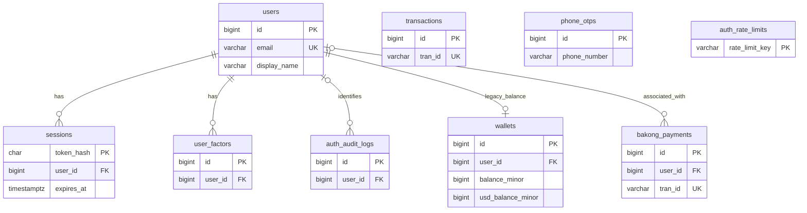
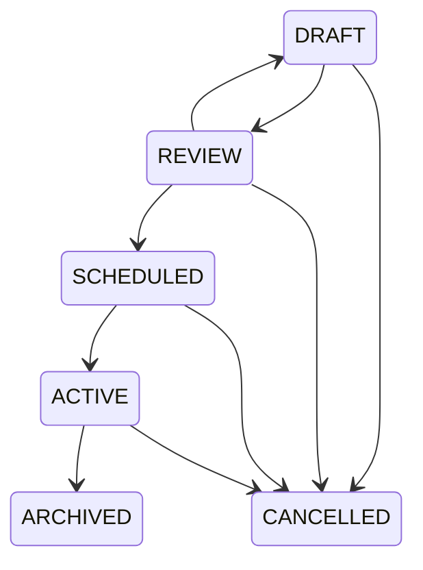
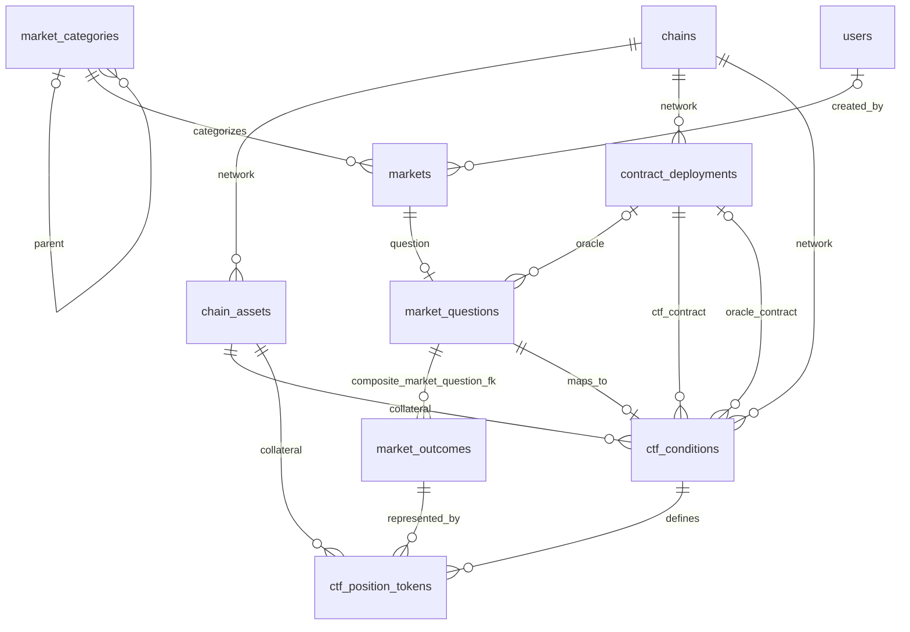
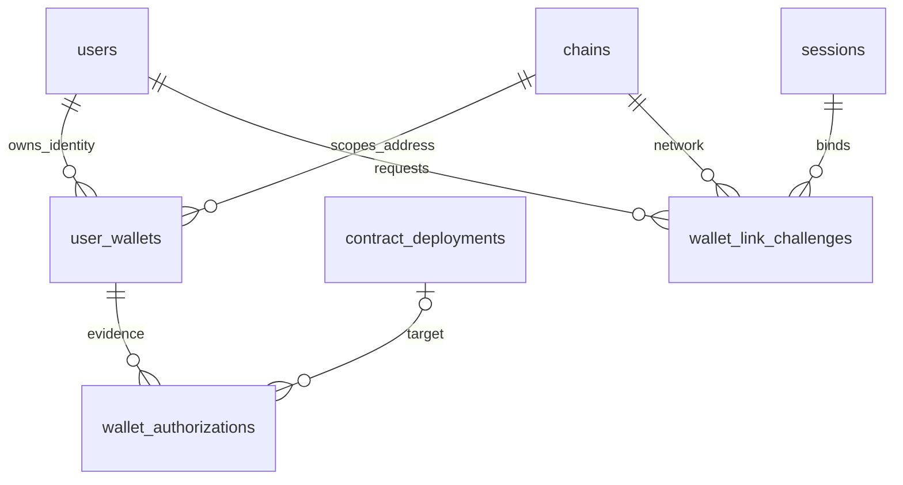
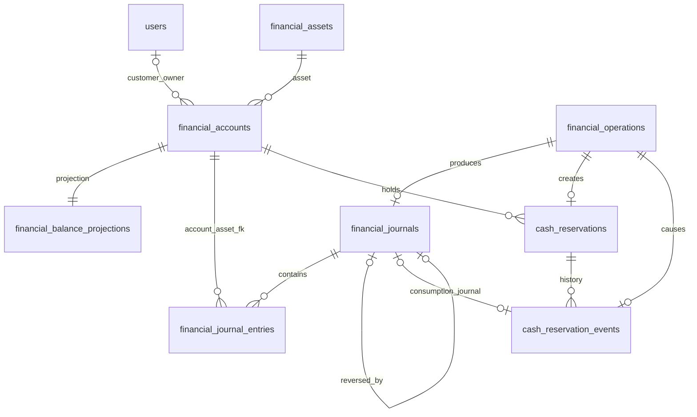
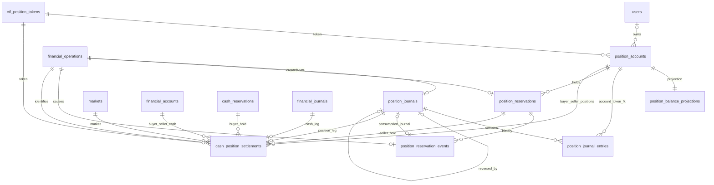
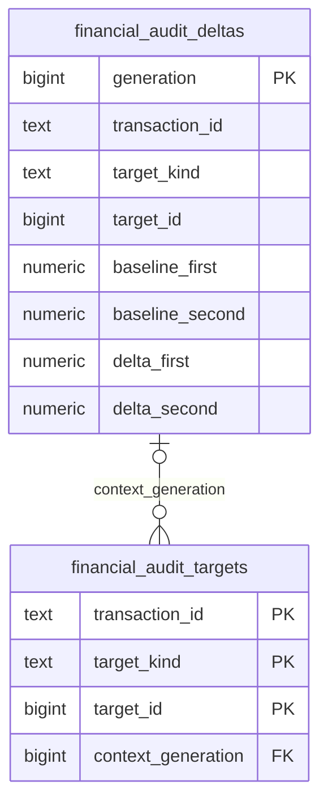
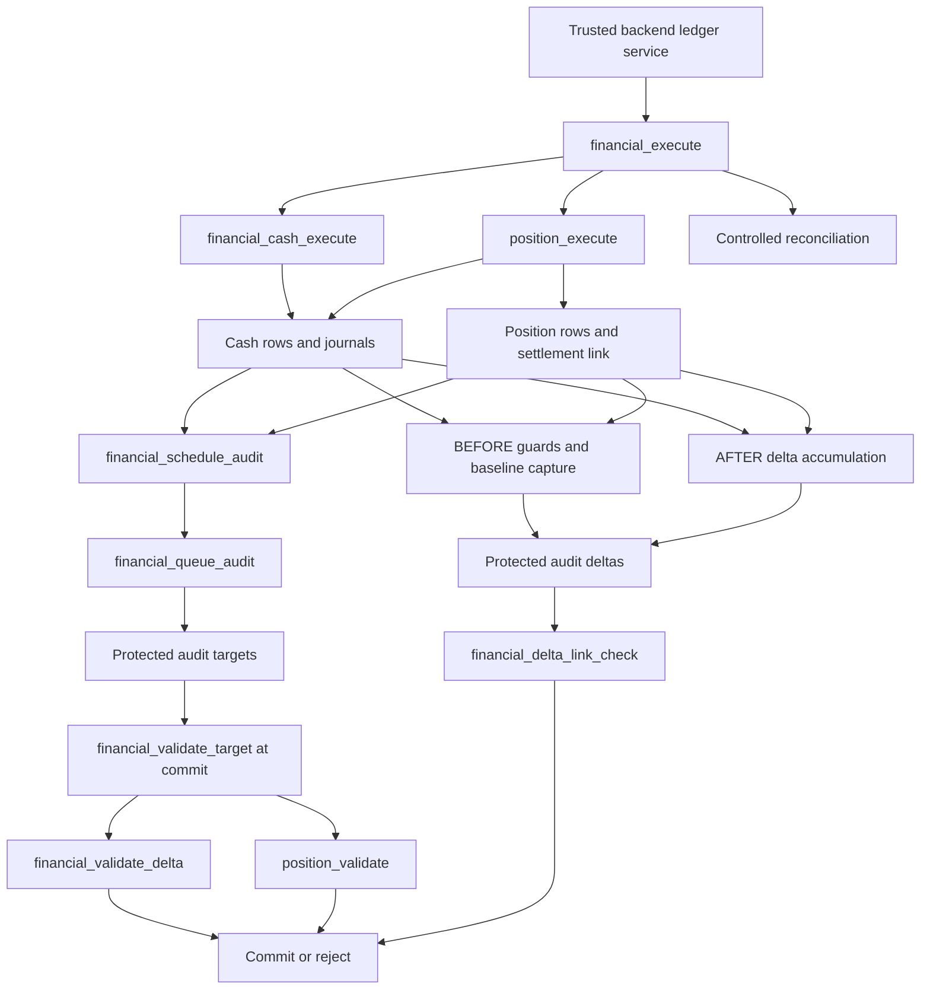
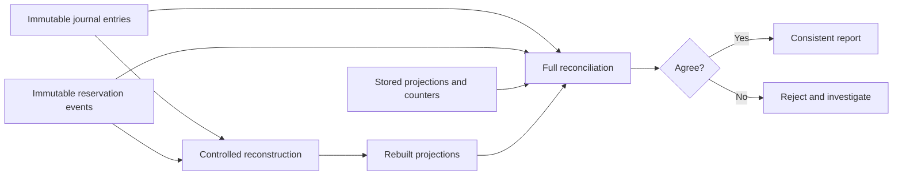

# KhmerFP database architecture walkthrough

This guide explains the database represented by the SQL reading copies through migration `0012`. It is a learning reference, not a migration or an instruction to enable production custody.

Sources:

- [SQL reading copies](../../packages/db/sql-reference/)
- [Ledger README](../../packages/ledger/README.md)

The architecture has three layers:

1. Existing application records: users, sessions, legacy balances and payments.
2. Market and blockchain references: markets, YES/NO outcomes, networks, contracts and CTF token identities.
3. Custodial accounting: cash, share ownership, reservations, immutable history and atomic accounting settlement.

**Database settlement does not itself transfer bank money or blockchain tokens.** A row also does not prove that custodial assets exist on-chain.

## 1. Reading map

The reading copies describe 38 tables, 27 named application functions and 58 active triggers after the complete migration chain. Later migrations replace some earlier function definitions and trigger bindings; those historical versions must not be treated as separate current implementations.

| Copy | Main responsibility |
| --- | --- |
| `0000_fat_shen.sql` | Users, authentication, legacy wallets and payment transactions |
| `0001_powerful_katie_power.sql` | USD cents on legacy wallets |
| `0002_bouncy_glorian.sql` | Bakong payments and legacy amount-filling compatibility |
| `0003_tidy_ricochet.sql` | Chains, assets and contract deployments |
| `0004_giant_trish_tilby.sql` | Categories, markets, questions and binary outcomes |
| `0005_mysterious_mojo.sql` | Wallet identities and authorization evidence |
| `0006_dapper_nova.sql` | CTF conditions and position-token registry |
| `0007_protect_ctf_reference_identity.sql` | Protection of referenced blockchain identities |
| `0008_wallet_link_challenges.sql` | Durable ownership challenges |
| `0009_financial_ledger.sql` | Cash accounting foundation |
| `0010_targeted_financial_audits.sql` | Deduplicated deferred audits and reconciliation |
| `0011_position_accounting.sql` | Position accounting and atomic cash/share settlement |
| `0012_incremental_financial_validation.sql` | Protected baselines and incremental commit validation |

`proposal_wallet_link_challenges.sql` is an archived proposal. It is not an additional migration or table. Never execute reading copies or point Drizzle at their directory.

## 2. Basic concepts

| Term | Meaning and example |
| --- | --- |
| Primary key, PK | Unique row identity, such as a user ID |
| Foreign key, FK | Reference to an existing row, such as an account's owner |
| Unique constraint | Prevents duplicates, such as two operations with the same key |
| Check constraint | Rejects invalid values, such as a negative reservation amount |
| Index | Helps locate records efficiently |
| Partial index | Includes only matching records, such as active primary wallets |
| Journal | One complete accounting posting |
| Entry | One debit, credit, incoming or outgoing line |
| Projection | Stored current balance derived from history |
| Reservation | Held funds or shares; not yet a transfer |
| Trigger | Function PostgreSQL runs automatically when data changes |
| Deferred check | Validation normally performed at transaction commit |
| Atomic transaction | All changes commit together, or all roll back |
| Idempotency key | Identifier allowing a request to be retried without executing twice |

### Common column and type conventions

- `id` is generally an automatically generated `BIGINT` primary key. Exceptions are identified below.
- `created_at` records creation; `updated_at` stores the last update time. A default alone does not refresh `updated_at` automatically.
- `TIMESTAMPTZ` represents an absolute timestamp.
- `JSONB` stores structured evidence or canonical request terms.
- `INET` stores an IP address.
- `CHAR(42)` represents an Ethereum-style address, including `0x`.
- `CHAR(66)` represents a hexadecimal 32-byte value, including `0x`.
- `NUMERIC(78,0)` stores large exact blockchain integers.
- `BIGINT` stores exact integers. JavaScript must not convert large values through unsafe `Number` arithmetic.
- Nullable references mean a relationship is optional. Null does not mean verified or authorized.

The table sections below list every column. Common timestamps and IDs retain the meanings above.

## 3. Users, authentication and existing payments

### 3.1 `users`

Purpose: identify a KhmerFP application user.

| Column | Purpose |
| --- | --- |
| `id` | Internal PK |
| `google_sub` | Optional unique Google identity |
| `email` | Required, uniquely indexed email |
| `display_name` | Displayed name |
| `avatar_url` | Optional profile image |
| `language` | Interface language: `en` or `km` |
| `last_login_at` | Most recent recorded login |
| `last_login_ip` | Most recent recorded login IP |
| `last_login_user_agent` | Most recent browser/device description |
| `created_at` | Creation time |
| `updated_at` | Update time |
| `password_hash` | Optional password hash |
| `facebook_sub` | Optional unique Facebook identity |
| `telegram_sub` | Optional unique Telegram identity |
| `phone_number` | Optional unique phone identity |
| `phone_verified_at` | Phone verification time |

Optional Facebook, Telegram and phone identifiers use partial unique indexes when present. A user can own accounting accounts and external wallet identities; these are separate relationships.

### 3.2 `sessions`

Purpose: persist authenticated application sessions.

| Column | Purpose |
| --- | --- |
| `token_hash` | `CHAR(64)` PK; hashed session token |
| `user_id` | FK to user |
| `created_at` | Session creation |
| `last_seen_at` | Last activity |
| `idle_expires_at` | Inactivity deadline |
| `expires_at` | Absolute expiry |
| `revoked_at` | Explicit revocation time |
| `step_up_at` | Recent stronger-authentication time |
| `ip_address` | Source IP |
| `user_agent` | Browser/device |

Idle expiry cannot exceed absolute expiry. The active-session index excludes revoked rows; the backend still checks current time.

### 3.3 `user_factors`

Purpose: record additional authentication factors.

- `id`: PK.
- `user_id`: FK to user.
- `factor_type`: supported factor, such as Telegram or SMS.
- `identifier`: factor identity.
- `verified_at`: optional verification time.
- `created_at`: creation time.

User/type/identifier is unique.

### 3.4 `phone_otps`

Purpose: store phone-code verification attempts.

- `id`: PK.
- `phone_number`: destination; not a user FK.
- `code_hash`: hash of the code, not its plaintext.
- `attempts`: nonnegative attempt count.
- `consumed_at`: successful one-time use.
- `expires_at`: expiry.
- `ip_address`: requesting IP.
- `created_at`: creation time.

The phone/recent-creation index supports lookup before a phone is attached to a user.

### 3.5 `auth_rate_limits`

Purpose: persist throttling counters.

- `rate_limit_key`: text PK identifying the limited source/action.
- `window_started_at`: counting-window start.
- `request_count`: nonnegative count.
- `blocked_until`: optional temporary block.
- `updated_at`: last counter update.

### 3.6 `auth_audit_logs`

Purpose: preserve authentication event records.

- `id`: PK.
- `user_id`: optional FK; becomes null if the user is deleted.
- `event_type`: event category.
- `ip_address`: source IP.
- `user_agent`: browser/device.
- `details`: structured event details.
- `created_at`: event time.

Indexes support recent events by user and by event type.

### 3.7 `wallets`

Purpose: retain existing application balances.

- `id`: PK.
- `user_id`: unique FK to user.
- `balance_minor`: nonnegative whole-KHR balance.
- `currency`: legacy label fixed to `KHR`.
- `created_at`: creation time.
- `updated_at`: update time.
- `usd_balance_minor`: nonnegative USD cents, added by `0001`.

This table is not the new financial ledger. Its balances are not automatically ledger opening balances.

### 3.8 `transactions`

Purpose: retain existing payment-provider transaction records.

- `id`: PK, identity generated by default.
- `tran_id`: unique transaction reference.
- `name`: transaction/customer name.
- `account_number`: provider account reference.
- `amount`: positive whole-KHR amount.
- `currency`: `KHR`.
- `status`: `PENDING`, `PAID`, `FAILED` or `CANCELLED`.
- `payway_response_code`: optional provider response.
- `paid_at`: payment-confirmation time.
- `verification_evidence`: structured evidence.
- `status_access_token_hash`: optional hash protecting status access.
- `created_at`: creation time.
- `updated_at`: update time.

There is no user FK or new-ledger FK. A name or account number is not an authenticated ownership relationship.

### 3.9 `bakong_payments`

Purpose: store Bakong payment requests, QR data and verification state.

- `id`: PK, identity generated by default.
- `user_id`: optional user FK; becomes null on user deletion.
- `tran_id`: unique payment reference.
- `md5`: unique QR/payment lookup identifier; not payment proof.
- `qr_string`: QR payload.
- `name`: payment name.
- `description`: optional description.
- `amount`: positive provider-facing `NUMERIC(14,2)` amount.
- `amount_minor`: positive integer minor units.
- `currency`: `USD` or `KHR`.
- `status`: `PENDING`, `PAID`, `EXPIRED` or `FAILED`.
- `status_access_token_hash`: optional status-access hash.
- `idempotency_key`: optional duplicate-request key.
- `expires_at`: request expiry.
- `paid_at`: confirmation time.
- `wallet_credited_at`: legacy wallet-credit marker.
- `provider_evidence`: structured provider evidence.
- `created_at`: creation time.
- `updated_at`: update time.

The partial unique user/idempotency index prevents duplicate keyed requests. Other indexes support status/expiry and user/status lookup. `wallet_credited_at` is not a new-ledger posting reference.

### Authentication and legacy-payment ERD



The isolated tables intentionally have no invented relationships.

## 4. Blockchain references, markets and CTF identities

### 4.1 `chains`

Purpose: identify supported blockchain networks.

- `id`: internal PK.
- `chain_id`: unique actual network number, such as `84532`.
- `name`: network name.
- `environment`: `testnet` or `mainnet`.
- `native_symbol`: gas-token symbol.
- `rpc_config_reference`: optional configuration reference, not a wallet secret.
- `enabled`: operational enablement; defaults false.
- `created_at`: creation time.
- `updated_at`: update time.

Name/environment is unique. Network FKs generally reference `chains.chain_id`, not `chains.id`.

### 4.2 `chain_assets`

Purpose: register token contracts.

- `id`: PK.
- `chain_id`: FK to network number.
- `contract_address`: normalized token address.
- `symbol`: token symbol.
- `name`: token name.
- `decimals`: precision, bounded from 0 to 255.
- `asset_type`: `ERC20` or `ERC1155`.
- `enabled`: defaults false.
- `created_at`: creation time.
- `updated_at`: update time.

Chain/address is unique. Chain/enabled is indexed.

### 4.3 `contract_deployments`

Purpose: register deployment identities and their roles.

- `id`: PK.
- `chain_id`: FK to network.
- `contract_address`: optional for planned deployments.
- `contract_role`: contract responsibility.
- `contract_version`: nonblank version.
- `deployment_tx_hash`: optional deployment transaction.
- `deployment_block_number`: optional nonnegative block.
- `deployment_status`: `PLANNED`, `PENDING`, `CONFIRMED`, `FAILED` or `RETIRED`.
- `created_at`: creation time.
- `updated_at`: update time.

Status must agree with deployment evidence. Planned records have no deployment metadata; pending records have a transaction but no confirmed block; confirmed/retired records require complete metadata.

Unique rules protect chain/role/version, present chain/address, present chain/transaction and one confirmed deployment per chain/role. Status/chain is indexed. A recorded confirmation still requires an independent chain-verification process.

### 4.4 `market_categories`

Purpose: group markets and subcategories.

- `id`: PK.
- `parent_id`: optional self-FK.
- `name`: display name.
- `slug`: unique URL identifier.
- `description`: optional explanation.
- `active`: selectable status.
- `created_at`: creation time.
- `updated_at`: update time.

A category cannot directly parent itself. That alone does not prevent every possible multi-row cycle. Parent/active is indexed.

### 4.5 `markets`

Purpose: identify a market and protect its trading terms.

- `id`: UUID PK.
- `category_id`: category FK.
- `created_by_user_id`: optional creator FK; may become null on deletion.
- `slug`: unique URL identifier.
- `title`: short title.
- `description`: nonblank description.
- `lifecycle_status`: overall stage.
- `trading_status`: trading availability.
- `resolution_status`: result state.
- `trading_starts_at`: opening time.
- `trading_ends_at`: cutoff, after opening.
- `resolution_deadline`: not before cutoff.
- `terms_hash`: optional frozen-terms fingerprint.
- `terms_frozen_at`: matching freeze timestamp.
- `created_at`: creation time.
- `updated_at`: update time.

Lifecycle transitions:



Trading permits `NOT_STARTED → OPEN`, pausing and resuming open trading, and allowed transitions to terminal `CLOSED`. Resolution permits `UNRESOLVED → PENDING → RESOLVED`, with allowed invalidation transitions.

Open trading requires an active market. Cancelled markets must be closed. Archived markets require closed trading and a terminal result. Frozen hash/time appear together. Indexes cover category/lifecycle, trading/cutoff and resolution/deadline.

### 4.6 `market_questions`

Purpose: preserve the exact question and resolution terms.

- `id`: UUID PK.
- `market_id`: unique FK; one question per market.
- `oracle_contract_deployment_id`: optional deployment FK.
- `question_text`: exact question.
- `resolution_rules`: decision rules.
- `resolution_source`: accepted evidence source.
- `created_at`: creation time.
- `updated_at`: update time.

The unique market/question-ID pair is a composite reference target for outcomes.

### 4.7 `market_outcomes`

Purpose: define binary answers.

- `id`: PK.
- `market_id`: market component of composite FK.
- `question_id`: question component of composite FK.
- `outcome_index`: 0 or 1.
- `outcome_label`: `YES` for 0; `NO` for 1.
- `created_at`: creation time.
- `updated_at`: update time.

Question/index and question/label are unique. The composite FK ensures the question belongs to that market. The freeze trigger requires both rows; an individual row CHECK cannot enforce the existence of exactly two rows.

### 4.8 `ctf_conditions`

Purpose: map an application question to Gnosis Conditional Tokens Framework, or CTF.

- `id`: internal PK.
- `market_question_id`: unique question FK.
- `chain_id`: network FK.
- `ctf_contract_deployment_id`: CTF deployment FK.
- `oracle_contract_deployment_id`: optional oracle deployment FK.
- `oracle_address`: exact oracle identity.
- `ctf_question_id`: blockchain question identifier.
- `condition_id`: blockchain condition identifier, not this table's PK.
- `outcome_slot_count`: exactly two.
- `collateral_asset_id`: collateral FK.
- `registration_status`: `DERIVED`, `SUBMITTED`, `PREPARED` or `FAILED`.
- `preparation_tx_hash`: transaction evidence.
- `preparation_block_number`: block evidence.
- `created_at`: creation time.
- `updated_at`: update time.

Condition identity is unique within chain/CTF deployment. The trigger checks confirmed deployment role, chain, ERC20 collateral and question/oracle relationships.

New rows begin `DERIVED`. Permitted progress is to `SUBMITTED`, then `PREPARED`, with failure and retry paths. Status and evidence must agree. `PREPARED` does not independently establish on-chain finality.

### 4.9 `ctf_position_tokens`

Purpose: register exact YES/NO token identities.

- `id`: internal PK.
- `condition_id`: FK to internal `ctf_conditions.id`.
- `market_outcome_id`: outcome FK.
- `chain_id`: copied identity checked against the condition.
- `ctf_contract_deployment_id`: copied deployment checked against the condition.
- `collateral_asset_id`: collateral FK.
- `outcome_index`: binary index.
- `index_set`: binary CTF partition, 1 or 2.
- `parent_collection_id`: root collection, zero in this design.
- `collection_id`: CTF collection identity.
- `position_id`: actual large ERC-1155 token identifier.
- `created_at`: creation time.
- `updated_at`: update time.

Unique constraints prevent repeated condition/outcome, index, index set and collection combinations, and duplicate position IDs within chain/deployment. Triggers check copied relationships and immutable identity. These SQL routines do not cryptographically derive Gnosis collection IDs.

### Market and CTF ERD



Copied chain/deployment fields on token rows are trigger-checked; no independent FKs are invented in this diagram.

## 5. External wallet identities and ownership linking

### 5.1 `user_wallets`

Purpose: associate a blockchain address with a KhmerFP user.

- `id`: PK.
- `user_id`: user FK.
- `chain_id`: network FK.
- `wallet_address`: normalized address.
- `wallet_type`: `EOA` or `SMART_ACCOUNT`.
- `custody_model`: `USER_CONTROLLED` or `HYBRID_RESTRICTED`.
- `wallet_provider`: optional provider name.
- `provider_external_reference`: optional paired provider identity.
- `ownership_verification_status`: `UNVERIFIED`, `PENDING`, `VERIFIED` or `REJECTED`.
- `ownership_verified_at`: verification time.
- `is_primary`: primary-wallet flag.
- `wallet_status`: `PENDING`, `ACTIVE`, `SUSPENDED` or `REVOKED`.
- `created_at`: creation time.
- `updated_at`: update time.

Chain/address is unique across users. One active primary wallet is allowed per user/chain. Active requires verified ownership, and primary requires active status. User, chain and address are immutable.

### 5.2 `wallet_authorizations`

Purpose: record evidence of bounded wallet authorization.

- `id`: PK.
- `wallet_id`: wallet FK.
- `authorization_type`: EIP-712 signature, on-chain approval or session-policy evidence.
- `authorization_scope`: order signing, settlement, CTF operations or redemption.
- `authorized_contract_deployment_id`: optional deployment target FK.
- `authorized_operator_address`: alternative address target.
- `eip712_domain_name`: signing domain name.
- `eip712_domain_version`: signing domain version.
- `authorization_reference`: business/evidence identifier, unique per wallet.
- `authorization_nonce`: optional nonnegative nonce.
- `payload_hash`: authorized-terms hash.
- `signature_hash`: signature-evidence hash.
- `valid_from`: validity start.
- `expires_at`: validity end.
- `revoked_at`: revocation time.
- `authorization_status`: `PENDING`, `VERIFIED`, `REVOKED` or `EXPIRED`.
- `created_at`: creation time.
- `updated_at`: update time.

Exactly one target form is allowed. Deployment targets must match the wallet's chain. Terms are immutable; state changes are restricted. Partial unique indexes prevent duplicate verified wallet/type/scope/target combinations.

`VERIFIED` means verified evidence, not an automatically granted on-chain permission. Expiry also requires time-aware application checks; a partial index does not run a clock.

### 5.3 `wallet_link_challenges`

Purpose: store durable, single-use link/unlink/relink challenges.

- `id`: supplied UUID PK.
- `user_id`: user FK.
- `session_hash`: FK to the exact session token hash.
- `chain_id`: network FK.
- `wallet_address`: intended wallet.
- `action`: `LINK`, `UNLINK` or `RELINK`.
- `app_origin`: intended application origin.
- `nonce`: unique challenge value.
- `typed_data`: exact EIP-712 payload.
- `payload_hash`: payload fingerprint.
- `created_at`: actual clock time at creation.
- `expires_at`: expiry, at most two minutes after creation.
- `consumed_at`: one-time consumption.

Typed data must match the stored challenge terms. The trigger requires a matching active session, immutable terms and valid one-time consumption. PostgreSQL does not verify an EOA or EIP-1271 signature here; the backend performs that verification.



Position accounts do not reference `user_wallets`. Custodial ownership is recorded against a user and token, not automatically against an external address.

## 6. Cash accounting tables

### 6.1 `financial_assets`

Purpose: define accounting units.

- `code`: text PK, `USD` or `USDC`.
- `decimals`: USD has 2; USDC has 6.
- `enabled`: USD is enabled; USDC is disabled in this foundation.

One USD dollar is 100 cents. It is not interchangeable with 100 USDC base units. Asset definitions are immutable.

### 6.2 `financial_accounts`

Purpose: identify the owner and accounting classification of money.

- `id`: PK.
- `asset`: asset FK.
- `owner_user_id`: optional user FK.
- `account_key`: unique application identity.
- `kind`: `CUSTOMER`, `ASSET`, `EQUITY`, `REVENUE`, `EXPENSE` or `CLEARING`.
- `normal_side`: `DEBIT` or `CREDIT`; determines which entry direction increases the balance.
- `created_at`: creation time.

Customer accounts require a user and are credit-normal liabilities: a credit increases what KhmerFP owes the customer. System accounts have no user owner. Customer/asset and account-ID/asset combinations are unique.

### 6.3 `financial_operations`

Purpose: bind an authorized canonical request to its retry-safe result.

- `id`: PK.
- `operation_key`: unique idempotency key.
- `actor`: authorized actor identity.
- `action`: requested operation.
- `terms`: canonical request details.
- `request_hash`: request fingerprint.
- `result`: completed result, initially absent while assembling the transaction.
- `created_at`: creation time.

Reusing a key with another actor, action or terms fails. Posting business references are independently unique.

### 6.4 `financial_journals`

Purpose: group one complete cash posting.

- `id`: PK.
- `operation_id`: unique operation FK.
- `status`: `DRAFT` or `POSTED`.
- `reversal_of`: optional unique self-FK to the original journal.
- `created_at`: creation time.

A posted journal cannot be edited. Reversal creates another journal.

### 6.5 `financial_journal_entries`

Purpose: store individual cash debit and credit lines.

- `id`: PK.
- `journal_id`: journal FK.
- `account_id`: account component of composite FK.
- `asset`: asset component of composite FK.
- `side`: `DEBIT` or `CREDIT`.
- `amount`: positive integer minor units.

The account/asset FK prevents asset substitution. Each posted journal balances independently per asset: total debits equal total credits. Entries cannot be appended after posting.

### 6.6 `financial_balance_projections`

Purpose: provide fast current balances.

- `account_id`: PK and account FK.
- `posted`: current posted balance.
- `reserved`: held portion.

Available is calculated as `posted - reserved`. Customer availability cannot become negative.

### 6.7 `cash_reservations`

Purpose: prevent held cash from being spent elsewhere.

- `id`: PK.
- `account_id`: account FK.
- `operation_id`: unique creation-operation FK.
- `reference`: immutable business reference; unique with account.
- `amount`: original hold.
- `consumed`: already spent from the hold.
- `released`: returned to availability.
- `status`: `OPEN`, `CLOSED` or `CANCELLED`.
- `created_at`: creation time.

Remaining is `amount - consumed - released`. Counters cannot exceed the original hold and must agree with lifecycle state.

### 6.8 `cash_reservation_events`

Purpose: preserve immutable hold history.

- `id`: PK.
- `reservation_id`: reservation FK.
- `operation_id`: unique operation FK.
- `kind`: `RESERVE`, `CONSUME`, `RELEASE` or `CANCEL`.
- `amount`: positive cents affected.
- `journal_id`: unique journal FK for consumption.
- `created_at`: event time.

Release changes availability without transferring posted money. Consumption must have its corresponding cash journal.

### Cash ERD



## 7. Position accounting and settlement tables

One share uses `1,000,000` base units. Current operations accept only whole-share multiples. The internal `token_id` below refers to the registry row, not the large external ERC-1155 `position_id`.

### 7.1 `position_accounts`

Purpose: identify ownership of one registered token.

- `id`: PK.
- `token_id`: FK to `ctf_position_tokens.id`.
- `owner_user_id`: optional user FK.
- `account_key`: unique application identity.
- `kind`: `CUSTOMER`, `UNALLOCATED` or `EXTERNAL_CONTROL`.
- `created_at`: creation time.

Customer/token is unique. System token/kind is unique. `UNALLOCATED` is recognized inventory not yet assigned to customers. `EXTERNAL_CONTROL` is a nonspendable balancing account whose API available quantity is always zero. No runtime live-inventory recognition operation exists.

### 7.2 `position_journals`

Purpose: group share movements.

- `id`: PK.
- `operation_id`: unique financial-operation FK.
- `reference`: unique business reference.
- `purpose`: `POST`, `TRANSFER`, `CONSUMPTION`, `REVERSAL`, `RECOGNITION` or `SETTLEMENT`.
- `status`: `DRAFT` or `POSTED`.
- `reversal_of`: optional unique self-FK.
- `created_at`: creation time.

A purpose label does not itself grant permission to recognize inventory.

### 7.3 `position_journal_entries`

Purpose: record incoming and outgoing token quantities.

- `id`: PK.
- `journal_id`: position-journal FK.
- `account_id`: account component of composite FK.
- `token_id`: token component of composite FK.
- `side`: `IN` or `OUT`.
- `quantity`: positive whole-share base units.

Each token balances independently: total IN equals total OUT. The composite FK prevents a YES entry from using a NO account.

### 7.4 `position_balance_projections`

Purpose: store current share quantities.

- `account_id`: PK and account FK.
- `posted`: owned quantity.
- `reserved`: held quantity.

For spendable kinds, available is posted minus reserved. Customer and unallocated quantities cannot become negative.

### 7.5 `position_reservations`

Purpose: prevent overselling.

- `id`: PK.
- `account_id`: position-account FK.
- `operation_id`: unique creation-operation FK.
- `reference`: immutable business reference, unique with account.
- `quantity`: original held shares in base units.
- `consumed`: transferred quantity.
- `released`: returned quantity.
- `status`: `OPEN`, `CLOSED` or `CANCELLED`.
- `created_at`: creation time.

Consumed plus released cannot exceed the original quantity.

### 7.6 `position_reservation_events`

Purpose: preserve immutable reservation history.

- `id`: PK.
- `reservation_id`: reservation FK.
- `operation_id`: unique operation FK.
- `kind`: `RESERVE`, `CONSUME`, `RELEASE` or `CANCEL`.
- `quantity`: positive whole-share base units.
- `journal_id`: unique position-journal FK for consumption.
- `created_at`: event time.

### 7.7 `cash_position_settlements`

Purpose: link cash and share movement into one atomic database trade.

- `id`: PK.
- `operation_id`: unique operation FK.
- `match_reference`: unique match identity.
- `market_id`: market FK.
- `token_id`: registry-token FK.
- `buyer_cash_account_id`: cash-account FK.
- `seller_cash_account_id`: cash-account FK.
- `buyer_position_account_id`: buyer account component of token/account FK.
- `seller_position_account_id`: seller account component of token/account FK.
- `cash_reservation_id`: buyer hold FK.
- `position_reservation_id`: seller hold FK.
- `cash_journal_id`: unique cash-journal FK.
- `position_journal_id`: unique position-journal FK.
- `quantity`: whole-share base units.
- `price_cents`: positive USD cents per whole share.
- `consideration_cents`: exact total price.
- `created_at`: creation time.

The equation is `consideration_cents = (quantity / 1000000) * price_cents`. Both position accounts must use that exact token. There is no blockchain transaction hash here.

### Position and settlement ERD



## 8. Protected audit-state tables

These tables are transaction-scoped working state, not customer history.

### 8.1 `financial_audit_targets`

Purpose: deduplicate records requiring mandatory commit validation.

- `transaction_id`: PostgreSQL transaction identity.
- `target_kind`: operation, journal, account, reservation, position object or settlement.
- `target_id`: affected object ID; polymorphic according to kind.
- `context_generation`: optional FK to incremental context generation.

The composite PK is transaction/kind/ID. `target_id` is not a conventional FK to every possible target table.

### 8.2 `financial_audit_deltas`

Purpose: preserve locked starting values and independently derived changes.

- `generation`: generated PK.
- `transaction_id`: owning transaction.
- `target_kind`: cash/position account, reservation or maintenance context.
- `target_id`: affected object.
- `baseline_first`: initial posted balance or consumed counter.
- `baseline_second`: initial reserved balance or released counter.
- `delta_first`: independently accumulated first-value change.
- `delta_second`: independently accumulated second-value change.
- `new_object`: whether created in this transaction.
- `full_rebuild`: controlled reconstruction marker.
- `event_ids`: IDs of new reservation events to validate.
- `rebuild_domain`: cash/position maintenance domain.

Transaction/kind/ID is unique. Numeric values are exact integers. Final values must equal baseline plus changes derived from authoritative entries/events.



## 9. Indexes and relationship rules

PK and unique constraints create supporting indexes. Additional indexes support these lookups:

| Area | Indexed access |
| --- | --- |
| Authentication | Recent user/event audits; recent phone OTPs; active user sessions |
| Users | Email and present Facebook, Telegram and phone identities |
| Bakong | Status/expiry, user/status, partial user/idempotency uniqueness |
| Blockchain | Enabled assets; deployment status; unique present addresses/transactions and confirmed roles |
| Markets | Parent/active categories, category/lifecycle, trading/cutoff, resolution/deadline |
| Wallets | User/chain/status, verification state, active primary wallet |
| Authorizations | Wallet/status, status/expiry, unique verified targets |
| CTF | Chain/status and chain/CTF question |
| Challenges | User/recent creation, session, expiry |
| Cash | Entries by account/ID and journal; reservations by account; events by reservation/ID; unique POST reference |
| Positions | Entries by account/ID and journal; reservations by account; events by reservation/ID; system token/kind uniqueness |
| Settlement | Market/settlement ID |
| Audit state | Transaction/object uniqueness and context generation |

An index does not expire a session or close a market automatically. A partial index filters stored rows, not future clock events.

Financial references generally restrict deletion. Some authentication records cascade with a user; audit/payment references may become null. Financial history can therefore prevent user deletion even where another relationship allows cascading deletion.

## 10. SQL function catalog

Trigger functions receive `NEW`, `OLD`, operation and table context from PostgreSQL. Their explicit SQL argument list is empty, and they return a trigger result or raise an exception. AFTER-trigger return values are ignored. Other functions below have explicit inputs and return values.

### Application and registry functions: 9

| Function | Inputs/output and responsibility |
| --- | --- |
| `bakong_payments_fill_amount_minor()` | Inserted row → adjusted row. Fills only missing minor amounts: KHR rounds amount; USD rounds amount times 100. Does not verify payment or credit funds. |
| `protect_frozen_market_terms()` | Market/question/outcome change → row or error. Protects frozen terms, transitions and complete binary outcomes. Does not authenticate an admin. |
| `protect_user_wallet_identity()` | Wallet update → row or error. Prevents changing user, chain and address. |
| `protect_wallet_authorization_state()` | Authorization change → row or error. Enforces target chain, immutable terms and allowed lifecycle changes. |
| `enforce_ctf_condition_registry()` | Condition change → row or error. Validates chain, roles, oracle, collateral, identity and preparation lifecycle. |
| `enforce_ctf_position_token_registry()` | Token change → row or error. Enforces exact condition/outcome relationships and immutable identity. |
| `protect_ctf_chain_asset_identity()` | Asset update → row or error. Protects referenced chain, address, decimals and asset type. |
| `protect_ctf_contract_deployment_identity()` | Deployment update → row or error. Protects referenced chain, address, role and version. |
| `protect_wallet_link_challenge()` | Challenge change → row or error. Requires active matching session, immutable terms and valid one-time consumption. |

### Ledger guards and operation functions: 9

| Function | Inputs/output and responsibility |
| --- | --- |
| `financial_immutable()` | Trigger context → error for prohibited history/identity updates or deletion. |
| `financial_guard()` | Cash row change → row or error. Enforces draft/posting rules, draft-only entries, asset consistency, reservation counters and safe projections. |
| `financial_audit()` | Trigger context → result/error. Original full-history audit retained from 0009; its original trigger bindings are replaced later. |
| `financial_execute(actor text, action text, key text, terms jsonb)` | Returns JSONB. Runtime dispatcher to cash or position/settlement operations; controlled cash rebuild also invokes reconciliation. |
| `financial_cash_execute(actor text, action text, key text, terms jsonb)` | Returns JSONB result. Implements cash actions, locks, authorization checks, canonical idempotency and operation completion. |
| `financial_reconcile(actor text)` | Returns JSONB consistency report/counts or error. System-only full cash-history validation under exclusive maintenance access; does not silently repair history. |
| `position_guard()` | Position row change → row or error. Validates registered token/account compatibility, posting and safe inventory/reservations. |
| `position_validate(kind text, id bigint)` | Returns VOID or error. Independently validates position accounts, journals, reservations or settlement links, including historical consistency. |
| `position_execute(actor text, action text, key text, terms jsonb)` | Returns JSONB. Implements position operations and atomic SETTLE using shared financial operation/idempotency infrastructure. |

### Audit functions: 9

| Function | Inputs/output and responsibility |
| --- | --- |
| `financial_schedule_audit()` | Changed row → trigger result. Determines affected audit objects. |
| `financial_validate_target()` | Deferred target → result/error. Validates final operation/journal/account/reservation/settlement and cleans checked working state. |
| `financial_protect_delta()` | Context mutation → row/error. Protects baseline identity, allowed changes and cleanup; blocks unauthorized replacement/truncation. |
| `financial_protect_target()` | Target mutation → row/error. Protects scheduling and rejects unauthorized mutation. |
| `financial_capture_baseline()` | Relevant first mutation → row/error. Captures locked pre-mutation balances/counters or protected maintenance context. |
| `financial_accumulate_delta()` | New immutable entry/event → trigger result/error. Independently derives expected changes; does not trust caller-supplied projections. |
| `financial_queue_audit(kind text, id bigint)` | Returns VOID. Inserts deduplicated current-transaction target with applicable generation. |
| `financial_validate_delta(kind text, id bigint, generation bigint)` | Returns VOID or error. Compares final values with protected baseline plus authoritative changes; validates new reservation events and controlled rebuilds. |
| `financial_delta_link_check()` | Deferred context → result/error. Rejects orphan context lacking its required audit target. |

### Cash action inputs and outputs

All operations use canonical terms. IDs and returned amounts are decimal strings where appropriate.

| Action | Main terms | Responsibility/result |
| --- | --- | --- |
| `ACCOUNT` | Asset, owner, key, kind, normal side | Create account; return account identity |
| `POST` | Reference and debit/credit entries | Balanced posting; return journal identity |
| `BALANCE` | Account ID | Return posted/reserved/available |
| `RESERVE` | Account, amount, reference | Create hold; return reservation identity |
| `RELEASE` | Reservation, amount | Release part of hold |
| `CANCEL` | Reservation | Release remainder and cancel |
| `CONSUME` | Reservation, amount, destination | Spend hold through balanced journal |
| `REVERSE` | Journal | Full eligible compensating journal |
| `REBUILD` | Controlled maintenance request | Reconstruct projections and verify |

Account creation, posting, consumption, reversal and maintenance require trusted system authorization. A customer actor can only operate on their permitted owned records.

### Position action inputs and outputs

| Action | Main terms | Responsibility/result |
| --- | --- | --- |
| `POSITION_ACCOUNT` | Token, owner, key, kind | Create account |
| `POSITION_BALANCE` | Account | Return quantities and spendability |
| `POSITION_POST` | Reference and entries | Balanced posting; not unrestricted inventory recognition |
| `POSITION_TRANSFER` | Source, destination, quantity, reference | Transfer available shares |
| `POSITION_RESERVE` | Account, quantity, reference | Hold shares |
| `POSITION_CONSUME` | Reservation, quantity, destination | Transfer held shares |
| `POSITION_RELEASE` | Reservation, quantity | Release part |
| `POSITION_CANCEL` | Reservation | Cancel remainder |
| `POSITION_REVERSE` | Journal | Full eligible reversal |
| `POSITION_REBUILD` | Maintenance request | Reconstruct projections |
| `POSITION_RECONCILE` | Maintenance request | Full cash/position report |
| `SETTLE` | Accounts, both holds/references, market, token, quantity, price and match reference | Return settlement/journal identities, quantity and consideration |

### Function dependency diagram



## 11. Active trigger catalog

`I`, `U` and `D` mean INSERT, UPDATE and DELETE. All are row triggers except the two TRUNCATE guards. Normal triggers execute immediately at their stated timing; the last two are deferred constraint triggers.

### Application and registry: 11

| Trigger | Table | Timing | Function |
| --- | --- | --- | --- |
| `bakong_payments_fill_amount_minor` | `bakong_payments` | BEFORE I | Same-named function |
| `markets_protect_frozen_terms` | `markets` | BEFORE I/U/D | `protect_frozen_market_terms` |
| `market_questions_protect_frozen_terms` | `market_questions` | BEFORE I/U/D | Same |
| `market_outcomes_protect_frozen_terms` | `market_outcomes` | BEFORE I/U/D | Same |
| `user_wallets_protect_identity` | `user_wallets` | BEFORE U | `protect_user_wallet_identity` |
| `wallet_authorizations_protect_state` | `wallet_authorizations` | BEFORE I/U | `protect_wallet_authorization_state` |
| `ctf_conditions_enforce_registry` | `ctf_conditions` | BEFORE I/U | `enforce_ctf_condition_registry` |
| `ctf_position_tokens_enforce_registry` | `ctf_position_tokens` | BEFORE I/U | `enforce_ctf_position_token_registry` |
| `chain_assets_protect_ctf_identity` | `chain_assets` | BEFORE U | `protect_ctf_chain_asset_identity` |
| `contract_deployments_protect_ctf_identity` | `contract_deployments` | BEFORE U | `protect_ctf_contract_deployment_identity` |
| `wallet_link_challenges_protect_state` | `wallet_link_challenges` | BEFORE I/U | `protect_wallet_link_challenge` |

### Immutable records: 6

All execute BEFORE U/D and call `financial_immutable()`.

| Trigger | Table |
| --- | --- |
| `financial_assets_immutable` | `financial_assets` |
| `financial_accounts_immutable` | `financial_accounts` |
| `financial_events_immutable` | `cash_reservation_events` |
| `position_accounts_immutable` | `position_accounts` |
| `position_reservation_events_immutable` | `position_reservation_events` |
| `cash_position_settlements_immutable` | `cash_position_settlements` |

### Cash guards: 5

All call `financial_guard()`.

| Trigger | Table | Timing |
| --- | --- | --- |
| `financial_journal_guard` | `financial_journals` | BEFORE I/U/D |
| `financial_entry_guard` | `financial_journal_entries` | BEFORE I/U/D |
| `financial_reservation_guard` | `cash_reservations` | BEFORE I/U/D |
| `financial_projection_guard` | `financial_balance_projections` | BEFORE I/U/D |
| `financial_operation_guard` | `financial_operations` | BEFORE U/D |

### Position guards: 5

All call `position_guard()`.

| Trigger | Table | Timing |
| --- | --- | --- |
| `position_accounts_guard` | `position_accounts` | BEFORE I |
| `position_journals_guard` | `position_journals` | BEFORE I/U/D |
| `position_journal_entries_guard` | `position_journal_entries` | BEFORE I/U/D |
| `position_balance_projections_guard` | `position_balance_projections` | BEFORE I/U/D |
| `position_reservations_guard` | `position_reservations` | BEFORE I/U/D |

### Audit schedulers: 14

All execute AFTER I/U and call `financial_schedule_audit()`.

| Trigger | Table |
| --- | --- |
| `financial_accounts_audit` | `financial_accounts` |
| `financial_operations_audit` | `financial_operations` |
| `financial_journals_audit` | `financial_journals` |
| `financial_journal_entries_audit` | `financial_journal_entries` |
| `financial_balance_projections_audit` | `financial_balance_projections` |
| `cash_reservations_audit` | `cash_reservations` |
| `cash_reservation_events_audit` | `cash_reservation_events` |
| `position_accounts_audit` | `position_accounts` |
| `position_journals_audit` | `position_journals` |
| `position_journal_entries_audit` | `position_journal_entries` |
| `position_balance_projections_audit` | `position_balance_projections` |
| `position_reservations_audit` | `position_reservations` |
| `position_reservation_events_audit` | `position_reservation_events` |
| `cash_position_settlements_audit` | `cash_position_settlements` |

The original cash triggers in 0009 were deferred global audits. Later migrations replace those bindings with these immediate schedulers and targeted deferred validation.

### Baselines: 6

All call `financial_capture_baseline()`.

| Trigger | Table | Timing |
| --- | --- | --- |
| `aaa_financial_accounts_baseline` | `financial_accounts` | BEFORE I |
| `aaa_position_accounts_baseline` | `position_accounts` | BEFORE I |
| `aaa_financial_balance_projections_baseline` | Cash projection | BEFORE I/U |
| `aaa_position_balance_projections_baseline` | Position projection | BEFORE I/U |
| `aaa_cash_reservations_baseline` | Cash reservation | BEFORE I/U |
| `aaa_position_reservations_baseline` | Position reservation | BEFORE I/U |

The `aaa_` names deliberately order capture before relevant later trigger work.

### Maintenance context: 1

`financial_operations_rebuild_context` runs AFTER I on `financial_operations`, calling `financial_capture_baseline()`. It establishes context for controlled rebuild operations, not ordinary caller-selected bypasses.

### Independent deltas: 4

All execute AFTER I and call `financial_accumulate_delta()`.

| Trigger | Table |
| --- | --- |
| `aaa_financial_journal_entries_delta` | `financial_journal_entries` |
| `aaa_position_journal_entries_delta` | `position_journal_entries` |
| `aaa_cash_reservation_events_delta` | `cash_reservation_events` |
| `aaa_position_reservation_events_delta` | `position_reservation_events` |

### Audit-state protection: 4

| Trigger | Table | Timing | Function |
| --- | --- | --- | --- |
| `financial_delta_protection` | `financial_audit_deltas` | BEFORE I/U/D | `financial_protect_delta` |
| `financial_delta_truncate_protection` | Same | BEFORE TRUNCATE, statement | Same |
| `financial_target_protection` | `financial_audit_targets` | BEFORE I/U/D | `financial_protect_target` |
| `financial_target_truncate_protection` | Same | BEFORE TRUNCATE, statement | Same |

### Mandatory deferred checks: 2

| Trigger | Table | Timing | Function |
| --- | --- | --- | --- |
| `financial_target_commit_check` | `financial_audit_targets` | AFTER I, deferrable, initially deferred | `financial_validate_target` |
| `financial_delta_requires_target` | `financial_audit_deltas` | AFTER I, deferrable, initially deferred | `financial_delta_link_check` |

These normally run at commit. Forcing immediate checks while a multi-step posting is incomplete can reject that operation; it must never bypass validation.

## 12. Buying, selling and reservations

A buyer needs available USD cash. A seller needs available ownership of the exact YES or NO token.

The future order workflow is:

1. Authenticate and authorize the request.
2. Validate intended order terms.
3. Reserve buyer cash or seller shares.
4. Find a compatible counterparty.
5. Settle the agreed quantity atomically.
6. Release unused holds when appropriate.

The ledger implements holds and accounting transfers, not the order book. SQL SETTLE checks positive price, exact consideration, ownership, market/token identity and holds. It does not implement signed limit-price verification, price-time priority or blockchain exchange execution.

### Partial use example

Reserve five shares at 60 cents:

```text
Buyer cash held:       300 cents
Seller shares held:    5,000,000 base units

Fill two shares:
Cash consumed:         120 cents
Shares consumed:       2,000,000 base units

Remaining holds:
Cash:                  180 cents
Shares:                3,000,000 base units
```

Release returns unused holds to availability. It does not create money or move posted ownership.

## 13. Complete worked settlement

Assume mock accounting starts with Alice owning $100 cash and Bob owning 10 YES shares. Bob sells Alice two YES shares for 60 cents each.

### Step 1: Establish mock cash

| Account | Debit | Credit |
| --- | ---: | ---: |
| Treasury cash asset | 10,000 cents | — |
| Alice customer cash | — | 10,000 cents |

The customer credit increases KhmerFP's liability to Alice. This mock posting does not independently prove a real bank deposit.

### Step 2: Reserve buyer cash

Alice has posted 10,000 cents, reserved 120 and available 9,880. No cash has moved to Bob.

### Step 3: Reserve seller shares

Bob has posted 10,000,000 units, reserved 2,000,000 and available 8,000,000. No shares have moved to Alice.

### Step 4: Submit an authorized settlement

The trusted backend supplies both users' cash and position account IDs, both reservation IDs and original business references, market/token identity, quantity `2000000`, price `60`, unique match reference and actor-bound idempotency key.

### Step 5: Lock and validate

Lock order:

1. Shared financial-maintenance gate.
2. Operation key.
3. Market.
4. Cash accounts in ascending ID order.
5. Position accounts in ascending ID order.
6. Cash reservation.
7. Position reservation.

Checks cover different buyer/seller, correct account owners/kinds, USD cash, exact token/market, original hold references, remaining quantities, frozen active/open/unresolved market and start/cutoff times.

### Step 6: Post both legs

Cash:

| Account | Debit | Credit |
| --- | ---: | ---: |
| Alice customer cash | 120 | — |
| Bob customer cash | — | 120 |

Positions:

| Account | OUT | IN |
| --- | ---: | ---: |
| Bob YES | 2,000,000 | — |
| Alice YES | — | 2,000,000 |

Consumption events record both holds being used. An immutable settlement row links the operation, accounts, reservations and journals.

### Step 7: Validate and commit

Deferred checks independently verify journals, projections, events, counters, operation completion, exact settlement linkage and the market requirements for this new settlement. Validated audit state is cleaned up.

| Owner | Cash after trade | YES shares after trade |
| --- | ---: | ---: |
| Alice | $98.80 | 2 |
| Bob | $1.20 | 8 |

Total customer cash and total YES quantity are conserved.

### Request-to-commit sequence

```mermaid
sequenceDiagram
    actor User
    participant API as Trusted backend
    participant Service as Ledger service
    participant DB as PostgreSQL
    participant Guard as Guards and delta triggers
    participant Audit as Deferred validators

    User->>API: Request permitted action
    API->>API: Authenticate and authorize canonical terms
    API->>Service: Actor, action, key, terms
    Service->>DB: Dedicated connection and BEGIN
    Service->>DB: financial_execute
    DB->>DB: Lock key, market, accounts and holds
    DB->>DB: Check idempotency and ownership
    DB->>Guard: Capture baseline before mutation
    DB->>DB: Write entries, events and settlement
    Guard->>Guard: Derive independent deltas
    Guard->>DB: Schedule protected audit targets
    DB-->>Service: Provisional result
    Service->>DB: COMMIT
    DB->>Audit: Mandatory deferred checks
    alt All checks pass
        Audit-->>DB: Valid; working state cleaned
        DB-->>Service: Commit succeeds
        Service-->>API: Durable result
        API-->>User: Confirmed accounting result
    else A check fails
        Audit-->>DB: Exception
        DB-->>Service: Commit fails
        Service->>DB: Rollback and cleanup
        API-->>User: Operation failed
    end
```

A function's provisional result is not success until COMMIT succeeds. Both legs roll back together if any step fails. Settlement journals cannot be independently reversed.

## 14. Concurrency, retries and authorization

If two requests each try to reserve $80 from the same $100 balance, the account lock makes the second wait. After the first commits, the second sees only $20 available and fails.

Reservation locks serialize competing consume/release/cancel actions. Unique operation keys and business references prevent duplicates. Another actor cannot obtain an operation result merely by reusing its key.

On a connection failure, the client may not know whether a commit happened. Retry the same actor, key and canonical terms; do not invent a second financial operation.

The backend must derive actors from authenticated context, never request JSON. A `system:` string is not independent proof of authority. Anyone holding the shared runtime database credential is trusted infrastructure.

Runtime receives controlled function execution, not direct financial-table writes. The restricted function owner is separate from the runtime login. Functions use safe fixed search paths and qualified ledger objects. A superuser or object owner capable of disabling guards remains a trusted administrative boundary.

## 15. Incremental validation and maintenance

Normal commits compare final values with protected baselines plus new immutable changes. Each new journal and settlement still receives independent validation. This avoids repeatedly scanning all old reservation consumptions.

Full reconciliation independently compares historical entries/events with current projections. It remains a separate controlled operation, not a scheduled substitute for commit integrity.

Reconstruction uses exclusive maintenance access, rebuilds projections from history and verifies the result. It does not rewrite historical entries. Migration adoption first reconciles existing state and rejects inconsistency rather than silently accepting it.

Savepoint rollback restores working context together with source changes. Context generations distinguish later mutations after earlier forced validation. Deferred link checks reject orphan state.



## 16. PostgreSQL versus backend responsibilities

| Responsibility | PostgreSQL | Backend |
| --- | --- | --- |
| Application login | Stores supporting records | Verifies credentials and establishes session |
| Actor identity | Checks supplied actor and ownership rules | Derives actor from authenticated context |
| Privileged operations | Controlled function and database privilege boundary | Authorizes trusted workers |
| Exact amounts and token relationships | Constraints, guards and arithmetic | Request validation and canonicalization |
| Duplicate financial requests | Keys, references, locks and operation results | Correct key reuse |
| Overspending/overselling | Account locks, holds and commit checks | Requests appropriate reservations |
| Balanced history | Mandatory independent validation | Authorized posting requests |
| Matching and price priority | Not implemented here | Future order/matching service |
| Payment verification | Stores evidence and state | Provider verification and future ledger wiring |
| EOA/EIP-1271 ownership | Protects challenge lifecycle | Cryptographic and RPC verification |
| CTF derivation/finality | Stores references and checks relationships | Identifier utility, chain verification and indexing |
| Blockchain submissions | None | Future controlled chain worker |
| Market scheduling | Enforces valid changes and cutoff | Worker initiates scheduled transitions |
| Oracle result | Stores terms and resolution state | Authorized decision process |
| User-facing errors | Raises database errors | Maps them safely to API/UI messages |

## 17. Current scope and remaining boundaries

The accounting foundation provides exact USD cash, registered YES/NO ownership, reservations, immutable movement history, atomic database settlement, actor-bound idempotency, mandatory validation and controlled reconciliation/reconstruction.

It does not establish:

- Payment-to-ledger integration or migration of legacy balances.
- Live custodial inventory recognition or proof of backing.
- A production order registry or matching engine.
- Blockchain transaction/event tracking and settlement reconciliation.
- Oracle execution, redemption and payout orchestration.
- USD/USDC conversion, trading fees or fractional-share accounting.
- Production activation or production readiness.

For a code review, follow this order:

**Accounts → Operations → Journals → Entries → Projections → Reservations → Reservation events → Settlement links → Protected audit state.**

That follows the financial story: who is acting, what they requested, what moved, what remains available and how PostgreSQL verifies the result.
