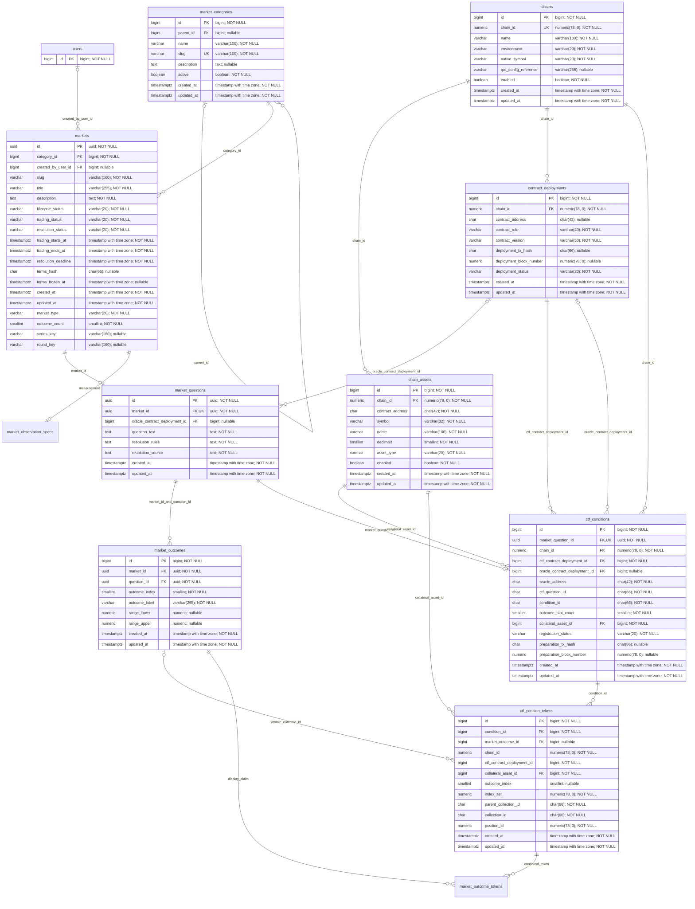
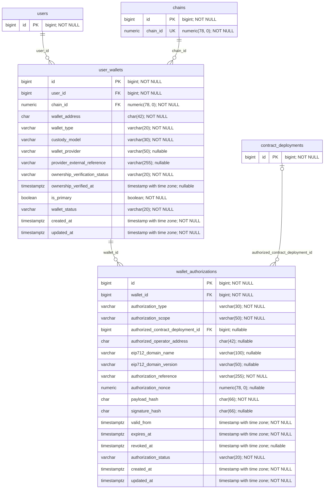
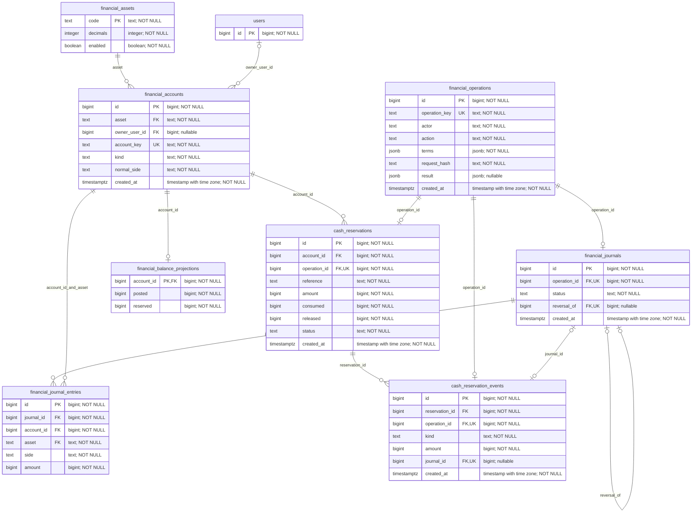
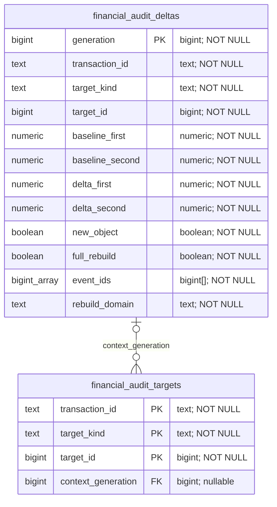
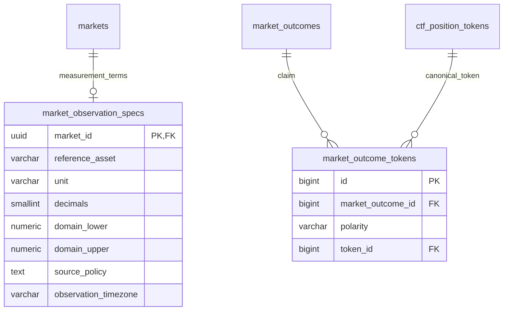
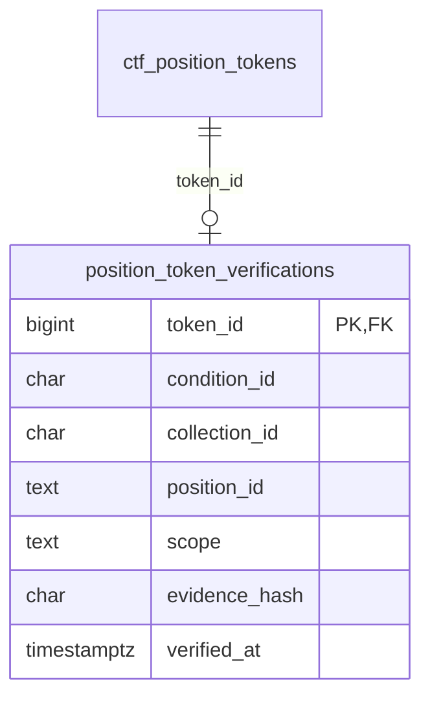
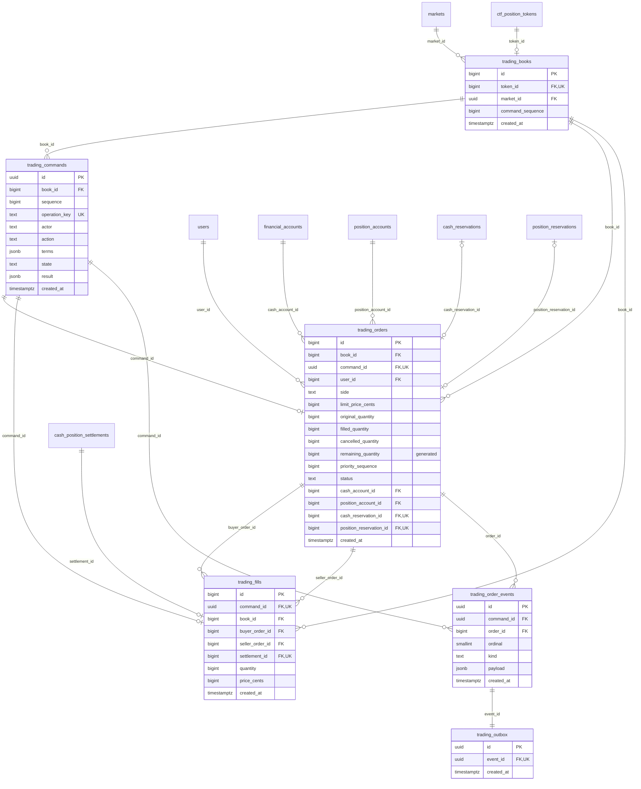

# KhmerFP Implemented Database ERD

## Current architecture and scope

This is the implemented PostgreSQL model, checked against the exported Drizzle schemas and migration `0015_snapshot.json`. It contains **47 public tables across 16 migrations (`0000`-`0015`)**: 21 earlier application tables, two generalized registry tables, 15 cash/position accounting tables, two private audit-state tables, one mock-token verification table and six trading tables. Migrations 0000-0014 are locally committed; migration 0015 is local and uncommitted. Hosted adoption and GitHub CI are not claimed. Drizzle's migration-history table lives in the separate `drizzle` schema and is not included in that count.

The current product direction is **shared custodial treasury with individual user cash and position accounting in PostgreSQL**. Users are intended to interact with USD balances; KhmerFP will manage collateral and blockchain operations. The isolated accounting foundation implements that direction, but it is not connected to existing payments, a production matching engine or live blockchain settlement. Production custody remains disabled.

The existing embedded-wallet and wallet-linking implementation is retained. It is not a prerequisite for the proposed custodial user flow and does not give the backend authority to sign user orders or transfer their funds. A separate deployed smart wallet test is not proof that the original SDK account completed onboarding.

The wider proposed architecture remains in [BLOCKCHAIN_DATABASE_ERD.md](./BLOCKCHAIN_DATABASE_ERD.md). That planned document is not the inventory of current tables. No proposed payment intents, payout requests, outbox, FX quotes, indexing or redemption tables are added here.

### Migration inventory

| Migration | Implemented change | Tables added |
|---|---|---:|
| `0000` | Original authentication and payment foundation | 8 |
| `0001` | USD legacy-wallet column and check | 0 |
| `0002` | Bakong payments and compatibility amount-fill function/trigger | 1 |
| `0003` | Chains, assets and contract deployment registry | 3 |
| `0004` | Binary market categories, markets, questions and outcomes; frozen-term protections | 4 |
| `0005` | Blockchain wallet identity and scoped authorization evidence | 2 |
| `0006` | Gnosis CTF conditions and outcome-token registry | 2 |
| `0007` | Protect referenced CTF asset/deployment identities | 0 |
| `0008` | Durable wallet-link challenges and protection trigger | 1 |
| `0009` | Double-entry cash ledger and reservations | 8 |
| `0010` | Protected targeted deferred audits | 1 |
| `0011` | Position ledger, reservations and atomic cash/position settlement | 7 |
| `0012` | Protected incremental validation baselines/deltas and audit-context foreign key | 1 |
| `0013` | Generalized atomic outcomes, exact observation terms, claim aliases and canonical token lookup and binary-only accounting guards | 2 |
| `0014` | Restricted immutable mock-token verification evidence and generalized accounting eligibility | 1 |
| `0015` | Persistent canonical books, commands, orders, fills, order events and outbox | 6 |
| **Total** | **Public tables** | **47** |

### Verification and deployment status

- Phase 4.3 local PostgreSQL 16 verification passed 106 ledger/registry tests and five migration-adoption tests with zero skips. These include categorical/range definitions, categorical accounting rejection, alias identity, exact precision, immutable terms, invalid masks and concurrent freezing. Baseline catalog, repeat migration and historical/forward CTF checks also passed. Empty migration, populated adoption, repeated migrator execution, catalog/fingerprint and CTF regressions passed. Three benchmark runs completed 18 full cash/position workload reconciliations.
- Local schema-to-snapshot parity, offline artifact validation and Drizzle consistency passed. The readability cleanup of accounting source files did not change the schema.
- Local performance is not consistently within every target: one independent-account run missed 200 TPS, one history-growth run exceeded 1.25x, and an earlier profiled run exceeded 180 seconds. Dependency vulnerabilities and independent security/load review remain blockers.
- These local results do **not** establish a passing GitHub run for the current combined branch, production schema adoption, treasury backing, real CTF inventory or finalized blockchain settlement. The earlier merge and readability checkpoint were pushed separately. Phases 4.3 and 4.4 are locally committed; Phase 4.5 persistent trading is local and uncommitted.
- Runtime startup DDL still exists. Existing-database adoption and migration-owner/runtime-role provisioning require separate review before activation. No production database was inspected for this ERD update.

## Reading the diagrams

The following six diagrams divide the same 38 tables into domains. A parent repeated with only its referenced key columns is a reference, not an additional table. Entity attributes come from the migration snapshot and show SQL types and nullability. They are listed in snapshot order, not a guarantee of physical column order on a runtime-created database.

`PK` marks primary keys; `FK` marks columns participating in a real foreign key. `UK` marks a single-column non-partial uniqueness rule. Composite and partial uniqueness are explained below; a column in a composite unique key is not individually unique. Lines show only declared foreign keys, with `o|` for an optional parent and `o{` for zero or more children. A unique child key gives `o|` children. Some trigger-enforced business rules are stricter than these basic FK cardinalities.

## Accounts, authentication and legacy payments

```mermaid
erDiagram
    users ||--o{ sessions : user_id
    users ||--o{ user_factors : user_id
    users o|--o{ auth_audit_logs : user_id
    users ||--o| wallets : user_id
    users o|--o{ bakong_payments : user_id
    users ||--o{ wallet_link_challenges : user_id
    sessions ||--o{ wallet_link_challenges : session_hash
    chains ||--o{ wallet_link_challenges : chain_id

    users {
        bigint id PK "bigint; NOT NULL"
        varchar google_sub UK "varchar(255); nullable"
        varchar email UK "varchar(320); NOT NULL"
        varchar display_name "varchar(255); NOT NULL"
        text avatar_url "text; nullable"
        varchar language "varchar(5); NOT NULL"
        timestamptz last_login_at "timestamp with time zone; nullable"
        inet last_login_ip "inet; nullable"
        text last_login_user_agent "text; nullable"
        timestamptz created_at "timestamp with time zone; NOT NULL"
        timestamptz updated_at "timestamp with time zone; NOT NULL"
        text password_hash "text; nullable"
        varchar facebook_sub "varchar(255); nullable"
        varchar telegram_sub "varchar(255); nullable"
        varchar phone_number "varchar(32); nullable"
        timestamptz phone_verified_at "timestamp with time zone; nullable"
    }

    sessions {
        char token_hash PK "char(64); NOT NULL"
        bigint user_id FK "bigint; NOT NULL"
        timestamptz created_at "timestamp with time zone; NOT NULL"
        timestamptz last_seen_at "timestamp with time zone; NOT NULL"
        timestamptz idle_expires_at "timestamp with time zone; NOT NULL"
        timestamptz expires_at "timestamp with time zone; NOT NULL"
        timestamptz revoked_at "timestamp with time zone; nullable"
        timestamptz step_up_at "timestamp with time zone; nullable"
        inet ip_address "inet; nullable"
        text user_agent "text; nullable"
    }

    user_factors {
        bigint id PK "bigint; NOT NULL"
        bigint user_id FK "bigint; NOT NULL"
        varchar factor_type "varchar(30); NOT NULL"
        varchar identifier "varchar(255); NOT NULL"
        timestamptz verified_at "timestamp with time zone; nullable"
        timestamptz created_at "timestamp with time zone; NOT NULL"
    }

    auth_rate_limits {
        varchar rate_limit_key PK "varchar(255); NOT NULL"
        timestamptz window_started_at "timestamp with time zone; NOT NULL"
        integer request_count "integer; NOT NULL"
        timestamptz blocked_until "timestamp with time zone; nullable"
        timestamptz updated_at "timestamp with time zone; NOT NULL"
    }

    auth_audit_logs {
        bigint id PK "bigint; NOT NULL"
        bigint user_id FK "bigint; nullable"
        varchar event_type "varchar(100); NOT NULL"
        inet ip_address "inet; nullable"
        text user_agent "text; nullable"
        jsonb details "jsonb; NOT NULL"
        timestamptz created_at "timestamp with time zone; NOT NULL"
    }

    phone_otps {
        bigint id PK "bigint; NOT NULL"
        varchar phone_number "varchar(32); NOT NULL"
        char code_hash "char(64); NOT NULL"
        integer attempts "integer; NOT NULL"
        timestamptz consumed_at "timestamp with time zone; nullable"
        timestamptz expires_at "timestamp with time zone; NOT NULL"
        inet ip_address "inet; nullable"
        timestamptz created_at "timestamp with time zone; NOT NULL"
    }

    wallets {
        bigint id PK "bigint; NOT NULL"
        bigint user_id FK, UK "bigint; NOT NULL"
        bigint balance_minor "bigint; NOT NULL"
        bigint usd_balance_minor "bigint; NOT NULL"
        varchar currency "varchar(3); NOT NULL"
        timestamptz created_at "timestamp with time zone; NOT NULL"
        timestamptz updated_at "timestamp with time zone; NOT NULL"
    }

    transactions {
        bigint id PK "bigint; NOT NULL"
        varchar tran_id UK "varchar(100); NOT NULL"
        varchar name "varchar(100); NOT NULL"
        varchar account_number "varchar(64); NOT NULL"
        bigint amount "bigint; NOT NULL"
        varchar currency "varchar(3); NOT NULL"
        varchar status "varchar(20); NOT NULL"
        text payway_response_code "text; nullable"
        timestamptz paid_at "timestamp with time zone; nullable"
        jsonb verification_evidence "jsonb; nullable"
        varchar status_access_token_hash "varchar(64); nullable"
        timestamptz created_at "timestamp with time zone; NOT NULL"
        timestamptz updated_at "timestamp with time zone; NOT NULL"
    }

    bakong_payments {
        bigint id PK "bigint; NOT NULL"
        bigint user_id FK "bigint; nullable"
        varchar tran_id UK "varchar(25); NOT NULL"
        char md5 UK "char(32); NOT NULL"
        text qr_string "text; NOT NULL"
        varchar name "varchar(100); NOT NULL"
        varchar description "varchar(100); nullable"
        numeric amount "numeric(14, 2); NOT NULL"
        bigint amount_minor "bigint; NOT NULL"
        varchar currency "varchar(3); NOT NULL"
        varchar status "varchar(20); NOT NULL"
        char status_access_token_hash "char(64); nullable"
        varchar idempotency_key "varchar(64); nullable"
        timestamptz expires_at "timestamp with time zone; NOT NULL"
        timestamptz paid_at "timestamp with time zone; nullable"
        timestamptz wallet_credited_at "timestamp with time zone; nullable"
        jsonb provider_evidence "jsonb; nullable"
        timestamptz created_at "timestamp with time zone; NOT NULL"
        timestamptz updated_at "timestamp with time zone; NOT NULL"
    }

    wallet_link_challenges {
        uuid id PK "uuid; NOT NULL"
        bigint user_id FK "bigint; NOT NULL"
        char session_hash FK "char(64); NOT NULL"
        numeric chain_id FK "numeric(78, 0); NOT NULL"
        char wallet_address "char(42); NOT NULL"
        varchar action "varchar(10); NOT NULL"
        text app_origin "text; NOT NULL"
        char nonce UK "char(66); NOT NULL"
        jsonb typed_data "jsonb; NOT NULL"
        char payload_hash "char(66); NOT NULL"
        timestamptz created_at "timestamp with time zone; NOT NULL"
        timestamptz expires_at "timestamp with time zone; NOT NULL"
        timestamptz consumed_at "timestamp with time zone; nullable"
    }

    %% Existing parent shown only as a reference in this domain.
    chains {
        bigint id PK "bigint; NOT NULL"
        numeric chain_id UK "numeric(78, 0); NOT NULL"
    }
```

| Table | Purpose |
|---|---|
| `users` | KhmerFP account identity, login providers and profile. The full schema includes more than email. |
| `sessions` | Hashed application sessions, expiry, revocation and step-up state. |
| `user_factors` | Verified secondary authentication factors. |
| `auth_rate_limits` | Authentication attempt counters and temporary blocks. |
| `auth_audit_logs` | Authentication and account-security events. |
| `phone_otps` | Hashed, expiring phone codes; phone_number is not a user foreign key. |
| `wallets` | Legacy customer KHR and USD balances; separate from the new double-entry ledger. |
| `transactions` | Existing whole-KHR ABA PayWay records; no user foreign key or ledger-credit link. |
| `bakong_payments` | Existing USD/KHR KHQR attempts, verification evidence and legacy wallet-credit marker. |
| `wallet_link_challenges` | Single-use wallet ownership challenges bound to user, session, chain and action. |

## Blockchain reference, binary markets and CTF registry

| Table | Purpose |
|---|---|
| `chains` | Network identities and non-secret configuration references. |
| `chain_assets` | Token and collateral identities scoped to a network. |
| `contract_deployments` | Contract address, role and deployment metadata on a network. |
| `market_categories` | Categories and optional parent categories. |
| `markets` | Market terms, deadlines and separate lifecycle, trading and resolution statuses. |
| `market_questions` | One immutable question identity per market, with resolution rules and optional oracle deployment. |
| `market_outcomes` | Atomic binary, categorical or numeric-range outcomes bound to the correct question. |
| `ctf_conditions` | Gnosis condition identity, oracle, collateral and preparation metadata. |
| `ctf_position_tokens` | Canonical root ERC-1155 identity per index set; composite claims need no atomic-outcome FK and never store balances. |

## Retained blockchain wallet identity

| Table | Purpose |
|---|---|
| `user_wallets` | Retained user-to-blockchain-wallet identity and ownership-verification records. |
| `wallet_authorizations` | Scoped authorization evidence; not a grant of live on-chain permission. |

## Cash accounting and reservations

| Table | Purpose |
|---|---|
| `financial_assets` | Fixed accounting asset identities: enabled USD cents and disabled six-decimal USDC. |
| `financial_accounts` | Customer cash liabilities and system asset, clearing, equity, expense or revenue accounts. |
| `financial_operations` | Actor-bound idempotency, canonical operation terms and durable results. |
| `financial_journals` | Cash journal headers, posting status and eligible reversal linkage. |
| `financial_journal_entries` | Immutable cash debit and credit lines, balanced independently per asset. |
| `financial_balance_projections` | Current posted and reserved cash; available equals posted minus reserved. |
| `cash_reservations` | Cash holds with cumulative consumed and released amounts. |
| `cash_reservation_events` | Immutable reserve, consume, release and cancel history. |

## Position accounting and atomic database settlement

```mermaid
erDiagram
    ctf_position_tokens ||--o{ position_accounts : token_id
    users o|--o{ position_accounts : owner_user_id
    financial_operations ||--o| position_journals : operation_id
    position_journals o|--o| position_journals : reversal_of
    position_journals ||--o{ position_journal_entries : journal_id
    position_accounts ||--o{ position_journal_entries : account_id_and_token_id
    position_accounts ||--o| position_balance_projections : account_id
    position_accounts ||--o{ position_reservations : account_id
    financial_operations ||--o| position_reservations : operation_id
    position_reservations ||--o{ position_reservation_events : reservation_id
    financial_operations ||--o| position_reservation_events : operation_id
    position_journals o|--o| position_reservation_events : journal_id
    financial_operations ||--o| cash_position_settlements : operation_id
    markets ||--o{ cash_position_settlements : market_id
    ctf_position_tokens ||--o{ cash_position_settlements : token_id
    financial_accounts ||--o{ cash_position_settlements : buyer_cash_account_id
    financial_accounts ||--o{ cash_position_settlements : seller_cash_account_id
    cash_reservations ||--o{ cash_position_settlements : cash_reservation_id
    position_reservations ||--o{ cash_position_settlements : position_reservation_id
    financial_journals ||--o| cash_position_settlements : cash_journal_id
    position_journals ||--o| cash_position_settlements : position_journal_id
    position_accounts ||--o{ cash_position_settlements : buyer_position_account_id_and_token_id
    position_accounts ||--o{ cash_position_settlements : seller_position_account_id_and_token_id

    position_accounts {
        bigint id PK "bigint; NOT NULL"
        bigint token_id FK "bigint; NOT NULL"
        bigint owner_user_id FK "bigint; nullable"
        text account_key UK "text; NOT NULL"
        text kind "text; NOT NULL"
        timestamptz created_at "timestamp with time zone; NOT NULL"
    }

    position_journals {
        bigint id PK "bigint; NOT NULL"
        bigint operation_id FK, UK "bigint; NOT NULL"
        text reference UK "text; NOT NULL"
        text purpose "text; NOT NULL"
        text status "text; NOT NULL"
        bigint reversal_of FK, UK "bigint; nullable"
        timestamptz created_at "timestamp with time zone; NOT NULL"
    }

    position_journal_entries {
        bigint id PK "bigint; NOT NULL"
        bigint journal_id FK "bigint; NOT NULL"
        bigint account_id FK "bigint; NOT NULL"
        bigint token_id FK "bigint; NOT NULL"
        text side "text; NOT NULL"
        bigint quantity "bigint; NOT NULL"
    }

    position_balance_projections {
        bigint account_id PK, FK "bigint; NOT NULL"
        bigint posted "bigint; NOT NULL"
        bigint reserved "bigint; NOT NULL"
    }

    position_reservations {
        bigint id PK "bigint; NOT NULL"
        bigint account_id FK "bigint; NOT NULL"
        bigint operation_id FK, UK "bigint; NOT NULL"
        text reference "text; NOT NULL"
        bigint quantity "bigint; NOT NULL"
        bigint consumed "bigint; NOT NULL"
        bigint released "bigint; NOT NULL"
        text status "text; NOT NULL"
        timestamptz created_at "timestamp with time zone; NOT NULL"
    }

    position_reservation_events {
        bigint id PK "bigint; NOT NULL"
        bigint reservation_id FK "bigint; NOT NULL"
        bigint operation_id FK, UK "bigint; NOT NULL"
        text kind "text; NOT NULL"
        bigint quantity "bigint; NOT NULL"
        bigint journal_id FK, UK "bigint; nullable"
        timestamptz created_at "timestamp with time zone; NOT NULL"
    }

    cash_position_settlements {
        bigint id PK "bigint; NOT NULL"
        bigint operation_id FK, UK "bigint; NOT NULL"
        text match_reference UK "text; NOT NULL"
        uuid market_id FK "uuid; NOT NULL"
        bigint token_id FK "bigint; NOT NULL"
        bigint buyer_cash_account_id FK "bigint; NOT NULL"
        bigint seller_cash_account_id FK "bigint; NOT NULL"
        bigint buyer_position_account_id FK "bigint; NOT NULL"
        bigint seller_position_account_id FK "bigint; NOT NULL"
        bigint cash_reservation_id FK "bigint; NOT NULL"
        bigint position_reservation_id FK "bigint; NOT NULL"
        bigint cash_journal_id FK, UK "bigint; NOT NULL"
        bigint position_journal_id FK, UK "bigint; NOT NULL"
        bigint quantity "bigint; NOT NULL"
        bigint price_cents "bigint; NOT NULL"
        bigint consideration_cents "bigint; NOT NULL"
        timestamptz created_at "timestamp with time zone; NOT NULL"
    }

    %% Existing parent shown only as a reference in this domain.
    cash_reservations {
        bigint id PK "bigint; NOT NULL"
    }

    %% Existing parent shown only as a reference in this domain.
    ctf_position_tokens {
        bigint id PK "bigint; NOT NULL"
        bigint condition_id FK "bigint; NOT NULL"
        bigint market_outcome_id FK "bigint; nullable"
        numeric chain_id "numeric(78, 0); NOT NULL"
        bigint ctf_contract_deployment_id "bigint; NOT NULL"
        bigint collateral_asset_id FK "bigint; NOT NULL"
        smallint outcome_index "smallint; nullable"
        numeric index_set "numeric(78, 0); NOT NULL"
        char parent_collection_id "char(66); NOT NULL"
        char collection_id "char(66); NOT NULL"
        numeric position_id "numeric(78, 0); NOT NULL"
        timestamptz created_at "timestamp with time zone; NOT NULL"
        timestamptz updated_at "timestamp with time zone; NOT NULL"
    }

    %% Existing parent shown only as a reference in this domain.
    financial_accounts {
        bigint id PK "bigint; NOT NULL"
    }

    %% Existing parent shown only as a reference in this domain.
    financial_journals {
        bigint id PK "bigint; NOT NULL"
    }

    %% Existing parent shown only as a reference in this domain.
    financial_operations {
        bigint id PK "bigint; NOT NULL"
    }

    %% Existing parent shown only as a reference in this domain.
    markets {
        uuid id PK "uuid; NOT NULL"
        bigint category_id FK "bigint; NOT NULL"
        bigint created_by_user_id FK "bigint; nullable"
        varchar slug "varchar(160); NOT NULL"
        varchar title "varchar(255); NOT NULL"
        text description "text; NOT NULL"
        varchar lifecycle_status "varchar(20); NOT NULL"
        varchar trading_status "varchar(20); NOT NULL"
        varchar resolution_status "varchar(20); NOT NULL"
        timestamptz trading_starts_at "timestamp with time zone; NOT NULL"
        timestamptz trading_ends_at "timestamp with time zone; NOT NULL"
        timestamptz resolution_deadline "timestamp with time zone; NOT NULL"
        char terms_hash "char(66); nullable"
        timestamptz terms_frozen_at "timestamp with time zone; nullable"
        timestamptz created_at "timestamp with time zone; NOT NULL"
        timestamptz updated_at "timestamp with time zone; NOT NULL"
        varchar market_type "varchar(20); NOT NULL"
        smallint outcome_count "smallint; NOT NULL"
        varchar series_key "varchar(160); nullable"
        varchar round_key "varchar(160); nullable"
    }

    %% Existing parent shown only as a reference in this domain.
    users {
        bigint id PK "bigint; NOT NULL"
    }
```

| Table | Purpose |
|---|---|
| `position_accounts` | Customer or system inventory accounts for one registered CTF token. |
| `position_journals` | Position movement headers and reversal links, balanced independently per token. |
| `position_journal_entries` | Immutable IN/OUT share movements tied to the correct account and token. |
| `position_balance_projections` | Current posted and reserved shares; available equals posted minus reserved. |
| `position_reservations` | Share holds that prevent overselling and support partial consumption or release. |
| `position_reservation_events` | Immutable share reservation lifecycle events and consumption journals. |
| `cash_position_settlements` | One database settlement linking buyer/seller accounts, reservations and both journals. |

## Internal commit-time audit state

| Table | Purpose |
|---|---|
| `financial_audit_deltas` | Internal transaction baselines and independently derived changes; removed after validation. |
| `financial_audit_targets` | Internal deduplicated checks that must complete before commit. |

## Relationships and integrity rules

### Users, legacy balances and wallets

- `users` stores email, provider identities, phone data, profile information and timestamps; it is not an email-only account model. Optional provider identifiers use their schema-defined unique or partial unique indexes.
- A user can have one legacy `wallets` row. `balance_minor` is whole KHR; `usd_balance_minor` is USD cents. These are not ledger balance projections and are not automatically synchronized with them.
- `transactions` has no FK to a user, wallet or financial journal. Existing PayWay checkout authentication does not persist that ownership in the table. `account_number` and a name cannot establish ledger ownership.
- `bakong_payments.user_id` is nullable with `ON DELETE SET NULL`. Its `wallet_credited_at` is a legacy workflow marker, not a ledger-journal FK. Current Bakong crediting updates legacy wallet balances; the new ledger has no implemented payment-credit bridge.
- Runtime `server/src/db/bakongSchema.js` also adds `last_checked_at`; the Drizzle model and migration snapshot still have 19 Bakong columns and omit it. The status throttle writes that runtime-only column. This is known drift requiring a future additive correction, not a column silently included in this ERD.
- `wallet_link_challenges` already exists; a proposed extra `wallet_verification_challenges` table is not required to describe current persistence. Challenges bind to sessions by hashed session key. The challenged address is not a wallet FK because proof can precede wallet registration.
- `user_wallets` identifies chain-scoped blockchain addresses, with composite chain/address uniqueness and a partial active-primary-wallet index. An address is not globally unique across all chains. Authorization targets a registered deployment or operator; a trigger rejects deployment references on another chain.
- EOA recovery and deployed smart-account EIP-1271 verification are implemented behind development restrictions. Undeployed/EIP-6492 proofs remain blocked. Connection alone is not ownership proof. `wallet_authorizations.VERIFIED` records verified evidence, not an active on-chain allowance or unlimited transfer authority.

### Markets and CTF registry

- `chains.chain_id` is a unique numeric network identifier; network FKs point to it, not to the surrogate `chains.id`. Asset/deployment addresses are unique within their schema-defined chain scope.
- `market_categories.parent_id` is an optional self-reference. A market has a category, an optional creator, and at most one question. A draft can have zero outcomes; the composite outcome FK binds `market_id` and `question_id` to the same question. Freezing verifies both YES and NO rows exist and protects their terms.
- YES index 0 maps to CTF index set 1; NO index 1 maps to index set 2. Composite/unique constraints and registry triggers prevent invalid relationships, cross-chain references and duplicate registry identities. Oracle/CTF deployment roles and collateral identity are checked; referenced identities are protected from reassignment.
- Condition identity is unique within its chain and CTF deployment; a condition/market outcome mapping and chain/deployment position identity have their own unique scopes. Mermaid does not label the individual `condition_id` or on-chain `position_id` globally unique when the schema uses a composite key.
- `ctf_conditions.market_question_id` is a local UUID FK. `ctf_question_id` is the separate CTF bytes32 input. `ctf_position_tokens.condition_id` references the registry row's BIGINT ID, not the bytes32 condition value.
- `ctf_position_tokens` directly references condition, outcome and collateral. Its chain and CTF deployment fields are cross-checked by registry triggers; do not invent direct FKs for those columns. Migration 0013 supports root atomic and composite index sets for 2?256 slots. Nested condition accounting remains unsupported; actual token derivation and deployment/finality are separate checks.
- `packages/contracts/src/ctfIdentifiers.js` implements condition, elliptic-curve collection and position derivation with reference tests. PostgreSQL does not cryptographically recompute those IDs. A stored `PREPARED` status or a correctly derived identifier is not proof of a finalized chain event.

### Cash ledger

- `financial_accounts.owner_user_id` is required for `CUSTOMER` accounts and absent for system accounts. Customers are CREDIT-normal liabilities. System account kinds and normal sides follow the schema checks; one customer account per owner/asset is enforced.
- `financial_operations` stores a unique operation key, actor, action and canonical terms. The request hash/result support retries without another posting. The service authorizer binds the request before asynchronous work; idempotency is not an unauthenticated lookup API.
- Each cash journal belongs to one operation. Its entries have a composite `(account_id, asset)` FK, which prevents using the wrong asset for an account. Every posted journal balances independently per asset. Posted journals cannot receive new entries; history is immutable.
- A projection has one account PK/FK and contains `posted` and `reserved`. Available cash is `posted - reserved`. The controlled operations and database guards prevent negative customer availability.
- A cash reservation belongs to an account and operation, with a unique `(account_id, reference)` business identity. Consumed plus released cannot exceed its amount. Events are append-only; each event operation is unique, and consumption requires its journal.
- `financial_journals.reversal_of` is an optional unique self-FK. Eligible full reversals exactly compensate the original journal. Reservation/settlement-related journals cannot be independently reversed to reopen funds or separate the trade legs.
- USD cents are the only active cash accounting unit. USDC has a separate disabled six-decimal asset identity. KHR accounting/FX is not implemented; legacy whole-KHR amounts must not be passed as USD cents.

### Position ledger and settlement

- `position_accounts.token_id` points to `ctf_position_tokens.id`, the registry row key. It is not the large on-chain ERC-1155 `position_id`. Customer accounts reference `users` directly; there is no implemented FK to `user_wallets` or the legacy `wallets` table.
- Customer ownership is unique per user/token. Partial system-account uniqueness controls `UNALLOCATED` and `EXTERNAL_CONTROL` per token. External-control accounts balance the books but cannot become spendable inventory. Real chain inventory recognition is not connected; tests use explicit disposable fixtures.
- Share quantities use six-decimal integer base units. The current whole-share rule requires multiples of 1,000,000. Price and consideration are integer USD cents, not USDC base units.
- Position entries balance independently per token. Composite account/token FKs ensure correct inventory identity. Projections and reservations enforce available shares and prevent overselling. Position journal reversals follow the same eligibility restrictions.
- `cash_position_settlements` links exactly one cash journal and one position journal to a unique operation and match reference. Buyer/seller account FKs, composite position-account/token FKs and reservation references are verified together. A reservation can serve multiple partial settlements within its remaining limits; journals cannot be reused by another settlement.
- The settlement function checks market lifecycle, trading status, resolution status, frozen terms and cutoff under the appropriate locks. Commit-time checks also reject late/closed settlement. Self-trades and reservation substitution are rejected; either both legs commit or neither does.
- These are internal database settlements. No field here proves an exchange transaction, blockchain confirmation, token custody or redemption. Production matching, chain reconciliation and payment/withdrawal integration remain separate work.

### Incremental audits and security boundary

- `financial_audit_deltas` captures each account/reservation baseline before its first mutation under locks. Immutable entries and new reservation events independently contribute expected changes. At commit the resulting projections and counters must equal baseline plus deltas.
- For account contexts, the first/second values mean posted/reserved. For reservation contexts they mean consumed/released. NUMERIC keeps intermediate integer sums exact; persisted monetary/quantity columns remain BIGINT-bounded.
- `financial_audit_targets.context_generation` is the real nullable FK to the protected delta generation. The account/reservation IDs in `target_id` are polymorphic references enforced by controlled functions, not declared FKs. No invented account-to-audit relationship is drawn.
- Both internal tables are transaction-scoped working state, not a permanent accounting event log or eventual audit queue. They must be empty after successful validation. Savepoint rollback restores them with source changes; constraint rescheduling cannot bypass checks. Full-history reconciliation and controlled projection reconstruction remain available separately.
- Database functions and triggers implement the essential rules; Drizzle declarations alone do not enforce journal balance or frozen identities. Security-definer functions use fixed search paths and restricted execution. Runtime roles must not own ledger objects, inherit the migration-owner role or write financial tables/audit state directly.
- `packages/ledger/src/index.js` authorizes each operation and uses one dedicated transaction for its database call and deferred checks. A separate payment transaction cannot become atomic merely by calling this service, because it obtains its own connection. A future payment finalizer needs an explicitly reviewed same-transaction boundary.

## Current accounting workflow

1. The trusted backend authorizes canonical actor-bound terms and validates BigInt amounts.
2. One dedicated connection begins a transaction and verifies its restricted runtime role.
3. Controlled SQL locks affected accounts/reservations and captures baselines before mutation.
4. Journal entries or reservation events change cash/share projections; settlement links both legs.
5. Mandatory checks validate each journal, reservation, settlement and accumulated delta before commit.
6. Success commits everything and clears private audit state; failure rolls everything back.
7. Full reconciliation compares cash and position projections with immutable history independently of normal incremental commits.

Existing provider payments still use their legacy workflow. Phase 3 proposes verified deposit-to-ledger finalization, durable payout reservations, reconciliation and a reviewed opening-balance cutover. Those proposals are not implemented tables or working payment integrations. Existing balances must not be replayed as new deposits, and successful fiat verification is not proof of USDC backing.

## How to update this ERD

After each approved migration:

1. Read both `packages/db/src/schema` **and** `packages/ledger/src/schema.js` / `positionSchema.js`; all are exported through the shared schema index.
2. Compare the new SQL, snapshot, journal lineage and unchanged historical artifacts. Inspect trigger/function changes as well as table DDL.
3. Count actual public tables and separate internal working tables from application records; exclude `drizzle.__drizzle_migrations` from the public count.
4. Update the correct domain, its table-purpose rows, exact FK columns and unique scopes. Repeat external parents only as references. Explain trigger-only relationships without inventing FKs.
5. Check the Mermaid definitions against actual columns, types, nullability, PKs and FKs. Composite/partial rules and business-state requirements need prose alongside the diagram.
6. Run schema/snapshot parity, artifact negative checks, Drizzle consistency and disposable PostgreSQL integration/adoption tests. Parse/render Mermaid with a GitHub-compatible Mermaid implementation.
7. Record **local**, **GitHub CI**, **hosted adoption** and **production activation** evidence separately. Never infer deployment or treasury backing from a passing test.
8. Compare runtime SQL as well; document drift such as Bakong `last_checked_at` until corrected by an approved forward migration.
9. Keep unimplemented designs in the planned ERD and refresh this document only when their artifacts actually exist.

## Source of truth

- [Shared schema exports](../../packages/db/src/schema/index.js)
- [Cash and audit schemas](../../packages/ledger/src/schema.js)
- [Position and settlement schemas](../../packages/ledger/src/positionSchema.js)
- [Migration journal](../../packages/db/migrations/meta/_journal.json)
- [Current snapshot](../../packages/db/migrations/meta/0013_snapshot.json)
- [Ledger workflow and local validation](../../packages/ledger/README.md)

The original domains plus the two entity definitions below cover all 47 tables in the current local migration snapshot. The source schemas, immutable migration artifacts and executable PostgreSQL tests remain authoritative. This document makes no claim that existing hosted databases have adopted this schema.

## Generalized market registry (local migration 0013)

`market_observation_specs` holds frozen measurement metadata, not live asset prices or prediction-token quotes. HDPE can use USD-per-metric-ton observations with two decimal places; gasoline can use whole KHR-per-litre observations. Both trade through the same USD-cent ledger. Bounds are exact scaled integers, half-open intervals and cannot overlap; complete ordered domain coverage is required at freeze.

`market_outcome_tokens` maps a selected atomic outcome and YES/NO polarity to a canonical token. For six outcomes, YES masks are 1, 2, 4, 8, 16, 32 and NO masks are 62, 61, 59, 55, 47, 31. Binary NO(A) aliases YES(B); it never creates duplicate inventory. Canonical token identity, rather than display polarity, is used for reservations and settlement.

`markets.series_key` and `round_key` identify a recurring series and unique immutable round. Each round has its own market UUID, question and condition identity. No scheduler or recurring-market creation is implemented.

The exchange contract still accepts only binary conditions. This registry adds no matching engine, synthetic inventory, live reference feed, fees, redemption workflow or real-money capability. Market-order previews, multiple-share tickets, average cost, potential payout/loss and bounded market orders remain frontend/later execution concerns; no schema field treats indicative prices as executable quotes. Missing resolution evidence has no fallback winner. Payout and invalid-market rounding policy remain separate approval requirements.

At the Phase 4.3 checkpoint, categorical and price-range identities were registry-only and accounting was blocked. Migration 0014 replaces that temporary block with the restricted mock eligibility policy below. Local CTF payout tests do not activate platform accounting or production redemption.

### Phase 4.4 generalized mock accounting

Migration 0014 replaces the temporary categorical rejection without dropping its five database write guards. Generalized accounting requires an immutable verification record, matching canonical CTF identities, a registered claim, consistent chain/deployment/collateral identities, testnet context and six-decimal ERC20 collateral. Historical binary eligibility is preserved. Verification records have only MOCK_ONLY scope and cannot be enrolled or changed by runtime roles. They do not establish on-chain preparation, finality or real inventory backing.

Canonical singleton and complementary tokens use the existing position accounts, reservations, journals and atomic cash-position settlement. Aliases resolve to the same token and do not create another balance. USD-cent execution prices and whole-share units remain separate from reference observation precision. No matching engine, order tables, production redemption, payment integration or real inventory recognition is implemented.

Phase 4.4 local verification: 118 ledger/registry tests and six migration-adoption tests passed with zero skips. All 12 canonical tokens in each six-outcome fixture passed accounting scenarios. Repeated migration, catalog/fingerprint, historical CTF, full reconciliation, reconstruction and subsequent settlement checks passed. In the final 1,000-settlement samples, binary/singleton/complement throughput was 72.76/64.30/58.91 TPS. The 100-settlement shared-account workload achieved 19.42 TPS with 1,220.82 ms p99 latency. These samples had zero accounting errors or deadlocks; shared-account contention remains a limitation and no 10,000-settlement scalability acceptance is claimed for Phase 4.4.

### Phase 4.5 persistent trading foundation

The six new tables reuse the existing cash and position ledgers. Market and round identity are inherited through the book's immutable market and canonical token references. BUY/SELL is a trading direction, separate from a token's YES/NO display claim. The controlled database operation creates the reservation, order, immutable events and outbox together. Every fill links one existing atomic cash-position settlement. Standalone ledger mutation of order holds fails mandatory deferred reconciliation.

PENDING is a transaction-local acceptance state. OPEN/PARTIAL orders may fill, cancel or expire; terminal orders cannot reopen. Insufficient owned funds or inventory can produce a durable REJECTED order without a hold. Commands have a separate PENDING/APPLIED lifecycle and immutable actor-bound receipts. Book sequence, followed by event ordinal, supplies deterministic ordering; timestamps are not the price-time priority authority.

This is local mock trading infrastructure. Authentication is supplied by the existing trusted backend authorizer; no public order API, manual-fill endpoint, matching engine, event transport, blockchain settlement or production activation is introduced. GitHub CI and independent security/load review remain pending.

Phase 4.5 local verification passed 138 ledger/registry/trading tests and seven migration-adoption tests with zero skips, including lock-wait and commit-time cutoff races. The fresh final catalog has 47 application tables and 16 migration-history rows. Runtime write restrictions, generated remaining quantities, all trading trigger metadata and repeated-migration fingerprints were checked. These results do not establish production performance or live blockchain settlement.
