# KhmerFP Implemented Database ERD

## Scope and status

This document describes only the PostgreSQL tables that are currently represented by the Drizzle schemas and migrations in `packages/db`. It does not show proposed market, CLOB, ledger, oracle, or settlement tables. Those future designs remain in [BLOCKCHAIN_DATABASE_ERD.md](./BLOCKCHAIN_DATABASE_ERD.md).

The implemented migration chain currently contains 18 application tables:

- Migrations `0000` and `0001`: eight authentication and payment-foundation tables.
- Migration `0002`: `bakong_payments`.
- Migration `0003`: `chains`, `chain_assets`, and `contract_deployments`.
- Migration `0004`: the binary market core (`market_categories`, `markets`, `market_questions`, and `market_outcomes`).
- Migration `0005`: blockchain wallet identity and scoped authorization (`user_wallets` and `wallet_authorizations`).

The first nine tables have completed PostgreSQL catalog verification. The three blockchain reference tables are implemented in Drizzle and migration `0003`, but their final PostgreSQL CI catalog verification is **pending until the current CI tests pass**. The four market tables and two wallet-identity tables are implemented locally in migrations `0004` and `0005`; their disposable PostgreSQL verification is also **pending**. These statuses do not mean that blockchain contracts, markets, or wallets have been deployed.

The current PostgreSQL 16 CI blocker is an unresolved catalog-comparison normalization issue in the test runner. PostgreSQL returns explicit `::text` casts and `ANY (ARRAY[...])` forms for several `contract_deployments` checks while the expected definitions use equivalent uncast and `IN (...)` forms. The strict assertions remain enabled; no constraint or catalog check has been skipped or weakened. Migration `0004` must not be called PostgreSQL-verified until that earlier comparison passes and the new market assertions execute.

## Implemented relationships

```mermaid
erDiagram
    users ||--o| wallets : owns
    users ||--o{ sessions : has
    users ||--o{ user_factors : configures
    users o|--o{ auth_audit_logs : referenced_by
    users o|--o{ bakong_payments : initiates
    users ||--o{ user_wallets : controls
    chains ||--o{ user_wallets : hosts
    user_wallets ||--o{ wallet_authorizations : scopes
    contract_deployments o|--o{ wallet_authorizations : authorizes
    chains ||--o{ chain_assets : registers
    chains ||--o{ contract_deployments : hosts
    market_categories o|--o{ market_categories : contains
    market_categories ||--o{ markets : categorizes
    users o|--o{ markets : creates
    markets ||--o| market_questions : defines
    market_questions ||--|{ market_outcomes : offers
    contract_deployments o|--o{ market_questions : supplies_oracle

    users {
        bigint id PK
        varchar email UK
        varchar google_sub UK
        varchar facebook_sub
        varchar telegram_sub
        varchar phone_number
        varchar display_name
        varchar language
        text password_hash
        timestamptz phone_verified_at
        timestamptz created_at
        timestamptz updated_at
    }

    wallets {
        bigint id PK
        bigint user_id FK, UK
        bigint balance_minor
        bigint usd_balance_minor
        varchar currency
        timestamptz created_at
        timestamptz updated_at
    }

    sessions {
        char token_hash PK
        bigint user_id FK
        timestamptz idle_expires_at
        timestamptz expires_at
        timestamptz revoked_at
        timestamptz step_up_at
        inet ip_address
        timestamptz created_at
        timestamptz last_seen_at
    }

    user_factors {
        bigint id PK
        bigint user_id FK
        varchar factor_type
        varchar identifier
        timestamptz verified_at
        timestamptz created_at
    }

    auth_rate_limits {
        varchar rate_limit_key PK
        timestamptz window_started_at
        integer request_count
        timestamptz blocked_until
        timestamptz updated_at
    }

    auth_audit_logs {
        bigint id PK
        bigint user_id FK
        varchar event_type
        inet ip_address
        text user_agent
        jsonb details
        timestamptz created_at
    }

    phone_otps {
        bigint id PK
        varchar phone_number
        char code_hash
        integer attempts
        timestamptz consumed_at
        timestamptz expires_at
        inet ip_address
        timestamptz created_at
    }

    transactions {
        bigint id PK
        varchar tran_id UK
        varchar account_number
        bigint amount
        varchar currency
        varchar status
        text payway_response_code
        timestamptz paid_at
        jsonb verification_evidence
        varchar status_access_token_hash
        timestamptz created_at
        timestamptz updated_at
    }

    bakong_payments {
        bigint id PK
        bigint user_id FK
        varchar tran_id UK
        char md5 UK
        text qr_string
        numeric amount
        bigint amount_minor
        varchar currency
        varchar status
        varchar idempotency_key
        timestamptz expires_at
        timestamptz paid_at
        timestamptz wallet_credited_at
        jsonb provider_evidence
        timestamptz created_at
        timestamptz updated_at
    }

    chains {
        bigint id PK
        numeric chain_id UK
        varchar name
        varchar environment
        varchar native_symbol
        varchar rpc_config_reference
        boolean enabled
        timestamptz created_at
        timestamptz updated_at
    }

    chain_assets {
        bigint id PK
        numeric chain_id FK
        char contract_address
        varchar symbol
        varchar name
        smallint decimals
        varchar asset_type
        boolean enabled
        timestamptz created_at
        timestamptz updated_at
    }

    contract_deployments {
        bigint id PK
        numeric chain_id FK
        char contract_address
        varchar contract_role
        varchar contract_version
        char deployment_tx_hash
        numeric deployment_block_number
        varchar deployment_status
        timestamptz created_at
        timestamptz updated_at
    }

    user_wallets {
        bigint id PK
        bigint user_id FK
        numeric chain_id FK
        char wallet_address UK
        varchar wallet_type
        varchar custody_model
        varchar wallet_provider
        varchar ownership_verification_status
        timestamptz ownership_verified_at
        boolean is_primary
        varchar wallet_status
        timestamptz created_at
        timestamptz updated_at
    }

    wallet_authorizations {
        bigint id PK
        bigint wallet_id FK
        bigint authorized_contract_deployment_id FK
        char authorized_operator_address
        varchar authorization_type
        varchar authorization_scope
        varchar authorization_reference
        numeric authorization_nonce
        char payload_hash
        char signature_hash
        timestamptz valid_from
        timestamptz expires_at
        timestamptz revoked_at
        varchar authorization_status
    }

    market_categories {
        bigint id PK
        bigint parent_id FK
        varchar name
        varchar slug UK
        text description
        boolean active
        timestamptz created_at
        timestamptz updated_at
    }

    markets {
        uuid id PK
        bigint category_id FK
        bigint created_by_user_id FK
        varchar slug UK
        varchar title
        text description
        varchar lifecycle_status
        varchar trading_status
        varchar resolution_status
        timestamptz trading_starts_at
        timestamptz trading_ends_at
        timestamptz resolution_deadline
        char terms_hash
        timestamptz terms_frozen_at
        timestamptz created_at
        timestamptz updated_at
    }

    market_questions {
        uuid id PK
        uuid market_id FK, UK
        bigint oracle_contract_deployment_id FK
        text question_text
        text resolution_rules
        text resolution_source
        timestamptz created_at
        timestamptz updated_at
    }

    market_outcomes {
        bigint id PK
        uuid market_id FK
        uuid question_id FK
        smallint outcome_index
        varchar outcome_label
        timestamptz created_at
        timestamptz updated_at
    }
```

`UK` marks an important unique column. Some uniqueness rules use composite or partial indexes and therefore cannot be expressed fully beside one Mermaid attribute.

## Table purposes

| Table | Purpose | Verification status |
|---|---|---|
| `users` | Stores user identity, login-provider identifiers, profile data, and language preference. | PostgreSQL CI verified |
| `wallets` | Stores one current KHR and USD minor-unit balance record per user. This is the existing balance model, not the planned double-entry ledger. | PostgreSQL CI verified |
| `sessions` | Stores hashed login sessions, expiration times, revocation, and step-up authentication state. | PostgreSQL CI verified |
| `user_factors` | Stores verified Telegram or SMS authentication factors for users. | PostgreSQL CI verified |
| `auth_rate_limits` | Tracks authentication request windows and temporary blocks. | PostgreSQL CI verified |
| `auth_audit_logs` | Records authentication security events; a log can remain after its user is deleted. | PostgreSQL CI verified |
| `phone_otps` | Stores hashed, expiring phone verification codes and attempt counts. | PostgreSQL CI verified |
| `transactions` | Stores the existing ABA PayWay transaction records. It has no implemented database foreign key to a user or wallet. | PostgreSQL CI verified |
| `bakong_payments` | Stores Bakong KHQR payment attempts, provider evidence, idempotency data, and wallet-credit timestamps. | PostgreSQL CI verified |
| `chains` | Registers supported blockchain networks and non-secret RPC configuration references. | **PostgreSQL CI verification pending** |
| `chain_assets` | Registers token contracts, such as collateral assets, on a supported chain. | **PostgreSQL CI verification pending** |
| `contract_deployments` | Records planned and completed smart-contract deployments by chain, role, and version. | **PostgreSQL CI verification pending** |
| `market_categories` | Organizes markets into active categories and optional subcategories. | **Implemented; PostgreSQL verification pending** |
| `markets` | Stores frozen market terms plus separate administrative, trading, and resolution states. | **Implemented; PostgreSQL verification pending** |
| `market_questions` | Stores the single off-chain binary question, its rules, evidence source, and optional oracle deployment reference. | **Implemented; PostgreSQL verification pending** |
| `market_outcomes` | Stores the ordered YES index 0 and NO index 1 outcomes for a binary question. | **Implemented; PostgreSQL verification pending** |
| `user_wallets` | Links a user to one or more chain-specific EOA or smart-account addresses. It stores identity and verification state, never private keys or fiat balances. | **Implemented; PostgreSQL verification pending** |
| `wallet_authorizations` | Records explicit, expiring wallet permission evidence for a contract or operator. A row is an off-chain record and is not itself an on-chain permission. | **Implemented; PostgreSQL verification pending** |

## Relationship and constraint notes

- `wallets.user_id`, `sessions.user_id`, and `user_factors.user_id` reference `users.id` with `ON DELETE CASCADE`.
- `wallets.user_id` is unique, so a user can have at most one row in the current wallet table.
- `auth_audit_logs.user_id` and `bakong_payments.user_id` are nullable and reference `users.id` with `ON DELETE SET NULL`.
- `chain_assets.chain_id` and `contract_deployments.chain_id` reference the unique business key `chains.chain_id`, not the identity primary key `chains.id`. Both use `ON DELETE RESTRICT`.
- `user_wallets.user_id` references `users.id`, and `user_wallets.chain_id` references `chains.chain_id`, both with `ON DELETE RESTRICT`. An address is unique per chain, while the same address may exist on another chain.
- `user_wallets` is separate from `wallets`: the former identifies blockchain signers; the latter remains the existing KHR/USD balance record.
- A partial unique index allows at most one active primary blockchain wallet per user and chain. New wallets begin unverified and pending.
- `wallet_authorizations.wallet_id` references `user_wallets.id`. An authorization targets exactly one registered contract deployment or canonical operator address and has explicit type, scope, expiry, and revocation metadata.
- A database trigger rejects a contract-deployment authorization when the deployment chain differs from the wallet chain. This prevents a Base Sepolia wallet authorization record from being reused as evidence for another chain.
- `market_categories.parent_id` is a nullable self-reference used for subcategories.
- `markets.category_id` references `market_categories.id`; `markets.created_by_user_id` optionally references `users.id` and becomes null if that user is deleted.
- `market_questions.market_id` is unique, so this binary-first implementation permits at most one question per market. Its optional oracle reference points to a registered `contract_deployments` row, not a raw address.
- `market_outcomes` uses one composite foreign key to ensure its `market_id` and `question_id` identify the same question.
- Outcome checks and unique constraints allow only YES index 0 and NO index 1 and prevent duplicates. The frozen-market workflow verifies that both rows exist before terms can be frozen; no simple row constraint is claimed to enforce row count.
- Migration `0004` protects frozen market terms, questions, and outcomes with a database trigger. Lifecycle, trading, and resolution statuses may still move through separately authorized workflows.
- The same trigger rejects backward or unsupported lifecycle, trading, and resolution transitions. Database transition validity does not provide admin authorization; actor permissions remain a required service/admin-schema concern.
- `phone_otps.phone_number` is not a foreign key to `users.phone_number`.
- `transactions` has no foreign key to `users`, `wallets`, or either payment table.
- `bakong_payments.wallet_credited_at` records workflow state but is not a foreign key or proof of a ledger posting.
- No implemented table links blockchain assets or wallets to orders, trades, CTF conditions, or user positions. Those tables are still planned.
- The Bakong amount-fill function and trigger are implemented database objects, but they are not entities or relationships and therefore do not appear in the ER diagram.

Important rules that are present in the schemas but abbreviated in the diagram include status and value check constraints, composite unique constraints, partial unique indexes, and ordered indexes. The Drizzle schemas and generated migrations remain the source of truth for those details.

## Wallet verification and security boundary

Migration `0005` stores wallet identity and permission evidence only. `VERIFIED` means that the future backend verified the recorded authorization evidence; it does not mean an ERC-20 allowance, ERC-1155 approval, smart-account policy, or other permission is active on-chain. Every on-chain permission must be verified independently against finalized chain state before use.

The future ownership-verification service should issue a cryptographically random, single-use challenge bound to the authenticated user, wallet address, chain ID, application domain, purpose, and short expiration. It should verify an EOA signature by address recovery, an already-deployed smart account through ERC-1271, and an undeployed smart account only through a reviewed counterfactual-signature method supported by the selected provider. Successful verification must consume the challenge atomically before marking the wallet verified.

A separate `wallet_verification_challenges` table is intentionally deferred until that service is implemented. It will be necessary to enforce challenge uniqueness, expiration, single-use consumption, and replay protection, but adding unused challenge state in this schema-only stage would not provide live verification.

Future backend and contract controls must also:

- normalize addresses before insertion and never accept a caller-supplied user ID;
- lock registration rows or rely on the unique constraints during concurrent wallet linking;
- require recent authentication before linking, changing a primary wallet, or revoking access;
- refuse ownership reassignment—migration `0005` protects user, chain, and address identity fields with a trigger;
- bind EIP-712 domains to the exact chain, verifying contract, name, and version;
- treat expired or revoked authorizations as invalid at query and settlement time, even if a stale row still says `VERIFIED`;
- always require `expires_at > now()` when selecting usable authorization evidence; expiration is not inferred solely from the stored status;
- verify current EOA or ERC-1271 signatures again where the protocol requires settlement-time authorization;
- grant contracts only method- and amount-limited authority; KhmerFP must never receive unrestricted signing or transfer control;
- record security-sensitive wallet changes in an append-only audit stream;
- keep provider secrets, private keys, seed phrases, recovery secrets, and full signatures outside these tables.

## How to update this ERD

After each approved database migration:

1. Review every changed file in `packages/db/src/schema`, the generated migration SQL, snapshot, and journal entry.
2. Run the offline artifact validator and disposable PostgreSQL migration test. Do not label new tables as PostgreSQL verified until that CI run passes.
3. Add or change an entity only when the migration actually creates or changes that table.
4. Draw a relationship only when an implemented foreign-key constraint exists. Do not infer relationships from matching names or application code.
5. Record primary keys, foreign keys, important unique columns, and workflow-significant columns. Keep full constraints in the schema rather than overloading the diagram.
6. Update the table-purpose and verification-status rows.
7. Check that every entity and relationship name matches the exact PostgreSQL table and column names exported by `packages/db/src/schema/index.js`.
8. Validate the Mermaid block in a GitHub-compatible Mermaid renderer and review the rendered cardinalities.
9. Keep future or proposed tables in `BLOCKCHAIN_DATABASE_ERD.md`; move them here only after their migration is implemented.

## Source of truth

This diagram was derived from the 18 schemas exported by `packages/db/src/schema/index.js` and migrations `0000` through `0005`. If this document conflicts with an executable schema or migration, the executable artifact is authoritative and this document must be corrected.
