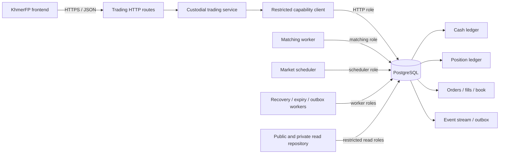
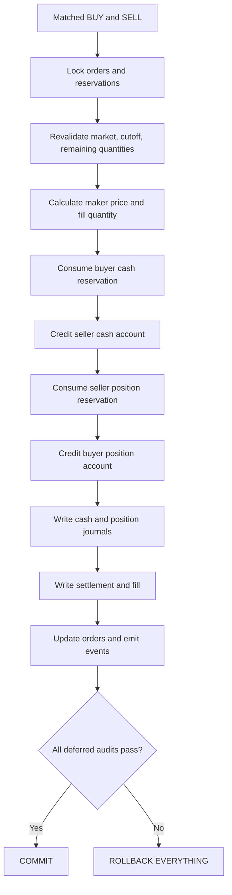
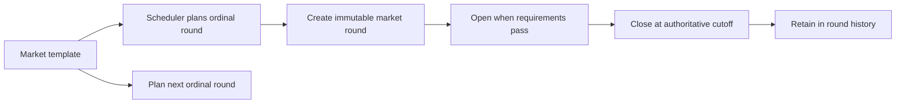

# KhmerFP Matching Engine: System Workflow and Code-Reading Guide

This document explains the current custodial matching system from the browser request to the final PostgreSQL accounting records. It is both an architecture reference and a recommended file-reading order for developers reviewing the implementation.

## 1. Current system status

KhmerFP currently implements a persistent, off-chain Central Limit Order Book (CLOB) backed by PostgreSQL accounting.

Implemented:

- Custodial BUY and SELL orders.
- Binary and registered multi-outcome token identities.
- LIMIT orders and protected MARKET orders.
- Direct matching of a BUY and SELL for the same canonical position token.
- Price-time priority and maker-price execution.
- Partial fills, cancellation, expiration, and market cutoffs.
- Cash reservations for BUY orders.
- Position reservations for SELL orders.
- Atomic cash-and-position settlement.
- Persistent commands, events, outbox records, and crash recovery.
- Recurring market rounds.
- Public order-book and quote reads.
- Session-bound private portfolio, order, and trade reads.
- Separate database capabilities for HTTP, matching, scheduling, and reconciliation.
- Mock collateral and position-backing foundations.

Not implemented or not production-enabled:

- Real customer funding or withdrawal.
- Production custody.
- Real blockchain settlement.
- Production oracle resolution, redemption, or payouts.
- Complementary MINT (`BUY YES + BUY NO`) matching.
- Complementary MERGE (`SELL YES + SELL NO`) matching.
- Production fees.

All current funds and inventory are mock-only. Production trading and funding remain disabled.

## 2. Core design principle

The backend does not maintain a second balance system in JavaScript. PostgreSQL is the authoritative transaction and accounting boundary.

The responsibilities are divided as follows:

| Layer | Responsibility |
| --- | --- |
| Frontend | Displays markets, builds user intent, requests quotes, submits and cancels orders, and refreshes authoritative data. |
| HTTP routes | Authentication, origin checks, request rate limits, payload routing, and sanitized HTTP responses. |
| Trading service | Input normalization, session-bound account lookup, canonical request construction, and capability selection. |
| Capability client | Calls only the database function allowed for the process role. |
| PostgreSQL trading functions | Order validation, reservations, persistence, matching requests, fills, settlement, idempotency, and lifecycle enforcement. |
| Matching worker | Repeatedly asks PostgreSQL to process persistent matching work. It does not hold an in-memory authoritative book. |
| Scheduler and lifecycle workers | Create and transition rounds, expire orders, release reservations, publish events, and recover unfinished work. |
| Read repository | Returns consistent public or session-bound private snapshots through fixed query capabilities. |



## 3. Recommended code-reading order

Read the files in this order. The order moves from the HTTP entry point toward the database-owned business rules, then outward to workers and recovery.

### Part A — HTTP request path

1. **`server/src/trading/routes.js`**
   - Main HTTP boundary.
   - Registers public market, round, book, quote, and event routes.
   - Applies authentication before private portfolio, order, trade, submit, and cancel routes.
   - Applies origin protection and rate limits.
   - Converts verified application sessions into `{ userId, sessionHash }`.

2. **`server/src/trading/service.js`**
   - Converts request fields into strict integers and canonical terms.
   - Rejects floating-point, negative, oversized, or unsupported values.
   - Resolves accounts owned by the authenticated user.
   - Separates quote, order, cancellation, and status capabilities.
   - Does not calculate or mutate authoritative balances directly.

3. **`server/src/trading/runtime.js`**
   - Creates the HTTP trading runtime.
   - Keeps authentication, write, public-read, and private-read database pools separate.
   - Performs read-only database compatibility checks.
   - Rejects matching or scheduler credentials in the HTTP process.

4. **`server/src/trading/readRepository.js`**
   - Implements public and private trading snapshots.
   - Uses fixed, registered query identifiers rather than caller-provided SQL.
   - Uses repeatable-read transactions so a response is internally consistent.
   - Sends private reads through a session-bound restricted connection.

5. **`server/src/trading/readQueries.js`**
   - Maps approved read statements to database query identifiers.
   - Prevents an API caller from selecting arbitrary tables or SQL.

6. **`server/src/trading/bookDepth.js`**
   - Calculates displayed depth and indicative execution from authoritative book rows.
   - Keeps quote calculations deterministic and integer-based.

7. **`server/src/trading/referencePrices.js`**
   - Builds the real-world reference-price state.
   - Keeps reference observations separate from prediction-token prices.

### Part B — Database capability boundary

8. **`packages/ledger/src/capabilities.js`**
   - The only normal Node-side gateway to privileged trading functions.
   - Uses a single checked-out PostgreSQL client for each transaction.
   - Exposes narrow HTTP order, quote, status, matching, scheduling, administration, and reconciliation calls.
   - Verifies that the connected database role is appropriate for the requested capability.

9. **`packages/ledger/src/index.js`**
   - Public package API.
   - Defines exact BigInt validation and `UNITS_PER_SHARE = 1,000,000`.
   - Constructs ledger, position, trading, matching, quote, lifecycle, and scheduler services.

10. **`packages/ledger/src/tradingSchema.js`**
    - Drizzle representation of persistent orders, commands, fills, events, matching work, and policies.

### Part C — Accounting structures

11. **`packages/ledger/src/schema.js`**
    - Cash ledger schema.
    - Covers assets, accounts, operations, journals, entries, projections, cash reservations, reservation events, and deferred audit state.

12. **`packages/ledger/src/positionSchema.js`**
    - Position ledger schema.
    - Covers position accounts, journals, entries, projections, reservations, reservation events, and atomic cash-position settlements.

13. **`packages/ledger/src/collateralSchema.js`**
    - Mock collateral and backing-provenance foundation.
    - Separates collateral balances from USD liabilities.
    - Tracks backed versus legacy unbacked position quantities.
    - Does not itself enable complementary MINT or MERGE matching.

14. **`packages/ledger/src/tokenVerification.js`**
    - Verifies mock token identity using registered condition, collateral, and token data.

### Part D — Matching and lifecycle workers

15. **`packages/ledger/src/matchingWorker.js`**
    - Claims persistent matching work and calls the matching database capability.
    - Continues until no immediately actionable work remains.

16. **`packages/ledger/src/lifecycleWorker.js`**
    - Coordinates expiration, recovery, and outbox delivery.
    - Safely retries persistent work after process interruption.

17. **`packages/ledger/src/marketScheduler.js`**
    - Derives immutable recurring-round registry terms.
    - Creates and advances market rounds through scheduler capabilities.

18. **`server/src/trading/capabilityWorkers.js`**
    - Connects worker processes to only their permitted matching or scheduler capabilities.

19. **`server/src/trading/processEnvironment.js`**
    - Defines credential requirements and prohibited credentials for each process type.

20. **`server/src/trading/processLauncher.js`** and **`localProcess.js`**
    - Launch the matching or scheduler process in local development.
    - Keep worker execution separate from the HTTP server.

### Part E — SQL business logic, in migration order

21. **`0013_generalized_market_registry.sql`** — generalized markets, outcomes, ranges, canonical CTF claims, and immutable identities.
22. **`0014_generalized_position_eligibility.sql`** — controls which registered tokens may enter position accounting.
23. **`0015_persistent_trading_foundation.sql`** — books, commands, orders, fills, order events, outbox, guards, and base execution functions.
24. **`0016_automatic_matching.sql`** — persistent matching requests and the automatic direct-matching step.
25. **`0017_protected_market_orders.sql`** — protected market orders, order policies, quotes, and stronger order validation.
26. **`0018_trading_lifecycle_recovery.sql`** — expiry, status recovery, durable event streams, cursors, diagnostics, and outbox capture.
27. **`0019_recurring_market_lifecycle.sql`** — recurring templates, immutable rounds, observations, lifecycle events, and scheduler operations.
28. **`0020_custodial_capability_boundaries.sql`** — session-bound HTTP functions and separate matching, scheduler, admin, and reconciliation capabilities.
29. **`0021_runtime_schema_compatibility.sql`** — runtime compatibility requirements and removal of application-startup DDL assumptions.
30. **`0022_closed_stingray.sql`** — mock collateral accounting and backed-position provenance foundation.

Historical migrations are immutable. Read them to understand behavior; do not reformat or edit applied migration files.

## 4. Important database objects

### 4.1 Persistent trading

| Table | Purpose |
| --- | --- |
| `trading_books` | One registered order book per eligible canonical token. |
| `trading_commands` | Idempotent user commands such as placing or cancelling an order. |
| `trading_orders` | Authoritative order terms, state, filled quantity, and reservation linkage. |
| `trading_fills` | Immutable executions between a BUY and SELL order. |
| `trading_order_events` | Immutable order lifecycle history. |
| `trading_outbox` | Durable events that must be delivered after database commit. |
| `matching_markets` | Markets enabled for automatic matching. |
| `matching_requests` | Durable units of work processed by the matching worker. |
| `trading_order_policies` | Protected market-order and execution policy values. |
| `trading_event_stream` | Committed stream of public/private invalidation events. |
| `trading_event_cursors` | Durable worker/client progress through event streams. |

### 4.2 Cash accounting

| Table group | Purpose |
| --- | --- |
| Financial assets and accounts | Identify USD or other assets and their customer/treasury/system ownership. |
| Operations, journals, and entries | Immutable double-entry history. Every posted journal balances per asset. |
| Balance projections | Fast current balances validated against accounting history. |
| Cash reservations and events | Lock BUY-order funds and record reserve, consume, and release events. |
| Audit targets and deltas | Protected transaction-scoped validation state used at commit. |

### 4.3 Position accounting

| Table group | Purpose |
| --- | --- |
| Position accounts | A user/system account for one exact canonical token. |
| Position journals and entries | Immutable, token-balanced position movements. |
| Position projections | Current token quantity per position account. |
| Position reservations and events | Lock SELL-order quantities and record consumption/release. |
| Cash-position settlements | Bind the cash journal and position journal for one atomic trade. |

### 4.4 Recurring markets

| Table | Purpose |
| --- | --- |
| `market_templates` | Recurrence definition and immutable market specification source. |
| `market_template_controls` | Scheduler-owned operational controls. |
| `market_rounds` | One immutable identity for each generated round. |
| `market_round_requirements` | Requirements needed before a round can advance. |
| `market_round_observations` | Timestamped observations; these are not automatically resolution evidence. |
| `market_lifecycle_events` | Durable history of scheduled transitions. |
| `market_lifecycle_cursors` | Scheduler/event-consumer progress. |

## 5. Exact units and arithmetic

The system uses integers throughout financial and quantity calculations.

- USD cash ledger: cents.
- Order price: cents per whole share.
- Valid prediction-token price: normally `1` through `99` cents.
- Position quantity: `1,000,000` base units per whole share.
- Mock USDC collateral: six decimal places, also `1,000,000` units per collateral token.
- PostgreSQL `BIGINT` and JavaScript `BigInt` are used; JavaScript floating-point `Number` is rejected for authoritative amounts.

Example: 3 shares at 60 cents have a maximum BUY reservation of 180 USD cents. The position quantity is 3,000,000 base units.

## 6. Complete BUY-order workflow

```mermaid
sequenceDiagram
    actor User
    participant UI as Frontend
    participant API as HTTP routes
    participant SVC as Trading service
    participant CAP as HTTP order capability
    participant DB as PostgreSQL
    participant MW as Matching worker

    User->>UI: Submit BUY 3 shares at 60 cents
    UI->>API: Authenticated POST order
    API->>API: Verify session, origin, rate limit
    API->>SVC: Canonical request + session
    SVC->>DB: Session-bound account lookup
    DB-->>SVC: User-owned cash account
    SVC->>CAP: PLACE command with idempotency key
    CAP->>DB: custodial_api.http_order(...)
    DB->>DB: Lock user/account/book state
    DB->>DB: Validate market, cutoff, token, price, quantity
    DB->>DB: Reserve maximum BUY cash
    DB->>DB: Insert command, order, event, matching request
    DB-->>CAP: Committed command result
    CAP-->>UI: Accepted order status
    MW->>DB: Process persistent matching request
    DB->>DB: Match using price-time priority
    DB->>DB: Settle each fill atomically
    DB->>DB: Release unused reservation when appropriate
    DB-->>UI: SSE invalidation; UI refetches snapshot
```

Detailed steps:

1. The browser submits a user intent, not a balance mutation.
2. The route verifies the KhmerFP session and request origin.
3. The service parses quantity and price into bounded `BigInt` values.
4. A session-bound private read resolves the authenticated user's cash account.
5. PostgreSQL verifies that the account belongs to that session user.
6. The database locks the necessary account, book, and operation records in deterministic order.
7. A LIMIT BUY reserves `quantity × limit price` cents.
8. The database persists the command and order in the same transaction.
9. A durable matching request ensures the order is processed even if a Node process stops.
10. If execution occurs below the BUY limit, only actual consideration is consumed; unused cash is released according to the order lifecycle.

## 7. Complete SELL-order workflow

SELL follows the same request boundary but reserves position quantity instead of cash.

1. Resolve the authenticated user's position account for the exact canonical token.
2. Verify the token is eligible for accounting and belongs to the selected market/round.
3. Lock the position account and projection.
4. Reject the request if available quantity is below the requested amount.
5. Create a position reservation.
6. Persist the order and matching request atomically.
7. Consume reserved positions only when a fill commits.
8. Release remaining reserved positions after cancellation, expiration, or terminal completion.

One token cannot be substituted for another token from a different outcome, market, chain, or recurring round.

## 8. Direct matching algorithm

The implemented engine currently supports `DIRECT` matching only:

- Same canonical token.
- One BUY order and one SELL order.
- BUY limit must be greater than or equal to SELL limit.
- The older resting order is the maker.
- Execution uses the maker's limit price.
- Fill quantity is the smaller remaining quantity.
- Multiple counterparties and repeated partial fills are supported.

Price-time priority:

1. Better price has priority.
2. At the same price, earlier accepted order has priority.
3. Stable database identifiers provide deterministic tie-breaking.

Example:

- Resting SELL: 10 YES shares at 53 cents.
- Incoming BUY: 3 YES shares with a 60-cent limit.
- The orders cross because `60 >= 53`.
- Execution price is 53 cents because the SELL is the resting maker.
- Buyer pays 159 cents, receives 3 YES shares, and retains/reclaims unused reservation above the actual consideration.
- Seller gives 3 YES shares and receives 159 cents.
- The SELL remains open with 7 shares.

## 9. Atomic settlement workflow

Every fill settles cash and positions inside one PostgreSQL transaction.



The settlement guarantees:

- No cash-only fill.
- No position-only fill.
- No fill without corresponding reservations.
- No consumption beyond reserved quantity.
- No negative customer available cash or positions.
- No duplicate settlement from an idempotent retry.
- A failure at any step rolls back the full fill.

## 10. LIMIT and MARKET order behavior

### LIMIT order

- User supplies a price boundary.
- The order may execute immediately, partially execute, or rest on the book.
- Unmatched quantity remains open until cancellation, expiration, or cutoff.

### Protected MARKET order

- It is not an unlimited-price instruction.
- PostgreSQL applies registered protection policy and available depth.
- The order is immediate-or-cancel: executable quantity fills; the remainder does not rest indefinitely.
- The quote is indicative. Submission revalidates the authoritative state inside the transaction.

Public users may read order books and request read-only estimates. Placing or cancelling an order always requires an authenticated session.

## 11. Cancellation and expiration

Cancellation:

1. The route verifies the user session.
2. The database confirms the order belongs to that user.
3. It locks the order and related reservation.
4. It rejects terminal or incompatible transitions.
5. It cancels remaining quantity.
6. It releases unused cash or positions.
7. It records an immutable order event and emits a durable update.

Expiration and cutoff use worker-owned capabilities. The HTTP role cannot directly impersonate the scheduler or matching worker.

## 12. Recurring market workflow

Each recurring round has a separate immutable market and CTF condition identity.



The scheduler:

- Uses authoritative server/database time.
- Prevents duplicate rounds through stable template and ordinal identities.
- Does not silently reuse the previous round's token or book.
- Closes trading separately from resolution.
- Does not treat a live reference observation as verified payout evidence.

## 13. Reads, SSE, and frontend refresh

The event stream is an invalidation mechanism, not a second accounting system.

1. A committed database mutation writes an outbox/event record.
2. SSE informs the frontend that relevant state changed.
3. The frontend refetches an authoritative market, book, order, or portfolio snapshot.
4. If SSE disconnects or is rate-limited, reconnect and snapshot recovery avoid trusting stale deltas.

Public reads include markets, rounds, books, trades, and quotes. Private reads include a user's balances, reservations, orders, positions, and trade history and require a current session binding.

## 14. Idempotency, crash recovery, and concurrency

### Idempotency

- A client operation key is bound to actor, operation type, and canonical terms.
- Repeating the same logical request returns the existing result.
- Reusing a key with different terms is rejected.
- One user cannot retrieve another user's operation by guessing a key.

### Crash recovery

- Commands and matching requests are persisted before a worker acts.
- Fills and accounting changes commit atomically.
- Lost HTTP or worker responses can be retried without duplicating effects.
- Event cursors and diagnostics identify unfinished work.

### Concurrency

- PostgreSQL row locks, deterministic lock ordering, unique constraints, and deferred audits protect shared state.
- Two concurrent orders cannot reserve the same available funds or positions twice.
- Matching revalidates remaining quantities after locking; an earlier snapshot is never sufficient to settle.

## 15. Database role and security boundaries

| Process/role | Allowed | Prohibited |
| --- | --- | --- |
| Public read | Registered public snapshots | Private data, writes, arbitrary SQL |
| Private read | Session-bound user snapshots | Cross-user reads, writes, worker operations |
| HTTP trading | Session-bound quote/place/cancel/status | Funding, direct settlement, matching, scheduling, administration |
| Matching worker | Claim/process matching and expiry work | User impersonation, market administration, arbitrary funding |
| Scheduler | Create/advance registered recurring rounds | Customer trading or financial posting |
| Market admin | Narrow reviewed registry operations | Customer order impersonation |
| Reconciliation | Controlled full integrity checks | Normal customer operations |
| Migration admin | Apply registered migrations and grants | Application request handling |

`SECURITY DEFINER` functions use fixed search paths and explicit grants. Application processes should never receive migration credentials.

## 16. Backing and complementary-token status

The collateral schema distinguishes:

- Mock collateral held by the custodial treasury.
- Collateral locked against complete sets.
- Position quantities with verified mock backing provenance.
- Legacy mock position quantities whose backing is not proven.

DIRECT transfers preserve provenance: backed quantity remains backed when transferred. Unbacked quantity cannot release collateral.

The foundation does **not** mean complementary matching is enabled. Future MINT and MERGE execution must add separate, atomic operations and reconciliation:

- MINT: two complementary BUY orders fund exactly one complete collateral unit and receive complementary positions.
- MERGE: two complementary SELL orders retire a backed complete set and release exactly one collateral unit.

Until those operations are implemented and approved, the engine must not synthesize positions or release collateral through complementary orders.

## 17. Worked end-to-end example

Assume:

- Alice submits BUY YES, 5 shares, limit 60 cents.
- Bob submits SELL YES, 3 shares, limit 53 cents.
- Bob's SELL is already resting.

Flow:

1. Alice's session is verified.
2. Alice's BUY reserves 300 cents.
3. Bob's SELL already reserves 3,000,000 YES base units.
4. The matching worker sees compatible orders for the same token.
5. Fill quantity is 3 shares.
6. Maker price is 53 cents.
7. Actual consideration is 159 cents.
8. Alice's reserved cash is consumed by 159 cents for the fill; reservation remains only as needed for her remaining 2-share order.
9. Bob's 3 YES shares move to Alice.
10. Bob receives 159 cents.
11. Bob's order becomes filled.
12. Alice's order remains open for 2 shares at 60 cents.
13. Fill, settlement, journals, reservation events, order events, and outbox updates commit together.
14. The browser receives an invalidation and refetches balances, the book, and trade history.

## 18. How to trace one order while debugging

Use this order of investigation:

1. Confirm the browser payload and selected market/token.
2. Inspect `routes.js` for authentication and HTTP validation.
3. Inspect `service.js` for normalized terms and resolved account identifiers.
4. Find the row in `trading_commands` by idempotency key.
5. Find the related `trading_orders` row.
6. Check the BUY cash reservation or SELL position reservation.
7. Check `matching_requests` for durable worker state.
8. Check `trading_fills` and `cash_position_settlements`.
9. Check cash and position journal entries.
10. Check reservation events for consumed/released amounts.
11. Check `trading_order_events`, `trading_outbox`, and `trading_event_stream`.
12. Run controlled reconciliation if projections or backing appear inconsistent.

Never correct financial state by manually updating projection tables. Fix the initiating defect and use authorized reversal or reconstruction operations.

## 19. Test map

When changing the matching path, validate at least:

- Input and BigInt boundary tests.
- Session and cross-user authorization tests.
- Database role/capability negative tests.
- Cash and position reservation concurrency tests.
- LIMIT and protected MARKET order tests.
- BUY/SELL and YES/NO combinations.
- Price-time priority and maker-price tests.
- Partial fill and multiple-counterparty tests.
- Cancellation, expiration, and cutoff tests.
- Idempotent retry and conflicting-key tests.
- Worker crash and lost-response recovery tests.
- Recurring round transition tests.
- Public/private read isolation tests.
- SSE reconnect and snapshot recovery tests.
- Full cash, position, reservation, settlement, collateral, and backing reconciliation.
- Existing DIRECT matching regression tests whenever collateral/backing code changes.

## 20. Rules for future development

1. Do not create a second application-side balance.
2. Do not mutate projections directly.
3. Do not trust frontend-supplied account, token, contract, price-source, or market identity.
4. Do not represent an internal database fill as confirmed blockchain settlement.
5. Do not mix USD cents, USDC base units, and position base units.
6. Do not add a privileged generic financial SQL endpoint.
7. Do not place worker credentials in the HTTP environment.
8. Keep reference asset prices separate from prediction-token prices.
9. Preserve immutable migration and accounting history.
10. Add reconciliation and negative authorization coverage with every new settlement path.

## 21. Short presentation summary

KhmerFP uses a persistent PostgreSQL order book. A user order first reserves custodial cash or positions. A separate matching worker selects compatible orders using price-time priority and executes at the resting maker's price. PostgreSQL then transfers cash and positions atomically using immutable double-entry journals. Commands, matching work, fills, events, and recovery state are durable, so process restarts do not lose orders or duplicate trades. Separate database roles prevent the HTTP server from directly funding accounts, matching orders, scheduling markets, or administering the registry. The current implementation is mock-only and supports direct same-token trading; real funding, blockchain settlement, resolution, payouts, and complementary MINT/MERGE matching remain future work.
