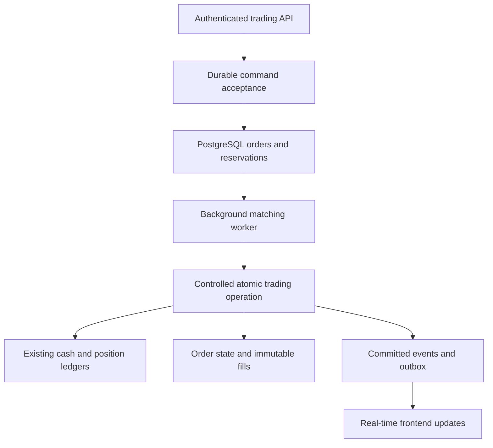
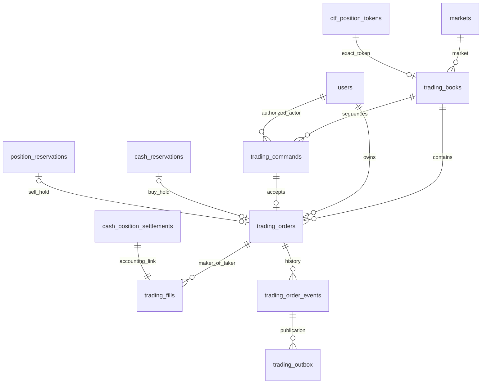
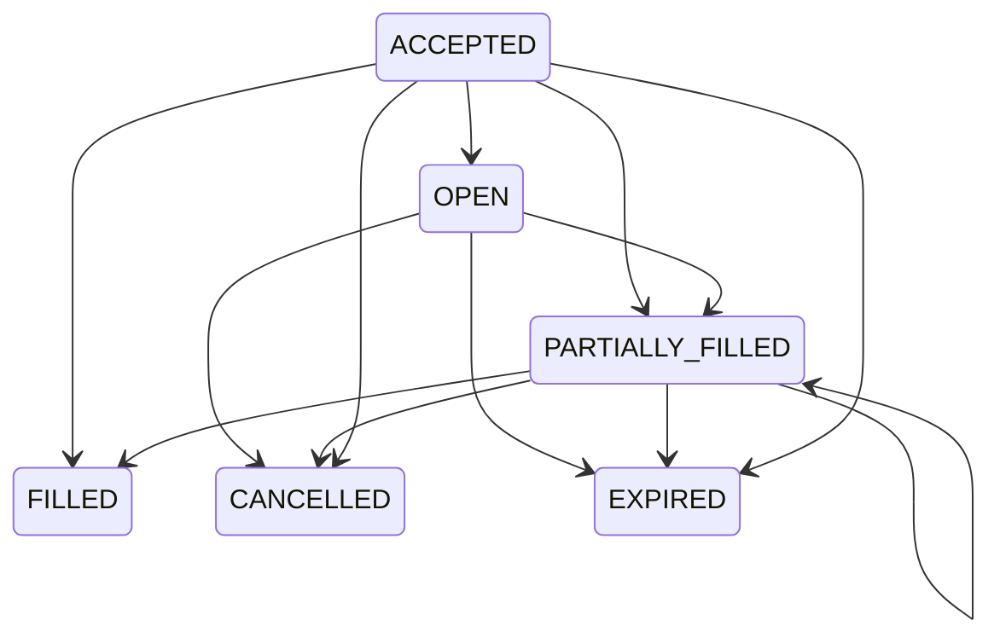
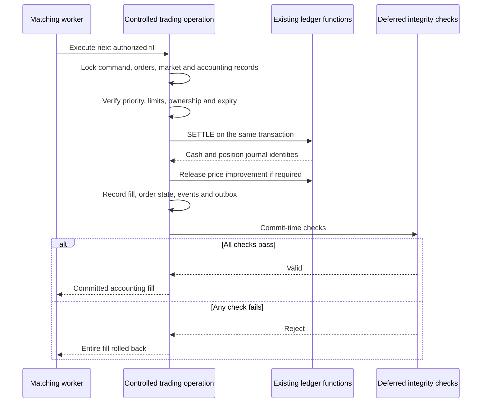

# Phase 4.1 — Matching engine architecture review

Status: proposed design, awaiting approval before implementation.

Repository reviewed: `F:/khmerfp-matching-contract`.

Branch reviewed: `feature/matching-contract-mvp`.

Review baseline: `c96638a`, with approved accounting checkpoint `e45bbad24460c530bbdb63d0b5a07c5a0e464df4` in its history.

## Recommendation

Build the first persistent matching engine inside the existing Node.js backend. Use PostgreSQL as the source of truth and reuse the existing financial and position ledgers for all accounting.

Start with direct BUY/SELL matching for the same registered outcome token. Defer complementary minting/merging and live blockchain settlement.

This document records a read-only code review and a proposed design. The review did not access a database, implement matching changes or execute transactions. Creating this document does not approve its proposed schema or implementation.

## 1. Payment work status

Phase 3 payment integration is deferred.

At the reviewed baseline:

- No migration `0013` exists.
- No payment-to-ledger bridge is implemented.
- No application wiring to `createLedger()` or `createPositionLedger()` was found in `server/src`.
- No uncommitted payment implementation exists.
- The unrelated empty file `console.log(r.result))` remains untracked and untouched.

There is one existing committed payment change after accounting checkpoint `e45bbad`: the merge from `main` added Bakong's `claimStatusCheck()` polling throttle. It prevents concurrent requests from repeatedly checking the same payment upstream. This is legacy-payment maintenance, not Phase 3 ledger integration. It must not be silently removed.

Bakong still credits the legacy `wallets` table rather than the new ledger. No Bakong migration, ABA PayWay change, KHR conversion, withdrawal or legacy-balance migration is proposed for this phase.

Evidence:

- [Bakong payment model](../../server/src/models/bakongPayment.js)
- [Existing runtime Bakong schema](../../server/src/db/bakongSchema.js)
- [Current migration directory](../../packages/db/migrations/)

## 2. Existing matching architecture

Three separate implementations exist: simulated frontend trading, the local signed-order blockchain demo and the isolated PostgreSQL accounting foundation. They are not one integrated persistent exchange.

| Component | Actual implementation | Classification |
| --- | --- | --- |
| Main frontend order book | Randomly generated bids and asks | Simulated |
| Main frontend trading | Changes React balances, positions and books locally | Simulated |
| Local blockchain demo | Signed orders, JSON persistence and manual operator matching | Working local demo |
| Smart contract exchange | Direct outcome-token BUY/SELL settlement | Reusable contract foundation |
| Cash ledger | Exact cash accounting and reservations | Implemented isolated foundation |
| Position ledger | Share ownership and reservations | Implemented isolated foundation |
| Atomic database settlement | Cash and positions transferred together | Implemented isolated foundation |
| Persistent PostgreSQL orders and fills | No corresponding schemas found | Missing |
| Automatic price-time matching | No backend implementation found | Missing |
| Production order APIs | Main Express app has no trading-order router | Missing |
| Order-book WebSocket or SSE server | No implementation found | Missing |

### Main frontend

[orderbook.js](../../client/src/lib/orderbook.js) generates liquidity using `Math.random()`. Its `walkAsks()` function walks supplied ask levels. It can support visual previews, but it is not an authoritative matching engine.

[DetailPanel.jsx](../../client/src/components/DetailPanel.jsx) handles purchases through `ADD_BALANCE`, `CREDIT_POSITION` and `UPDATE_BOOK` actions. These mutate frontend state rather than creating PostgreSQL orders, reservations or settlements.

[AppContext.jsx](../../client/src/state/AppContext.jsx) maintains simulated positions, price movements and local payout behavior.

The simulated fee calculation and floating-point arithmetic must not become authoritative trading accounting.

### Local blockchain demo

[orderService.js](../../server/src/demo/orderService.js) implements:

- Hardhat environment and deployment verification.
- EIP-712 order validation.
- EOA and EIP-1271 signature checks.
- Token balance and approval checks.
- Local `orders.json` persistence.
- Single-process serialization and a process lock.
- Manual matching of stored order IDs.
- Contract-call simulation and transaction submission.
- Transaction reconciliation and uncertain-submission handling.

[The demo routes](../../server/src/demo/app.js) expose `/api/demo/orders`, `/api/demo/matches` and related endpoints. [demoServer.js](../../server/src/demoServer.js) runs separately from the normal backend.

Limitations:

- Separate demo authentication rather than the normal user-account trading flow.
- Local-file storage rather than PostgreSQL order history.
- Single-process coordination rather than persistent worker coordination.
- Manual price and quantity selection rather than price-time priority.
- No custodial cash or position holds.
- No atomic link between PostgreSQL order state and ledger settlement.

Reuse validation ideas and acceptance tests. Do not promote the demo's storage or settlement workflow directly into the custodial engine.

## 3. Completed and reusable components

### Market and token identity

The existing schemas provide market lifecycle, trading and resolution statuses, trading windows, frozen terms, a question, two binary outcomes and CTF references.

The exact registered CTF token is a suitable identity for an order book. A user-visible `YES` label alone is not enough to identify what is traded.

Sources:

- [Markets](../../packages/db/src/schema/markets.js)
- [Market questions](../../packages/db/src/schema/marketQuestions.js)
- [Market outcomes](../../packages/db/src/schema/marketOutcomes.js)
- [CTF conditions](../../packages/db/src/schema/ctfConditions.js)
- [CTF position tokens](../../packages/db/src/schema/ctfPositionTokens.js)

### Cash and position accounting

[The ledger service](../../packages/ledger/src/index.js) already provides exact BigInt inputs, actor authorization, canonical request snapshots, idempotency, runtime-role checks, reservations, partial consumption/release and transactional execution.

The database adds immutable journals, mandatory validation, reconciliation and controlled reconstruction.

See the [ledger README](../../packages/ledger/README.md) and [database walkthrough](./DATABASE_ARCHITECTURE_WALKTHROUGH.md).

### Atomic accounting settlement

The `SETTLE` implementation in [0011](../../packages/db/migrations/0011_position_accounting.sql), together with [0012 incremental validation](../../packages/db/migrations/0012_incremental_financial_validation.sql), verifies:

- Correct buyer and seller accounts and different users.
- Exact market/token relationships.
- Original reservation business references.
- Remaining cash and share quantities.
- Open market and trading cutoff.
- Independently balanced cash and position journals.
- Complete settlement linkage.

Keep this implementation as the accounting authority. Matching code must not reproduce balance-projection updates.

### Smart contract exchange

[KhmerFPExchange.sol](../../contracts/src/KhmerFPExchange.sol) supports EIP-712 and EIP-1271 verification, authorized operators, emergency pause, registered binary tokens, crossed prices, partial fills, cumulative payment limits, cancellation, expiry, atomic token transfers and self-trade rejection.

It rejects BUY and SELL orders with the same maker address. A shared treasury cannot simply represent both customers using that same address.

The contract is therefore not a drop-in shared-custody settlement adapter. Keep it unchanged and separate during the initial database matching phase. A successful internal ledger fill is not proof of on-chain settlement.

## 4. Missing functionality

The persistent engine needs:

1. Durable order records and immutable order terms.
2. Authoritative acceptance sequence.
3. Order-to-reservation relationships.
4. Deterministic matching.
5. Immutable fill records.
6. Cancellation and expiration processing.
7. Atomic order/accounting updates.
8. Persistent worker recovery.
9. Durable real-time publication.
10. Order-level reconciliation.
11. Authenticated trading APIs.
12. Frontend integration with authoritative order, balance and position state.

No second balance system is needed.

## 5. Proposed matching engine architecture

Keep HTTP handling, matching orchestration and publication as separate modules inside the existing backend.



### Backend module versus separate service

| Consideration | Existing backend | Separate service |
| --- | --- | --- |
| Authentication | Reuses the existing session system | Adds another trust boundary |
| Transaction integration | Shared database infrastructure | Still needs the same atomic boundary |
| Recovery | PostgreSQL-backed worker | Requires equivalent persistence |
| Operations | Fewer processes and deployments | More operational work |
| Scaling | Measure the initial implementation | Extract later if measurements justify it |
| Complexity | Lower initial complexity | Higher initial complexity |

The worker should run in the background, not inside a long-running HTTP request. Durable work remains in PostgreSQL. An in-memory queue can wake a worker but cannot determine whether work exists or completed.

The module can later run as a separate worker process without changing order identity or accounting rules.

## 6. Proposed database changes

These tables are proposals only. No migration has been generated. Any next migration number must be checked again before generation; the deferred payment proposal is not part of this design.

| Proposed table | Contents |
| --- | --- |
| `trading_books` | Market/token identity, acceptance counter and committed book version |
| `trading_commands` | Actor-bound idempotent submit/cancel requests, status and recovery progress |
| `trading_orders` | Immutable owner, side, token, original quantity, limit, sequence, expiry, hold reference and current state |
| `trading_fills` | Maker/taker orders, quantity, execution price, sequence and unique accounting-settlement reference |
| `trading_order_events` | Immutable acceptance, fill, cancellation, expiration and rejection history |
| `trading_outbox` | Durable publication records for committed public/private updates |

### Order constraints

- FKs to user, market and exact registered token.
- BUY or SELL only.
- Positive quantity divisible by `1,000,000`.
- Proposed limit range of 1–99 USD cents per share.
- Filled quantity cannot exceed original quantity.
- Owner, side, token, limit, original quantity and acceptance sequence are immutable.
- BUY requires a cash reservation; SELL requires a position reservation.
- Hold ownership, account, token and business reference must agree with the order.
- Order expiry cannot exceed market cutoff.

### Fill constraints

- Positive quantity and exact integer consideration.
- Unique match reference and accounting-settlement link.
- Correct opposite sides, same token and different users.
- Execution price equals the resting maker's limit.
- Unique execution sequence.
- Immutable after creation.

### Command constraints

- Unique actor/idempotency-key combination.
- Canonical action and request terms.
- Conflicting same-key requests rejected.
- Another user cannot obtain a command result by guessing its key.

### Indexes

- Live SELL orders: lowest price, then earliest acceptance sequence.
- Live BUY orders: highest price, then earliest acceptance sequence.
- Orders by user/state and by expiry.
- Pending commands by book/sequence.
- Unpublished outbox records.
- Fills by order and market.

Display timestamps do not establish priority. Database-assigned serialized acceptance sequence does.

### Proposed relationship sketch

This diagram shows intended relationships, not implemented schemas.



## 7. Order lifecycle



`ACCEPTED` means the order and reservation are durable but matching has not finished. It must not appear as resting liquidity prematurely. Rejected requests do not become live orders.

Rules:

- Partial fills retain original priority.
- Cancellation retains executed fills and releases only the remainder.
- Expiration releases only the remaining hold.
- No amendments initially: cancel and replace with a new sequence.
- Market pause blocks matching.
- Cutoff blocks new fills even before cleanup marks orders expired.
- An HTTP response must distinguish acceptance from execution.

## 8. Matching and execution rules

### Safest initial scope

- Binary YES and NO, with an independent book per registered token.
- BUY and SELL limit orders.
- Good-until-expiry behavior bounded by cutoff.
- Whole shares and integer-cent prices.
- No fees, market orders or short selling initially.
- No complementary mint/merge matching.

### Price-time priority

Incoming BUY:

1. Select the lowest eligible SELL price.
2. At that price, select the earliest accepted order.
3. Match only when seller limit is no greater than buyer limit.

Incoming SELL:

1. Select the highest eligible BUY price.
2. At that price, select the earliest accepted order.
3. Match only when buyer limit is no lower than seller limit.

Do not use `SKIP LOCKED` to jump over the best resting order. Doing so can violate priority.

### Maker-price execution

The resting order is the maker and determines execution price.

| Resting order | Incoming order | Execution |
| --- | --- | --- |
| SELL at 60 cents | BUY limit 65 cents | 60 cents |
| BUY at 65 cents | SELL limit 60 cents | 65 cents |
| SELL at 60 cents | BUY limit 55 cents | No match |

The matcher cannot choose an arbitrary price inside the spread.

### Partial fills and multiple counterparties

Fill quantity is the smaller remaining quantity. An incoming order can fill against several resting orders, in priority order.

Initially, use one fill per transaction to bound transaction size and simplify recovery. Persist the active command's progress so later matching commands cannot overtake it. Earlier committed fills remain valid if a later fill cannot execute.

### Buyer price-improvement release

Reserve limit price times remaining whole shares.

Example:

```text
BUY 10 shares at a 65-cent limit: reserve 650 cents.
Fill 2 shares at 60 cents: consume 120 cents.
Release improvement on those shares: 10 cents.
Remaining hold: 8 shares times 65 cents = 520 cents.
```

Fill accounting and the improvement release must commit together.

### Self-trade prevention

Recommended policy: cancel the incoming order's remaining quantity when its next eligible maker belongs to the same user.

Do not skip that maker and execute against worse-priced liquidity. Preserve earlier fills; cancel only the unfilled remainder. This policy requires approval.

### Direct versus complementary matching

| Approach | Accounting effect | Initial recommendation |
| --- | --- | --- |
| BUY YES against SELL YES | Transfer existing YES and cash | Include |
| BUY NO against SELL NO | Transfer existing NO and cash | Include |
| BUY YES against BUY NO | Requires collateral-backed creation/splitting | Defer |
| SELL YES against SELL NO | Requires paired inventory merging | Defer |

Existing SETTLE transfers one existing token. It cannot synthesize complementary positions. Independent YES and NO quotes need not sum to exactly one dollar.

### Future categorical markets

Use generic token/outcome references rather than YES/NO-specific order columns. This keeps order matching extendable. Current market and contract binary restrictions still require separately approved changes before categorical trading.

## 9. Atomic accounting integration

The current JavaScript ledger API opens its own connection and commits its own transaction. This sequence would be unsafe:

```text
Update order state.
Call ledger.settle() on another connection.
Insert fill record.
```

A crash can leave transferred value with stale order state.

### Proposed controlled transaction boundary

Introduce a narrowly controlled trading operation that invokes existing PostgreSQL ledger functions on the same dedicated client and transaction.

It must:

1. Lock and verify the intended orders.
2. Reconfirm best maker and maker price.
3. Validate ownership, order expiry, market and price limits.
4. Invoke existing SETTLE.
5. Release buyer price improvement using a separate financial operation key.
6. Insert the immutable fill linked to that settlement.
7. Update both orders.
8. Append order events and outbox records.
9. Run deferred checks.
10. Commit once.

A reviewed database wrapper is preferable to direct runtime writes to protected trading/accounting tables. Do not expose a generic arbitrary-SQL transaction interface.

One committed fill must include:

```text
Order changes
+ immutable fill
+ cash journal
+ position journal
+ reservation consumption and release
+ settlement link
+ publication event
= one transaction
```

No matching function may independently modify balance projections.



## 10. Concurrency and recovery

### Deterministic acceptance

Assign acceptance/command sequence under a locked database book record. Priority reflects serialized database acceptance, not client clocks or an uncommitted sequence allocation.

### Worker coordination

Start with one logical writer per market, enforced through transaction-scoped PostgreSQL locking. Different markets can process concurrently. Market-level serialization simplifies YES/NO coordination, cancellation races, failover and future cross-outcome extensions.

Preserve the existing accounting lock hierarchy: maintenance gate, financial operation keys, market, ordered cash accounts, ordered position accounts and reservations. Place new book/command/order locks consistently around that hierarchy. All paths must use the same order.

### Cancellation races

Submission and cancellation are sequenced commands. A fill committed before cancellation remains valid. Cancellation releases only the remainder and must not claim to undo earlier fills.

### Crash recovery

| Crash point | Recovery |
| --- | --- |
| Before acceptance commit | No accepted order or hold |
| After acceptance, before matching | Durable pending command remains |
| During fill, before commit | Entire fill rolls back |
| After commit, before response | Retry reads existing command/fill result |
| Between counterparties | Resume active command from committed remaining quantity |
| Before publication | Outbox publisher retries |
| After publication, before acknowledgement | Duplicate event possible; client deduplicates |

Financial execution is idempotent. Network publication can be at least once; no exactly-once delivery claim is necessary.

### Real-time updates

Recommend SSE plus authenticated HTTP commands initially. SSE is a one-way server-to-browser event stream; WebSockets can follow if bidirectional requirements justify them.

Provide committed public book snapshots/deltas, private authenticated order/fill/balance updates, monotonic book versions and reconnect/snapshot recovery. Do not publish user identities, hold IDs or private accounting details.

An in-memory notification or PostgreSQL notification may wake publishers. The durable outbox remains authoritative.

## 11. Security and reconciliation

Required protections:

- Existing authentication, CSRF and origin controls.
- User identity derived on the server.
- Strict quantity, price, expiry and overflow checks.
- Actor-bound canonical idempotency.
- Order and reservation ownership checks.
- Immutable reservation business-reference binding.
- Database-level order/fill/accounting consistency.
- No arbitrary public credit operation or direct projection writes.
- No client-authoritative fills or balances.
- Bounded processing and rate limits.
- Restricted runtime and function-owner roles.
- Safe audit logging without credentials or signatures.
- Trading disabled outside approved local testing.

Extend reconciliation to verify:

1. Order filled quantities equal immutable fills.
2. Each fill has exactly one matching accounting settlement.
3. No orphan trading settlement exists.
4. Journals agree with fill quantity, token, price and consideration.
5. Live orders have the required remaining holds.
6. Terminal orders have no remaining holds.
7. Maker-price and sequence rules are reproducible.
8. Existing full cash and position reconciliation passes.

Use the term **accounting settled** for internal fills. Blockchain state remains absent or explicitly `NOT_SUBMITTED`; database success must not imply blockchain completion.

## 12. Implementation plan

| Step | Scope | Acceptance criteria |
| --- | --- | --- |
| 4.2 | Approve rules and composed transaction design | Reviewed states, units, prices, self-trade policy and atomic boundary |
| 4.3 | Persistent trading schema | Protected writes, valid relationships and unchanged historical migrations |
| 4.4 | Order acceptance and holds | Order/hold commit together; concurrent over-reservation rejected |
| 4.5 | Deterministic direct matching | Price-time priority, maker price and restart-independent results |
| 4.6 | Atomic accounting integration | Fill, journals, holds and order changes roll back together on injected failure |
| 4.7 | Expiration and recovery | No duplicate fills or stranded terminal holds |
| 4.8 | APIs and frontend | Authoritative balances/orders; no React-local financial mutation in integrated trading |
| 4.9 | Real-time publication | Durable events, reconnect and duplicate handling |
| 4.10 | Reconciliation and load tests | Zero accounting errors and accurately reported performance |

Treat the transaction boundary as an early prerequisite, not a final integration detail. After design approval, first build its focused prototype and failure-injection tests in disposable infrastructure, then implement persistent order acceptance and matching around that proven boundary.

Use mock USD postings and owner-controlled mock position recognition fixtures in disposable PostgreSQL only. No payment funding endpoint or live inventory recognition is required.

### Required tests

- Equal and crossed prices.
- Best price before oldest time, with deterministic ties.
- Maker-price execution in both directions.
- Partial fills and multiple counterparties.
- Price-improvement release.
- Insufficient cash and shares.
- Duplicate and conflicting submissions.
- Concurrent submissions and cancellation.
- User isolation and approved self-trade policy.
- Cutoff and expiry boundaries, including commit-time checks.
- Failure after each major settlement step.
- Worker death before/after commit and between fills.
- Outbox replay, deduplication and reconnect.
- Complete order/cash/position reconciliation.
- Preservation of all existing ledger regression tests.

## 13. Approval decisions and remaining blockers

Before implementation, approve:

1. Direct same-token BUY/SELL only.
2. Whole shares and one-cent ticks with limits from 1–99 cents.
3. Maker-price execution.
4. Cancel-incoming-remainder self-trade prevention.
5. Sequenced cancellation and one-fill transaction recovery.
6. Controlled same-transaction trading/ledger integration.
7. Proposed persistent trading tables.
8. SSE as the initial real-time transport.

Later release blockers remain: shared-treasury compatibility with on-chain contracts, live inventory recognition/backing verification, production scalability review and unresolved dependency vulnerabilities.

No payment integration, contract changes, wallet-provider changes, production access, funding, signing, deployment or feature activation is authorized by this review. Production custody remains disabled.
