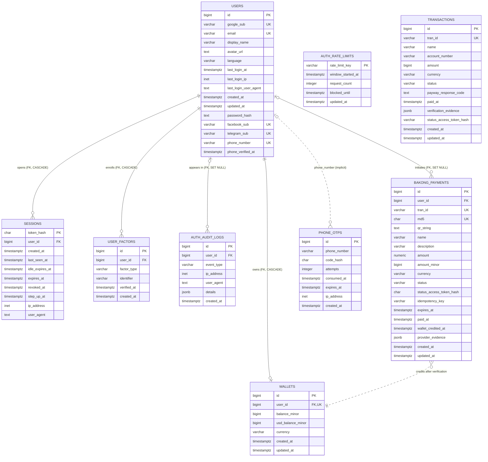

# Database audit and entity-relationship model

Audit date: 2026-11-11

## Scope and source of truth

This is a static audit of the repository. It does not inspect a deployed
PostgreSQL catalog or production data.

The repository currently has two schema-management paths:

1. `packages/db/src/schema` and the three ordered migrations define nine tables.
2. Runtime startup SQL in `server/src/config/database.js`,
   `server/src/db/authSchema.js`, and `server/src/db/bakongSchema.js` also defines
   or upgrades those nine tables.

The reviewed Drizzle model and runtime model now cover the same nine application
tables. Runtime DDL can still drift from migrations, and a read-only catalog
audit is required to establish what is actually deployed before migration
adoption.

## ER diagram

Solid relationships below are enforced by PostgreSQL foreign keys. Dashed
relationships are application-level associations only and have no foreign key.

`AUTH_RATE_LIMITS` and `TRANSACTIONS` are intentionally drawn without
relationships because the schema contains no relational key connecting them to
another table. The `PHONE_OTPS` to `USERS` association is by normalized phone
number in application logic, not a foreign key. A verified `BAKONG_PAYMENTS`
row credits the wallet belonging to the same `user_id`, but the payment does
not reference a wallet row directly.

## Audit findings

### Critical

1. **Existing database adoption is not yet proven.** Migration
   `0002_bouncy_glorian.sql` now includes `bakong_payments`, its trigger,
   indexes, constraints, and `users` foreign key. However, existing databases
   may contain runtime-created variants and real payment records. Compare each
   catalog read-only and establish migration history only through the approved
   Stage 1.6 adoption procedure.

2. **Runtime startup still performs DDL.** Application startup creates and
   alters tables, creates a PL/pgSQL function and trigger, and backfills data.
   This creates concurrent deployment risk, requires excessive application
   privileges, and permits drift from reviewed migrations. Follow the staged
   retirement plan in `baseline-adoption.md` after catalog parity is proven.

### High

3. **Schema metadata needs permanent regression coverage.** The accidental
   audit-log expression that removed one index from Drizzle metadata has been
   corrected. Keep strict schema import and catalog tests so both named audit
   indexes remain registered.

4. **Payment data is split across two unconnected models.** `transactions`
   represents ABA/PayWay KHR transactions and has no `user_id`; `bakong_payments`
   represents USD/KHR Bakong payments and can credit wallets. There is no common
   payment/ledger identifier or immutable wallet-credit record. Reconciliation
   therefore depends on service behavior and mutable timestamps. Define whether
   these are separate bounded contexts; if wallet balances represent money,
   introduce an append-only ledger and derive balances from ledger entries.

5. **Stored monetary representations can disagree.** `bakong_payments` stores
   both `amount NUMERIC(14,2)` and `amount_minor BIGINT` without a constraint
   tying them together. The insert trigger fills `amount_minor` only when it is
   null, while current code supplies both. Add a currency-aware consistency
   constraint or store one canonical representation.

### Medium

6. **Email uniqueness is case-sensitive.** The unique btree index permits
   values such as `User@example.com` and `user@example.com`. If authentication
   treats those as the same identity, normalize before storage or use a
   case-insensitive unique expression/type.

7. **Temporal state invariants are incomplete.** The database does not enforce
   that OTPs expire after creation, paid rows have `paid_at`, unconsumed OTPs
   have valid attempt counts, or Bakong expiry/credit timestamps follow a valid
   order. Add only invariants that match the intended state machine, then test
   migrations against existing data.

8. **Several format rules exist only in application code.** The database does
   not validate Bakong `md5`, the idempotency-key format, or agreement between
   `amount` and currency precision. Direct SQL or an older service version can
   bypass these checks.

9. **`updated_at` is not database-maintained.** Defaults populate it on insert,
   but PostgreSQL does not update it automatically. Every update path must set
   it correctly. Prefer a consistent application contract or a carefully
   reviewed trigger policy.

10. **Retention and cleanup are not encoded.** Sessions, OTPs, rate-limit rows,
    audit logs, and payment evidence can grow indefinitely unless external jobs
    remove or archive them. Document retention periods, indexes used by cleanup,
    and preservation requirements for financial/audit evidence.

### Low / design clarification

11. `wallets.currency` is fixed to `KHR`, but the same row also stores a USD
    balance. The column describes only one balance and can mislead consumers.
    Prefer one row per `(user_id, currency)` or explicitly name the fixed field
    as a wallet/account type.

12. `phone_otps.phone_number` intentionally has no foreign key, which supports
    verification before account creation. The tradeoff is no database-level
    linkage or canonical phone normalization; ensure every producer uses the
    same E.164 normalization.

## Existing strengths

- Foreign keys use deliberate deletion behavior: account-owned security state
  cascades, while audit and payment history retain rows with `user_id` set null.
- Hash format checks prevent accidental plaintext token/code storage.
- Balances and transaction amounts have basic non-negative/positive checks.
- Partial and composite indexes cover active sessions, audit lookup, payment
  expiry processing, user payment status, and idempotency.
- The Bakong credit path uses a transaction, row lock, and
  `wallet_credited_at` guard to reduce double-credit risk.

## Recommended sequence

1. Keep schema metadata and PostgreSQL catalog assertions in CI, including both
   audit-log indexes.
2. Inspect each deployed PostgreSQL catalog read-only and compare it with both
   schema sources; do not infer production state from this document.
3. Prove the three-migration chain and runtime schema are equivalent on a
   sanitized restore before adopting migration history on an existing database.
4. Decide the unified payment/ledger model before adding more balance-changing
   flows.
5. Add approved integrity constraints and cleanup/retention jobs.
6. Retire runtime DDL only through the separately reviewed rollout described in
   `baseline-adoption.md`.

## Verification performed

- `npm run db:validate-baseline --workspace @khmerfp/db` passed offline.
- Importing the Drizzle schema succeeded.
- The audit-log schema expression was corrected so both intended indexes remain
  part of Drizzle metadata.
- The repository's PostgreSQL 16 CI previously verified the three ordered
  migrations and nine-table target; this audit did not connect to that service.
- The disposable PostgreSQL migration test was not run because
  `MIGRATION_TEST_DATABASE_URL` was not provided.
